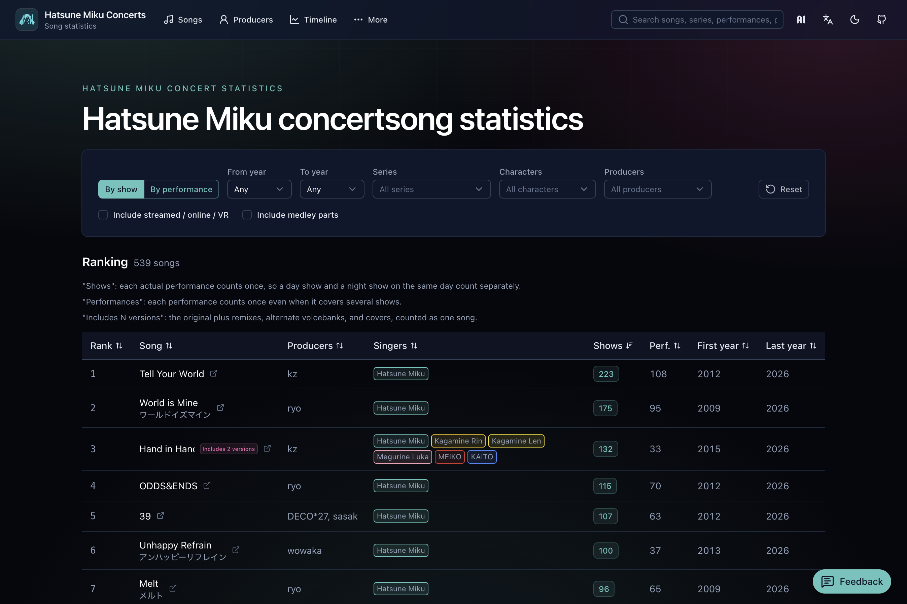
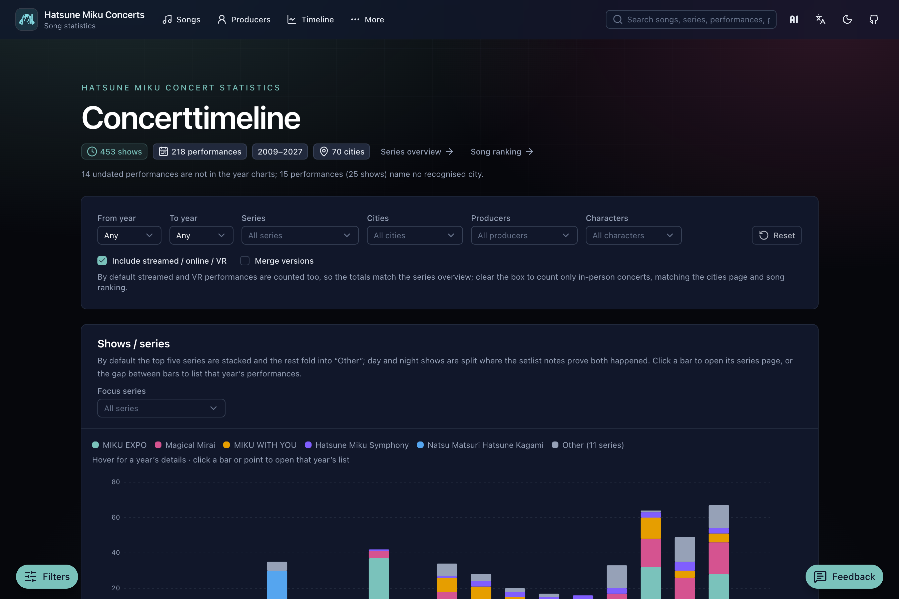
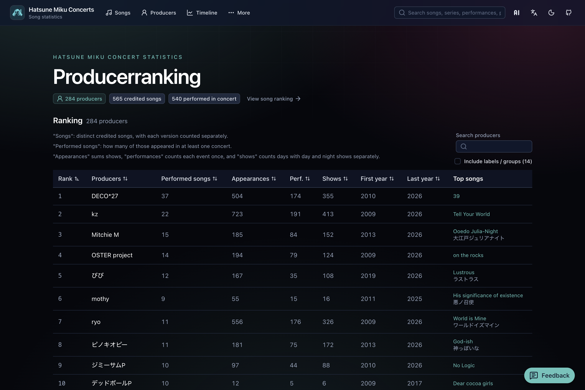

  

<h1 align="center">Hatsune Miku Concert Stats</h1>

  <strong>English</strong> ·
  <a href="docs/README.zh-CN.md">简体中文</a> ·
  <a href="docs/README.zh-Hant.md">繁體中文</a> ·
  <a href="docs/README.ja.md">日本語</a>

  Explore song rankings, producers, timelines, and setlists across various Hatsune Miku concerts.

  <a href="https://miku-concert-stats.rjiazhen.top"><strong>Open the site</strong></a>

<table>
  <tr>
    <td align="center" valign="top" width="33%">
       
      Song ranking
    </td>
    <td align="center" valign="top" width="33%">
       
      Timeline
    </td>
    <td align="center" valign="top" width="33%">
       
      Producers
    </td>
  </tr>
</table>

## Features

- **Song rankings** — See which songs appear most often across concerts, with filters for series, year, character, and producer
- **Timeline** — Browse how shows and series unfold year by year and by city
- **Producers** — Rank producers by how their songs show up on stage
- **Series & shows** — Open a series or a single show and read its setlist
- **Search** — Find songs, series, shows, places, and producers from the header

## Included concert series

- Magical Mirai
- MIKU EXPO
- MIKU WITH YOU
- Hatsune Miku Symphony
- Hatsune Miku Live Party
- SNOW MIKU LIVE!
- Hatsune Miku × Kodo
- Hatsune Miku JAPAN TOUR 2023 〜THUNDERBOLT〜
- Hatsune Miku JAPAN TOUR 2025 〜BLOOMING〜
- Dekomiku LIVE starring Hatsune Miku
- MikuFES
- Natsu no Owari no 39 Matsuri
- Natsu Matsuri Hatsune Kagami
- Hatsune Miku GALAXY LIVE
- Hatsune Miku LAWSON 50th Anniversary Special LIVE
- Pokémon feat. Hatsune Miku VOLTAGE Live!

## Contribute

Development setup and contribution notes: [docs/CONTRIBUTING.md](docs/CONTRIBUTING.md).

## License

[MIT](LICENSE)
