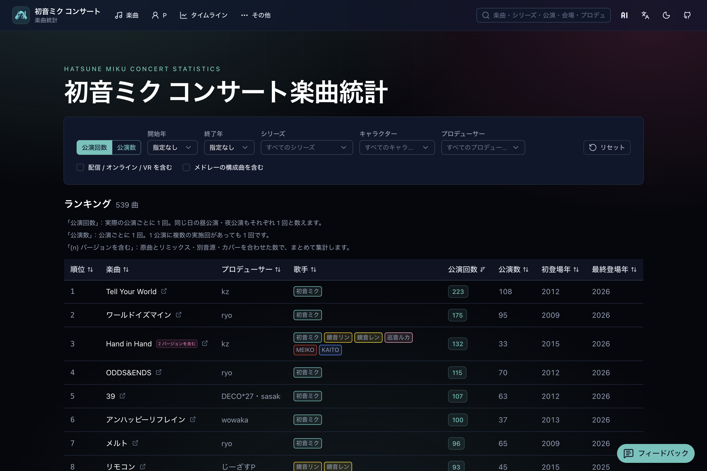
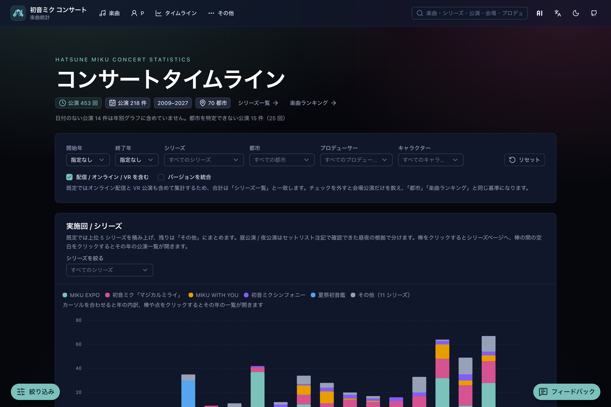
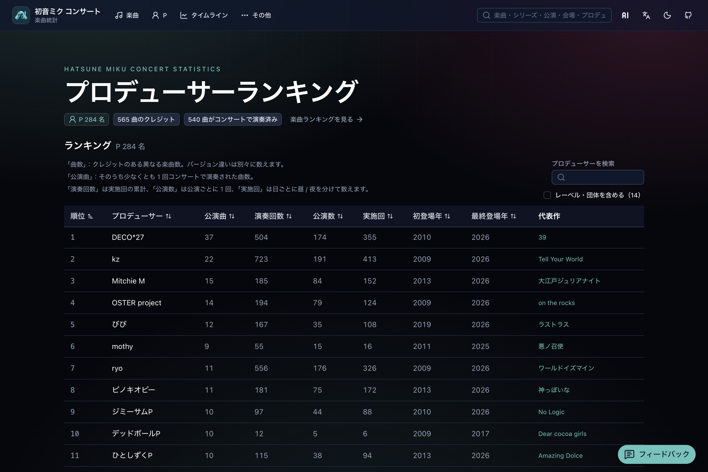

  

<h1 align="center">初音ミクコンサート統計</h1>

  <a href="../README.md">English</a> ·
  <a href="README.zh-CN.md">简体中文</a> ·
  <a href="README.zh-Hant.md">繁體中文</a> ·
  <strong>日本語</strong>

  さまざまな初音ミクのコンサートについて、楽曲ランキング・プロデューサー・タイムライン・セットリストを眺められます。

  <a href="https://miku-concert-stats.rjiazhen.top"><strong>サイトを開く</strong></a>

<table>
  <tr>
    <td align="center" valign="top" width="33%">
       
      楽曲ランキング
    </td>
    <td align="center" valign="top" width="33%">
       
      タイムライン
    </td>
    <td align="center" valign="top" width="33%">
       
      プロデューサー
    </td>
  </tr>
</table>

## できること

- **楽曲ランキング** — コンサートでよく歌われた曲を、シリーズ・年・キャラ・プロデューサーで絞り込み
- **タイムライン** — 年や都市ごとの公演の広がりを見る
- **プロデューサーランキング** — ステージに上がった楽曲からプロデューサーを眺める
- **シリーズと公演** — シリーズや 1 公演を開き、セットリストを読む
- **サイト内検索** — ヘッダーから曲・シリーズ・公演・場所・プロデューサーを探す

## 収録コンサートシリーズ

- 初音ミク「マジカルミライ」
- MIKU EXPO
- MIKU WITH YOU
- 初音ミクシンフォニー
- 初音ミクライブパーティー
- SNOW MIKU LIVE!
- 初音ミク×鼓童
- 初音ミク JAPAN TOUR 2023 〜THUNDERBOLT〜
- 初音ミク JAPAN TOUR 2025 〜BLOOMING〜
- デコミク LIVE starring 初音ミク
- ミクFES
- 夏の終わりの39祭り
- 夏祭初音鑑
- 初音ミク GALAXY LIVE
- 初音ミク LAWSON 50th Anniversary Special LIVE
- ポケモン feat. 初音ミク VOLTAGE Live！

## 貢献する

開発と貢献の案内は [CONTRIBUTING.ja.md](CONTRIBUTING.ja.md)。

## ライセンス

[MIT](../LICENSE)
