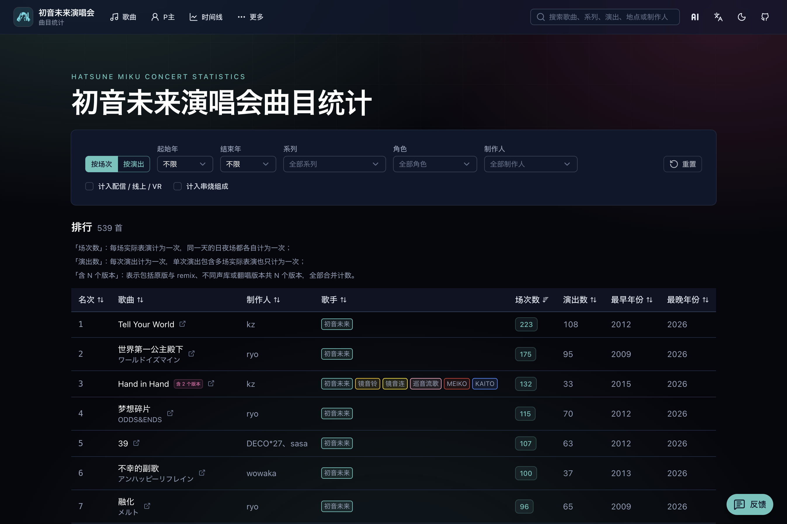
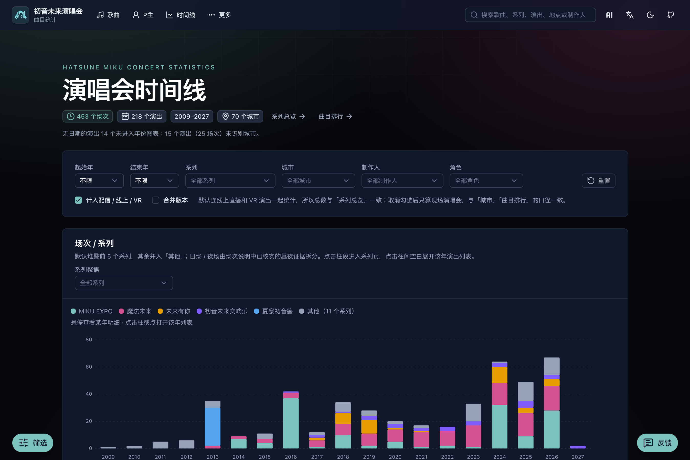
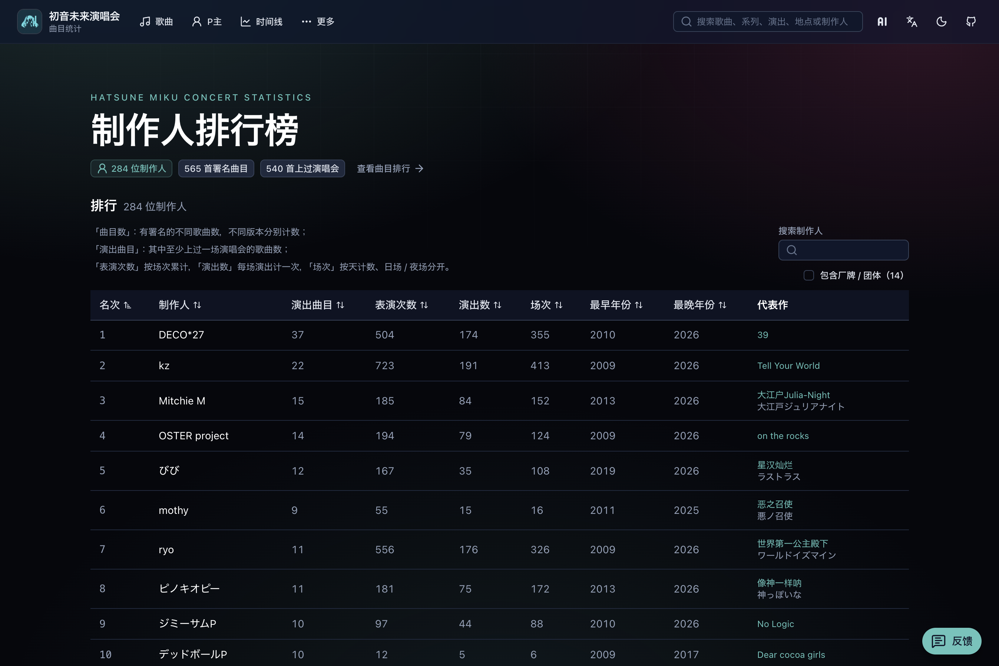

  

<h1 align="center">初音未来演唱会统计</h1>

  <a href="../README.md">English</a> ·
  <strong>简体中文</strong> ·
  <a href="README.zh-Hant.md">繁體中文</a> ·
  <a href="README.ja.md">日本語</a>

  浏览各类初音未来演唱会的曲目排行、制作人、时间线与歌单。

  <a href="https://miku-concert-stats.rjiazhen.top"><strong>打开网站</strong></a>

<table>
  <tr>
    <td align="center" valign="top" width="33%">
       
      曲目排行
    </td>
    <td align="center" valign="top" width="33%">
       
      时间线
    </td>
    <td align="center" valign="top" width="33%">
       
      制作人排行
    </td>
  </tr>
</table>

## 功能

- **曲目排行** — 看哪些歌在演唱会上最常出现，可按系列、年份、角色、制作人筛选
- **时间线** — 按年份与城市查看各系列场次的分布
- **制作人排行** — 了解制作人的作品在舞台上的出场情况
- **系列与演出** — 打开系列或单场演出，查看歌单
- **站内搜索** — 在页眉搜索歌曲、系列、演出、地点与制作人

## 收录演唱会系列

- 魔法未来
- MIKU EXPO
- 未来有你
- 初音未来交响乐
- 初音未来演唱会派对
- 雪初音演唱会
- 初音未来×鼓童
- 初音未来 JAPAN TOUR 2023 ～THUNDERBOLT～
- 初音未来 JAPAN TOUR 2025 ～BLOOMING～
- 初音未来·DECOMIKU LIVE
- 初音未来FES
- 夏末的39祭
- 夏祭初音鉴
- 初音未来 GALAXY LIVE
- 初音未来 LAWSON 50周年特别演唱会
- 宝可梦 feat. 初音未来 VOLTAGE Live！

## 参与贡献

开发与贡献说明见 [CONTRIBUTING.md](CONTRIBUTING.md)。

## 许可

[MIT](../LICENSE)
