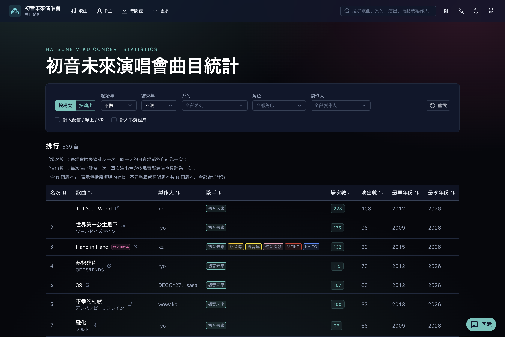
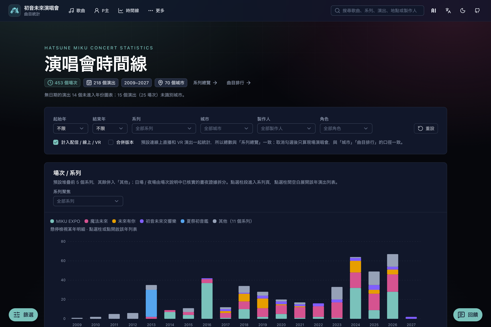
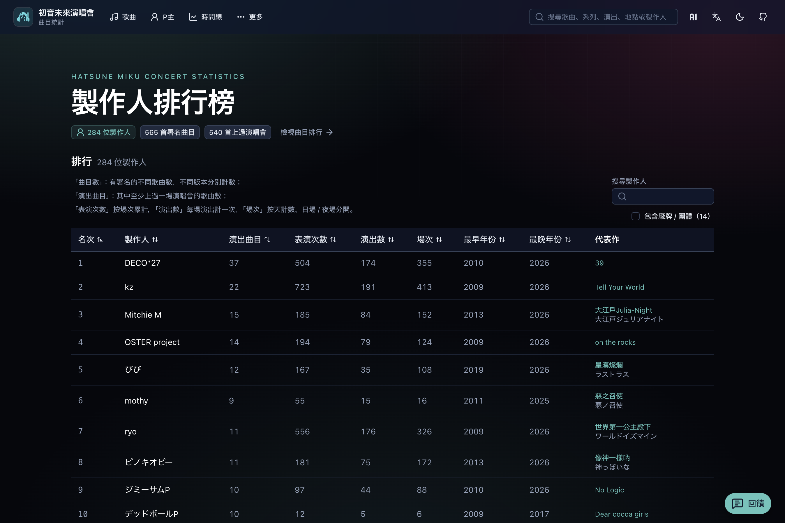

  

<h1 align="center">初音未來演唱會統計</h1>

  <a href="../README.md">English</a> ·
  <a href="README.zh-CN.md">简体中文</a> ·
  <strong>繁體中文</strong> ·
  <a href="README.ja.md">日本語</a>

  瀏覽各類初音未來演唱會的曲目排行、製作人、時間線與歌單。

  <a href="https://miku-concert-stats.rjiazhen.top"><strong>開啟網站</strong></a>

<table>
  <tr>
    <td align="center" valign="top" width="33%">
       
      曲目排行
    </td>
    <td align="center" valign="top" width="33%">
       
      時間線
    </td>
    <td align="center" valign="top" width="33%">
       
      製作人排行
    </td>
  </tr>
</table>

## 功能

- **曲目排行** — 看哪些歌在演唱會上最常出現，可按系列、年份、角色、製作人篩選
- **時間線** — 按年份與城市查看各系列場次的分布
- **製作人排行** — 了解製作人的作品在舞台上的出場情況
- **系列與演出** — 打開系列或單場演出，查看歌單
- **站內搜尋** — 在頁眉搜尋歌曲、系列、演出、地點與製作人

## 收錄演唱會系列

- 魔法未來
- MIKU EXPO
- 未來有你
- 初音未來交響樂
- 初音未來演唱會派對
- 雪初音演唱會
- 初音未來×鼓童
- 初音未來 JAPAN TOUR 2023 ～THUNDERBOLT～
- 初音未來 JAPAN TOUR 2025 ～BLOOMING～
- 初音未來·DECOMIKU LIVE
- 初音未來FES
- 夏末的39祭
- 夏祭初音鑑
- 初音未來 GALAXY LIVE
- 初音未來 LAWSON 50週年特別演唱會
- 寶可夢 feat. 初音未來 VOLTAGE Live！

## 參與貢獻

開發與貢獻說明見 [CONTRIBUTING.md](CONTRIBUTING.md)。

## 授權

[MIT](../LICENSE)
