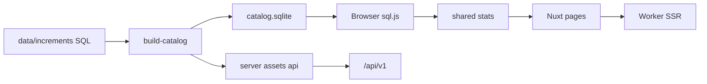

# アーキテクチャ

[English](architecture.md) | [简体中文](architecture.zh-CN.md) | [繁體中文](architecture.zh-Hant.md) | **日本語**

初音ミクコンサートのセットリスト統計：SQL カタログをソースにブラウザで集計し、Worker は SSR と一部 API を担当します。

**D1 も R2 も使いません。** カタログはビルドされた SQLite（`public/data/catalog.sqlite`）です。検索はそのローカルカタログのみ（Worker からのオンデマンド VocaDB 参照はありません）。

## スタック

- Nuxt 4（`app/`）、Nuxt UI 4、Tailwind CSS 4
- 共有 TypeScript：`shared/`（統計、セットリスト、i18n、訳名）
- ビルド時 better-sqlite3、ブラウザは sql.js
- 本番 Nitro preset：`cloudflare_module`

## モジュール

| パス | 役割 |
| --- | --- |
| `data/schema.sql` + `data/increments/` | カタログの正本 |
| `scripts/vocadb/*` と派生/レポート | オフラインデータパイプライン |
| `scripts/build-catalog.ts` / `build-api.ts` | sqlite と `/api/v1` 成果物 |
| `shared/*` | UI・API ビルド・テスト共通の集計ルール |
| `app/*` | ページ（クライアントでカタログ読込） |
| `server/api/v1/*` | ビルド時 JSON 上の動的フィルタ |
| `/raw` + `server/api/dev/raw/*` | 開発専用ソースブラウザ（本番ビルドでは ignore） |
| フィードバック / 管理 / 分析 | メンテナー機能（Cloudflare バインド） |

UI 言語：`zh` / `zh-Hant` / `ja` / `en`（`i18n/modules/` → `@nuxtjs/i18n` 用 JSON）。

## データフロー

## Cloudflare とローカル

| 機能 | CF が必要？ |
| --- | --- |
| ランキング / タイムライン / 検索 | いいえ |
| `pnpm test` / カタログ再構築 | いいえ |
| Worker デプロイ | はい |
| フィードバック KV / Access 管理 / Analytics Engine | はい |

[local-development.ja.md](local-development.ja.md) と [cloudflare.ja.md](cloudflare.ja.md) を参照。

## 詳細ドキュメント

- 採録ルールとファイル形式：[data-pipeline.zh-CN.md](data-pipeline.zh-CN.md)（簡体字中国語）
- 既知のデータ課題：[data-issues.md](data-issues.md)
- 初期設計メモ：[design.md](design.md)

## メンテナー運用（任意）

このリポジトリでは `~/projects/full-stack/miku-concert-stats.worktrees/<branch>` の worktree をよく使います。外部貢献者は通常の clone / ブランチで問題ありません。並列 `vp dev` は `--port` で空きポートを指定してください。
