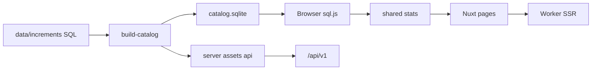

# Architecture

Hatsune Miku concert setlist stats: catalog in SQL, aggregation in the browser, Worker for SSR and a few APIs.

There is **no D1 and no R2**. The catalog is a built SQLite file (`public/data/catalog.sqlite`). Search is local-only on that catalog (no on-demand VocaDB lookup from the Worker).

## Stack

- Nuxt 4 (`app/`), Nuxt UI 4, Tailwind CSS 4
- Shared TypeScript under `shared/` (stats, setlists, i18n, names)
- better-sqlite3 at build time; sql.js in the browser
- Nitro preset `cloudflare_module` for production

## Modules

| Path | Role |
| --- | --- |
| `data/schema.sql` + `data/increments/` | Source of truth for the catalog |
| `data/tours.json` + `shared/tours.ts` | Hand registry of tours and which 演出 belong to each; tour detail paths |
| `data/tour-posters.json` | Tour poster provenance (`posters[]` per tour). Originals in `public/posters/originals/`; packaged WebP previews via `vp run posters:package` (max width 1800). UI shows the first poster; fullscreen uses `originalSrc`. Source rank: official vertical → horizontal → site OG → cleaned screenshot → homemade (`poster-intake/README.md`). Homepage banner and `/tours/{id}` resolve 演出 → tour → poster |
| `scripts/vocadb/*`, derive/report scripts | Offline data pipeline |
| `scripts/report-tour-posters.ts` | Writes gitignored `temp/tour-poster-audit.md` for poster review |
| `scripts/build-catalog.ts` / `build-api.ts` | Emit sqlite + `/api/v1` assets |
| `shared/*` | Counting rules used by UI, API build, and tests |
| `app/*` | Pages and UI; loads catalog client-side. `/` is the landing page; song rankings live at `/rank`; concert detail is `/tours/{id}` (legacy `/shows/{id}` redirects). |
| `server/api/v1/*` | Dynamic filters over build-time JSON assets |
| `server/api/feedback*`, `/admin*`, analytics | Maintainer ops (Cloudflare bindings) |
| `/raw` + `server/api/dev/raw/*` | Dev-only source browser (ignored in production builds) |

UI languages: `zh` / `zh-Hant` / `ja` / `en` (`i18n/modules/` → split JSON for `@nuxtjs/i18n`).

## Data flow

## Cloudflare vs local

| Feature | Needs CF? |
| --- | --- |
| Browse homepage / rankings / timeline / search | No |
| `pnpm test` / catalog rebuild | No |
| Deploy Worker | Yes |
| Feedback KV / Access admin / Analytics Engine | Yes |

See [local-development.md](local-development.md) and [cloudflare.md](cloudflare.md) (production deploy plus Worker Previews / `wrangler preview`).

## Deeper references

- Curated data rules and file formats: [data-pipeline.md](data-pipeline.md)
- Known data issues: [data-issues.md](data-issues.md)
- Historical design notes: [design.md](design.md), including the dedicated homepage at `/` and the song ranking at `/rank`

## Maintainer workflow (optional)

This repo often develops in git worktrees under `~/projects/full-stack/miku-concert-stats.worktrees/<branch>`. Contributors can use any normal clone/branch workflow. Parallel task setup, status, ship, and leftover cleanup are driven by `vp run task` (`scripts/task.ts`: `start`, `status`, `dev-url`, `dev-stop`, `ship`, `clean`); `/continue` only decides the phase and implements the feature. Ship cleanup retries a forced worktree remove when leftover ignored files block a normal remove; agents should run `vp run task -- clean <branch>` for interrupted cleanup and fix `scripts/task/` when the helper itself is wrong, not hand-roll git/workspace commands.
