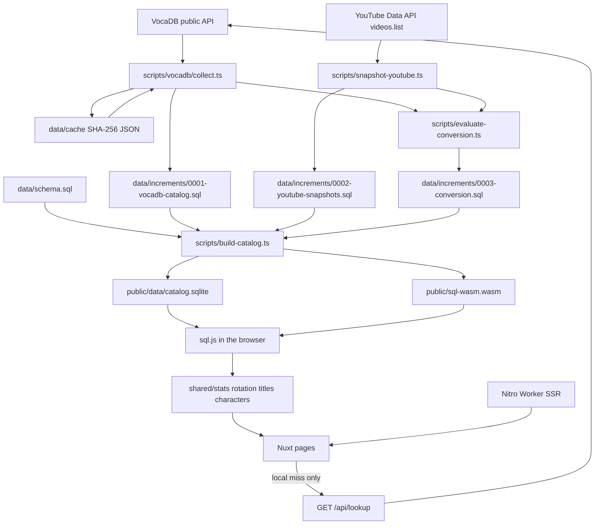

# 架构

统计 Crypton 主办的初音未来演唱会歌单，并在浏览器里比较各场、各系列、各年份的播放量区间。日常聚合不在服务器上跑。Cloudflare Worker 只做首屏 SSR，以及目录里找不到歌时的按需检索。

设计约束见 [docs/design.md](design.md)。本文件描述当前代码怎么跑。

收录系列由 `scripts/vocadb/collect.ts` 的 `SERIES_IDS` 固定为 VocaDB release-event series id：

| id | 当前目录中的系列名 |
| --- | --- |
| 81 | 初音ミク「マジカルミライ」 |
| 82 | MIKU EXPO |
| 173 | MIKU WITH YOU |
| 256 | 初音ミクシンフォニー |
| 219 | 初音ミクライブパーティー |
| 204 | SNOW MIKU LIVE! |

## 目录与模块

这是单个 Nuxt 应用，不是 pnpm workspace 多包。`pnpm-workspace.yaml` 只放 `allowBuilds`。

### 采集与 SQL

`scripts/vocadb/client.ts` 请求 VocaDB 公共 REST API。`User-Agent` 为 `miku-concert-stats/0.1 (+https://github.com/RJiazhen/miku-concert-stats)`。未缓存请求至少间隔 `MIN_INTERVAL_MS`（300ms），网络请求上限 `MAX_REQUESTS`（800）。缓存命中不睡眠、不计入上限。429 或 5xx 等 2 秒后重试一次。响应按 URL 的 SHA-256 存在 `data/cache/*.json`。该目录被 `.gitignore` 忽略，不提交。

`scripts/vocadb/collect.ts`（`pnpm collect`）拉取上述六个系列：系列详情、每场 `releaseEvents`、歌单分页（每页 50，`fields=Names,PVs,WebLinks`）。`scripts/vocadb/normalize.ts` 把 API 对象收成目录行。`scripts/vocadb/api-types.ts` 是这些响应的类型。

写入规则：

- 名称或简介命中「配信」或 `livestream` 的场次，`shared/premiere.ts` 的 `performanceRole` 标为 `broadcast`。「Online」单独出现仍是 `show`。
- 首演是同一 `series_id` + `series_number` 里 `role = show` 且有开始日的最早日期；同日取较小的 performance id。规则原文存在 `edition_premieres.rule`。
- `shared/showtime.ts` 只在场馆国家为 `JP`、且简介里恰好一条合法的 `Showtime` 或「開演」`HH:MM` 时写入 `showtime_local`、`timezone = Asia/Tokyo` 和摘录。多条钟点不写入。VocaDB 日期保持 `time_precision = day`。
- 歌单对象没有公布时间，`song_lists.announced_at` 写 `NULL`。
- `shared/medley.ts`：`songType !== Mashup` 整行计为列出的那首歌。Mashup 只有备注或网页链接里能核到至少两条其他 VocaDB 歌曲 URL（`vocadb.net/S/{id}` 或 `Song/Details/{id}`）才拆开，角色为 `component`；否则进入 `medley_quarantine`，不进入区间分母。组件歌曲 404 时该行隔离。
- 视频只保留 niconico、YouTube、bilibili 的 PV 链接。不调用 niconico 非官方观看页接口，不抓哔哩哔哩播放量。

`scripts/sql/emit.ts` 把行变成 SQL 字面量，每条 `INSERT` 最多 80 行。`catalogTransaction` 包在事务里，先删目录表再插入。它不删除 `view_snapshots`、`milestones`、`conversion_formulas`。产物是 `data/increments/0001-vocadb-catalog.sql`。采集结束还会调用 `scripts/evaluate-conversion.ts` 重写 `0003-conversion.sql`。

`scripts/snapshot-youtube.ts`（`pnpm snapshot:youtube`）在 `YOUTUBE_API_KEY` 存在时，对目录里未禁用的 YouTube `platform_video_id` 调用 Data API v3 `videos.list`（`part=statistics`，每批 50 个 id）。没有数字 `viewCount` 的条目跳过，不写成 0。结果以 `INSERT OR IGNORE` 追加到 `data/increments/0002-youtube-snapshots.sql`（文件首次出现时写表头）。没有密钥时打印跳过并返回 0，不估计播放量。快照写完后同样重写换算增量。当前仓库可以没有 `0002`：没有采集时 `view_snapshots` 与 `milestones` 都是空表。里程碑表保留，没有可引用的达成时间时不插入行。

`scripts/evaluate-conversion.ts` 在内存里用 better-sqlite3 套用全部 SQL，再经 `shared/correlation.ts` 评估。公式 id 为 `nico-to-youtube-log10`，形式是 `log10(youtube views) = a + b * log10(niconico views)`。配对要求同一首歌在 niconico 与 YouTube 上都有未禁用代表 PV，且两侧最新快照播放量都大于 0。留出集是 `song id % 5 === 0`。发布门槛：训练至少 40 对、留出至少 15 对、两侧 `|r| ≥ 0.8`、中位绝对百分比误差 ≤ 25%；留出层（发布年代十年、niconico 区间、YouTube `pvType`）样本不少于 8 时，该层误差 ≤ 40%。任一门槛失败则 `status = unpublished`，`formula_json` 保持 `NULL`。

`scripts/build-catalog.ts`（`pnpm build:catalog`，也是 `predev` / `prebuild`）用 better-sqlite3 执行 `data/schema.sql`，再按文件名字典序执行 `data/increments/*.sql`，写出 `public/data/catalog.sqlite`。同时把 `sql.js` 的 `sql-wasm.wasm` 复制到 `public/sql-wasm.wasm`。这两个产物都在 `.gitignore` 里。

### 共享逻辑 `shared/`

`shared/types.ts` 定义 `Queryable`、目录行和 `Catalog`。`shared/catalog.ts` 的 `loadCatalog` 用只读 `SELECT` 把表读成对象。聚合在 TypeScript 里做，不在 SQL 里做。Node 脚本用 better-sqlite3，浏览器用 sql.js，两边都走这个加载器。

`shared/stats.ts`：

- `representativeVideo`：某平台上未禁用的 PV 里，优先 `pvType = Original`，否则取最小的 VocaDB PV id。
- `playbackForSongs` / `summarizeBands`：用最新快照落入 `shared/bands.ts` 的固定区间（尚无快照、不足 10 万、10 万–100 万、100 万–1000 万、1000 万及以上）。没有快照保持 `none`。
- `compareBy`：按系列、年版（`series_number`）或场次开始日期的公历年分组，组内按歌曲去重后算区间占比。比较的是当前快照。
- `observeWindow`：观察点之前最近的快照与之后最早的快照。缺任一侧则 `insufficient`，不算差值。
- `rankSongAppearances`：排行。`setlist` 模式每个 `song_list_id` 至多计一次；`show` 模式只计轮换解析分配到该场的行。默认排除 `role = broadcast` 以及名称、日文名、`series_suffix` 命中 livestream / online / オンライン / VR / 配信 的场次，除非 `includeBroadcast`。`role = component` 默认不计，除非 `includeMedleyComponents`。空的系列列表表示全部已知系列。设了年份上下界时，没有 `YYYY-MM-DD` 开始日的场次不计入。

`shared/rotation.ts` 解析歌单备注，把一行分到共享该歌单的场次：

- 空备注表示该歌单的全部场次，且不算不确定。
- 备注按 `/`、`／`、逗号、顿号切开。段内识别城市别名、`day N`、昼夜 / 1st·2nd show。
- 一段都解析不出来时，退回全部场次并标为不确定。
- `reviewRotations` 再做长度一致性检查：每场按解析结果数行，期望长度是该歌单上场次行数的众数（并列取较大值）。与众数不同的场次记入 `shows`，原因是 `setlist length mismatch: X vs expected Y`。该歌单上已经不确定、或没有覆盖全部场次的行，会继承这条原因。

`shared/song-titles.ts` 校验并格式化中文歌名。`shared/characters.ts` 把声库名收成角色。`shared/lookup.ts` 做目录内子串匹配，并把 VocaDB 搜索结果收成最多 5 条、只含 niconico / YouTube / bilibili 的投稿链接。

### 页面、组件、服务端

页面在挂载后调用 `composables/useCatalog.ts` 的 `load`。服务端渲染不打开 wasm。客户端只下载一次 `/data/catalog.sqlite`，用 `/sql-wasm.wasm` 初始化 sql.js，再 `loadCatalog`。结果放在 Nuxt `useState` 里，各页共用。

| 路由 | 文件 | 做什么 |
| --- | --- | --- |
| `/` | `pages/index.vue` | 曲目排行。模式、系列、年份、是否计入配信、是否计入串烧组件、角色筛选、排序。不确定行和长度不一致的场次列在表下。年版链接到 `/editions/{seriesId}/{number}`。 |
| `/catalog` | `pages/catalog.vue` | 单场歌单与当前平台的播放量区间。 |
| `/shows/{id}` | `pages/shows/[id].vue` | 一场的轮换解析结果，以及该场是否长度不一致。 |
| `/editions/{seriesId}/{number}` | `pages/editions/[seriesId]/[number].vue` | 一个年版下各场与歌单行的角色、分配场次。 |
| `/compare` | `pages/compare.vue` | `compareBy`，分组为系列 / 年版 / 年份。 |
| `/windows` | `pages/windows.vue` | 以年版首演日和 `announced_at`（现为 null，故公布侧样本不足）为观察点。 |
| `/correlation` | `pages/correlation.vue` | 展示公式状态。未 `published` 时继续分平台。 |
| `/lookup` | `pages/lookup.vue` | 先 `localSongMatches`。本地有命中或查询为空时不请求服务器。 |

`server/api/lookup.get.ts` 只在浏览器请求 `GET /api/lookup?q=` 时搜索 VocaDB `/api/songs`（`maxResults=5`，`fields=PVs`）。查询长度须为 1–80。失败返回 400 或 502。

`components/SongTitle.vue` 用 `composables/useSongLanguage.ts`。语言存在 `localStorage` 键 `miku-concert-stats-song-lang`。服务端先用原文，以免 hydration 不一致；挂载后已存的选择优先，否则 `navigator.language` 以 `zh` 开头则用中文。中文模式在译文旁用括号保留原文，两者相同时只显示一条。`composables/useCharacters.ts` 在启动时编译 `data/characters.json`，供排行筛选和「演出角色」列。

`components/SiteHeader.vue` 提供导航、歌名语言切换和主题切换。默认深色。`nuxt.config.ts` 在首屏脚本里读 `localStorage` 键 `miku-concert-stats-theme`（`light` 或 `dark`）。未选择时跟随 `prefers-color-scheme`。`components/BandChart.vue` 画区间占比。`layouts/default.vue` 放页眉页脚和 VocaDB 署名。`assets/css/main.css` 由 `app.vue` 引入。

## 数据流



`0002` 仅在跑过带密钥的快照后存在。`build-catalog` 对缺失的增量目录或其中不存在的文件不会失败：目录不存在则跳过，存在则只执行 `*.sql`。

## 技术选择

- **Nuxt 3 + Nitro `cloudflare_module`。** `nuxt.config.ts` 把 Nitro preset 设为 `cloudflare_module`，`deployConfig: true`，`nodeCompat: true`。`wrangler.toml` 的 `compatibility_date` 为 `2026-10-06`，并打开 `nodejs_compat`。部署时 Nitro 会改写 `.output` 里的 Worker 入口，根目录的 `wrangler.toml` 不单独作为部署配置。
- **浏览器里的 sql.js。** 统计在客户端完成。Worker 不打开目录数据库。
- **SQL 增量是源。** 提交的是 `data/schema.sql` 和 `data/increments/*.sql`。`public/data/catalog.sqlite` 是构建产物。
- **VocaDB 数据库内容为 CC 署名转载。** 增量文件头和 `sources` 行指向 [VocaDB License](https://wiki.vocadb.net/docs/license)。本站不下载封面、歌词或官方标识。
- **YouTube Data API 可选。** 只有配置了 `YOUTUBE_API_KEY` 才写入快照。

Node 22 用于 CI。运行时依赖是 `sql.js`。采集、构建目录和测试用开发依赖里的 `better-sqlite3`、`tsx`、`vitest`。

## 配置文件

### `data/song-titles.zh-CN.json`

对象。键是 VocaDB 歌曲 id 的十进制字符串。值是：

| 字段 | 要求 |
| --- | --- |
| `title` | 非空字符串 |
| `source` | 非空字符串，例如 `vocadb-alias`、`萌娘百科` |
| `comment` | 可选字符串 |

`parseSongTitles` 在键不是纯数字、标题或来源为空、或 `comment` 不是字符串时抛错。没有条目的歌保持原文。

### `data/characters.json`

对象。键是展示用的角色名，顺序即筛选和单元格的顺序。值是：

| 字段 | 要求 |
| --- | --- |
| `patterns` | 可选字符串数组，按正则编译，无额外 flag |
| `aliases` | 可选字符串数组。每个别名编译为 `^{alias}(?:\s|$)`，flag 为 `i` |

至少要有一条 pattern 或 alias。匹配时优先使用带 Vocalist 类别或角色的结构化署名；没有则取 `artist_string` 里第一个 `feat.` 之后、按逗号或顿号分开的名字。未匹配的 token 不显示在「演出角色」里。

## 运行、构建、测试、部署

```bash
pnpm install
pnpm dev --port 3001
```

`predev` 会先跑 `build-catalog`。开发服务器已占用 Nuxt 锁时，另开的检查要跳过锁：

```bash
NUXT_IGNORE_LOCK=1 pnpm lint
NUXT_IGNORE_LOCK=1 pnpm typecheck
NUXT_IGNORE_LOCK=1 pnpm test
NUXT_IGNORE_LOCK=1 pnpm build
```

没有开发服务器时可以不设 `NUXT_IGNORE_LOCK`。`pnpm typecheck` 是 `tsc --noEmit` 再加 `nuxt typecheck`。`pnpm test` 是 `vitest run`（`tests/**/*.test.ts`）。`pnpm build` 同样先重建目录，再 `nuxt build`。

采集与快照：

```bash
pnpm collect
cp .env.example .env
# 填入 YOUTUBE_API_KEY 后
pnpm snapshot:youtube
```

部署到 Cloudflare Workers：

```bash
pnpm build
pnpm exec wrangler --cwd .output deploy
```

线上地址：<https://miku-concert-stats.zc791.workers.dev>

### GitHub Actions

`.github/workflows/ci.yml`（`ci`）在指向 `main` 或 `feat/initial-build` 的 push，以及所有 pull request 上运行。Node 22，`pnpm install --frozen-lockfile`，然后 `pnpm lint`、`pnpm typecheck`、`pnpm test`、`pnpm build:catalog`。

`.github/workflows/weekly-collect.yml`（`weekly-collect`）在每周一 16:00 UTC（`cron: 0 16 * * 1`）和手动 `workflow_dispatch` 时运行。它执行 `pnpm collect` 和 `pnpm snapshot:youtube`（密钥 `secrets.YOUTUBE_API_KEY`）。`data/increments` 有差异时，由 `github-actions[bot]` 提交并推送，信息为 `Update VocaDB catalog and playback snapshots.`。没有差异则直接结束。
