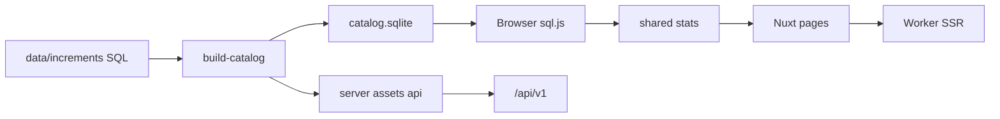

# Architecture

**English** | [简体中文](architecture.zh-CN.md) | [繁體中文](architecture.zh-Hant.md) | [日本語](architecture.ja.md)

Hatsune Miku concert setlist stats: catalog in SQL, aggregation in the browser, Worker for SSR and a few APIs.

There is **no D1 and no R2**. The catalog is a built SQLite file (`public/data/catalog.sqlite`). Search is local-only on that catalog (no on-demand VocaDB lookup from the Worker).

## Stack

- Nuxt 4 (`app/`), Nuxt UI 4, Tailwind CSS 4
- Shared TypeScript under `shared/` (stats, setlists, i18n, names)
- better-sqlite3 at build time; sql.js in the browser
- Nitro preset `cloudflare_module` for production

## Modules

| Path | Role |
| --- | --- |
| `data/schema.sql` + `data/increments/` | Source of truth for the catalog |
| `scripts/vocadb/*`, derive/report scripts | Offline data pipeline |
| `scripts/build-catalog.ts` / `build-api.ts` | Emit sqlite + `/api/v1` assets |
| `shared/*` | Counting rules used by UI, API build, and tests |
| `app/*` | Pages and UI; loads catalog client-side |
| `server/api/v1/*` | Dynamic filters over build-time JSON assets |
| `server/api/feedback*`, `/admin*`, analytics | Maintainer ops (Cloudflare bindings) |
| `/raw` + `server/api/dev/raw/*` | Dev-only source browser (ignored in production builds) |

UI languages: `zh` / `zh-Hant` / `ja` / `en` (`i18n/modules/` → split JSON for `@nuxtjs/i18n`).

## Data flow

## Cloudflare vs local

| Feature | Needs CF? |
| --- | --- |
| Browse rankings / timeline / search | No |
| `pnpm test` / catalog rebuild | No |
| Deploy Worker | Yes |
| Feedback KV / Access admin / Analytics Engine | Yes |

See [local-development.md](local-development.md) and [cloudflare.md](cloudflare.md).

## Deeper references

- Curated data rules and file formats: [data-pipeline.zh-CN.md](data-pipeline.zh-CN.md) (Simplified Chinese)
- Known data issues: [data-issues.md](data-issues.md)
- Historical design notes: [design.md](design.md)

## Maintainer workflow (optional)

This repo often develops in git worktrees under `~/projects/full-stack/miku-concert-stats.worktrees/<branch>`. Contributors can use any normal clone/branch workflow. Port notes for parallel `vp dev` sessions may appear in older docs; pick a free port with `--port`.

Active local ports: `dev-raw-browser` 用 `3127`；`header-x-link` 用 `3128`。
`fix-ai-prompt-language` 用 `3165`.
`refactor-i18n-modules` 用 `3211`.
`remove-cf-web-analytics-beacon` 用 `3167`.
`fix-locale-menu-mobile-fullscreen` 用 `3169`.
`feat-timeline-disable-bar-nav` 用 `3129`.
