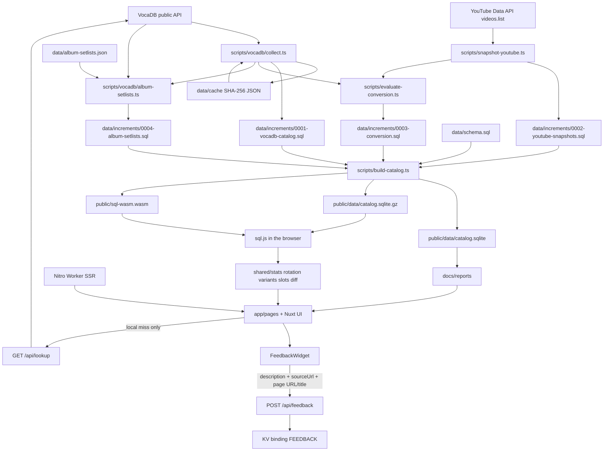

# 架构

统计 Crypton 主办的初音未来演唱会歌单，并在浏览器里比较各场、各系列、各年份的播放量区间。日常聚合不在服务器上跑。Cloudflare Worker 只做首屏 SSR，以及目录里找不到歌时的按需检索。

设计约束见 [docs/design.md](design.md)。本文件描述当前代码怎么跑。已确认但尚未修复的数据缺陷汇总在 [docs/data-issues.md](data-issues.md)。

收录系列由 `scripts/vocadb/collect.ts` 的 `SERIES_IDS` 固定为 VocaDB release-event series id：

| id | 当前目录中的系列名 |
| --- | --- |
| 81 | 初音ミク「マジカルミライ」 |
| 82 | MIKU EXPO |
| 173 | MIKU WITH YOU |
| 256 | 初音ミクシンフォニー |
| 219 | 初音ミクライブパーティー |
| 204 | SNOW MIKU LIVE! |
| 255 | 初音ミク×鼓童 |

`SERIES_IDS` 之外，`scripts/vocadb/collect.ts` 的 `STANDALONE_EVENTS` 补录 VocaDB 没挂到系列、但属于已收录系列的独立场次，并指定站内的 `series_id` 与系列年度号。目前只有 2010-03-09 的「ミクの日感謝祭39's Giving Day」（VocaDB 事件 2520，上游无 `seriesId`、`seriesNumber` 为 0），记作 `初音ミクライブパーティー` 2010。`data/increments/0004-standalone-events.sql` 是这次补录的 SQL，写入用 `INSERT OR IGNORE`，因此下一次 `pnpm collect` 把同一批行写进 0001 后它不再改变结果。

`data/increments/0005-kodo-series.sql` 以同样方式补录 255（初音ミク×鼓童）：2017 / 2018 / 2023 / 2026 四场有歌单，2020 场次上游标为取消、没有日期与歌单。这份 SQL 同样用 `INSERT OR IGNORE`，`pnpm collect` 把它写进 0001 后即成为空操作。

## 技术栈

- **Nuxt 4.6**，`srcDir` 为 `app/`。`shared/`、`scripts/`、`tests/`、`server/`、`data/` 留在根目录，`app/**` 通过 `~~/shared/*` 引用纯逻辑。
- **Nuxt UI 4 + Tailwind CSS 4**。`nuxt.config.ts` 注册 `@nuxt/ui`，颜色 token 在 `app/app.config.ts` 绑定为 `primary: miku`、`secondary: magenta`，色阶定义在 `app/assets/css/main.css` 的 `@theme`。
- **深色优先，默认跟随系统**。`@nuxtjs/color-mode`（由 Nuxt UI 注册）在 `html` 上加 `.dark`；页眉的 `UColorModeButton` 切换并记住选择。
- **字体不联网**：`ui.fonts: false`，使用系统字体栈，避免构建期请求字体服务。
- **图标本地打包**：`@iconify-json/lucide` + `icon.clientBundle.scan`，SSR 首屏不依赖 Iconify API。
- **Nitro `cloudflare_module`**：`deployConfig: true`、`nodeCompat: true`，产物写到 `.output`。

## 目录与模块

### 采集与 SQL

`scripts/vocadb/client.ts` 请求 VocaDB 公共 REST API。`User-Agent` 为 `miku-concert-stats/0.1 (+https://github.com/RJiazhen/miku-concert-stats)`。未缓存请求至少间隔 `MIN_INTERVAL_MS`（300ms），网络请求上限 `MAX_REQUESTS`（800）。缓存命中不睡眠、不计入上限。429 或 5xx 等 2 秒后重试一次。响应按 URL 的 SHA-256 存在 `data/cache/*.json`。该目录被 `.gitignore` 忽略，不提交。

`scripts/vocadb/collect.ts`（`pnpm collect`）拉取上述七个系列：系列详情、每场 `releaseEvents`、歌单分页（每页 50，`fields=Names,PVs,WebLinks`）；另外按 `STANDALONE_EVENTS` 补拉没有系列归属的场次。`scripts/vocadb/normalize.ts` 把 API 对象收成目录行。`scripts/vocadb/api-types.ts` 是这些响应的类型。

VocaDB 上没有歌单的演出可以由专辑曲目补位。`data/album-setlists.json` 为每个演出人工指定一张专辑，`scripts/vocadb/album-setlists.ts`（`pnpm collect:albums`，`pnpm collect` 末尾也会执行）只请求这些专辑的 `Tracks`，写出 `data/increments/0004-album-setlists.sql`：每张专辑一份 `song_lists` 行（`source = 'album'`、`album_id`、`medium`），曲目按碟号与轨号写进 `setlist_items`、`setlist_item_songs`，最后 `UPDATE performances ... WHERE song_list_id IS NULL` 把这批演出指向该歌单。这个条件保证 VocaDB 以后补上真歌单时专辑曲目不会覆盖它。曲目沿 `originalVersionId` 一路解析到原曲（专辑版可能是上一张专辑版本的再版，所以不能只跟一跳），播放量仍记在原曲上；没有原曲的串烧保留专辑曲目的 id 与标题。VocaDB 上 2018 年以后的蓝光条目没有曲目，所以多数系列年度只能用同一年度的 CD。

写入规则：

- 名称或简介命中「配信」或 `livestream` 的场次，`shared/premiere.ts` 的 `performanceRole` 标为 `broadcast`。「Online」单独出现仍是 `show`。
- 年度首演是同一系列年度（`series_id` + `series_number`）里第一个 `role = show` 且有开始日的演出；同日取较小的 performance id。规则原文存在 `edition_premieres.rule`。
- `shared/showtime.ts` 只在场馆国家为 `JP`、且简介里恰好一条合法的 `Showtime` 或「開演」`HH:MM` 时写入 `showtime_local`、`timezone = Asia/Tokyo` 和摘录。多条钟点不写入。VocaDB 日期保持 `time_precision = day`。
- 歌单对象没有公布时间，`song_lists.announced_at` 写 `NULL`。
- `shared/medley.ts`：`songType !== Mashup` 整行计为列出的那首歌。Mashup 只有备注或网页链接里能核到至少两条其他 VocaDB 歌曲 URL（`vocadb.net/S/{id}` 或 `Song/Details/{id}`）才拆开，角色为 `component`；否则进入 `medley_quarantine`，不进入区间分母。
- `shared/placeholder-song.ts`：`isPlaceholderSong` 检查歌名与全部译名，命中 VocaDB 的占位标记（`[Placeholder song]`、`[Unknown song]`、`[Temporary song]`、`[Custom song]`、`[Out of scope song]`、`[Unknown]`，忽略大小写与首尾空白）就整行丢弃，不写入 `setlist_items` / `songs`。占位曲 15591（`???`）在初音ミク×鼓童的三份歌单里出现 14 次，代表鼓童的太鼓独奏段落，不是歌曲；不丢弃会让 `???` 排到该系列第一。歌名本身不改写，只跳过整行。
- 视频只保留 niconico、YouTube、bilibili 的 PV 链接。

`scripts/sql/emit.ts` 把行变成 SQL 字面量，每条 `INSERT` 最多 80 行。`catalogTransaction` 包在事务里，先删目录表再插入。它不删除 `view_snapshots`、`milestones`、`conversion_formulas`。产物是 `data/increments/0001-vocadb-catalog.sql`。采集结束还会调用 `scripts/evaluate-conversion.ts` 重写 `0003-conversion.sql`。

`scripts/snapshot-youtube.ts`（`pnpm snapshot:youtube`）在 `YOUTUBE_API_KEY` 存在时，对目录里未禁用的 YouTube `platform_video_id` 调用 Data API v3 `videos.list`（`part=statistics`，每批 50 个 id）。没有数字 `viewCount` 的条目跳过，不写成 0。结果以 `INSERT OR IGNORE` 追加到 `data/increments/0002-youtube-snapshots.sql`。没有密钥时打印跳过并返回 0。

`scripts/build-catalog.ts`（`pnpm build:catalog`，也是 `predev` / `prebuild`）用 better-sqlite3 执行 `data/schema.sql`，再按文件名字典序执行 `data/increments/*.sql`，写出 `public/data/catalog.sqlite`，同时写一份 gzip 副本 `public/data/catalog.sqlite.gz`，并把 `sql.js` 的 `sql-wasm.wasm` 复制到 `public/sql-wasm.wasm`。这三个产物都在 `.gitignore` 里。

Cloudflare 只压缩固定内容类型，`application/vnd.sqlite3` 不在其中，所以浏览器下载 gzip 副本并用 `DecompressionStream('gzip')` 解压；不支持该 API 的浏览器退回未压缩文件。`nuxt.config.ts` 在构建时对 gzip 文件取 SHA-256 前 16 位写进 `runtimeConfig.public.catalogVersion`，下载 URL 变成 `/data/catalog.sqlite.gz?v=<hash>`；`nuxt dev` 直接读未压缩文件，避免重建后命中旧的 immutable 缓存。`routeRules` 让 Nitro 把它写进 Cloudflare 的 `_headers`：gzip 副本 `immutable` 缓存一年，未压缩文件保持 `must-revalidate` 并带上 `application/vnd.sqlite3`（`/raw` 的下载链接指向它）。

### 共享逻辑 `shared/`

`shared/types.ts` 定义 `Queryable`、目录行和 `Catalog`。`shared/catalog.ts` 的 `loadCatalog` 用只读 `SELECT` 把表读成对象。聚合在 TypeScript 里做，不在 SQL 里做。Node 脚本用 better-sqlite3，浏览器用 sql.js，两边都走这个加载器。

**三级术语（与 VocaDB、数据库列和页面文案的对应关系）**

| 层级 | 含义 | 数据来源 | 页面 |
| --- | --- | --- | --- |
| 系列 | 一个演唱会系列，如魔法未来 | `series` 行，`vocadb.net/Es/{id}` | 排行的系列筛选、各页标题 |
| 演出 | 一个城市站，即 VocaDB 的一个 release event | 一条 `performances` 行，`vocadb.net/E/{id}`；`series_id` 与 `series_number` 说明它属于哪个系列年度 | `/shows/{id}`；`/editions/{seriesId}/{number}` 是该系列年度的演出索引 |
| 场次 | 一天，或同一天有日场 / 夜场时的半天 | 由 `start_date`–`end_date` 推导；日夜证据来自歌单备注 | 排行「按场次」、`/shows` 页头的场次列表、歌曲页的覆盖数 |

`系列年度` 是 `series_id` + `series_number` 的分组，只用于演出索引、年度首演与歌单对照，**不再**合并成一场演唱会。VocaDB 自身也是这个结构：一个 `releaseEvents` 行 = 一个演出，同一年同一系列的不同城市各有自己的事件 id。站内不改列名，`performances` 仍是一条演出，`edition_premieres` 仍存系列年度首演。

`shared/stats.ts`：

- `representativeVideo` / `representativeVideoForSongs`：某平台上未禁用的 PV 里，优先 `pvType = Original`，否则取最小的 VocaDB PV id。合并组会跨版本选一条代表投稿。
- `playbackForSongs` / `summarizeBands`：用最新快照落入 `shared/bands.ts` 的固定区间。
- `compareBy`：按系列、系列年度（`series_number`）或演出开始日期的公历年分组，组内按歌曲去重后算区间占比。
- `observeWindow`：观察点之前最近的快照与之后最早的快照。缺任一侧则 `insufficient`。
- `rankSongAppearances`：排行。`event`（按演出）对每条 `performances` 行最多计 1，同一年大阪 / 东京两个城市站各计一次；`show`（按场次，默认）计 `shared/event-schedule.ts` 推导的场次：三日巡演计 3，同日日场 + 夜场计 2，无日期的演出没有场次、按场次不计、按演出仍计 1。备注写了天 / 半天 / 场次号时只计对应场次，否则一行计入该演出的全部场次。默认排除 `role = broadcast` 以及名称、日文名、`series_suffix` 命中 livestream / online / オンライン / VR / 配信 的演出。`role = component` 默认不计。每行带 `variantSongIds`，供页面标注「含 N 个版本」。
- 所有计数函数接受可选的 `SongVariantIndex`，默认不合并版本。

`shared/song-variants.ts` 校验 `data/song-variants.json`：键是变体歌曲 id，值含 `canonical`、`kind`（`remix` / `remaster` / `voicebank` / `cover` / `language`）与可选 `note`。链式映射（canonical 本身也是变体）与自指会抛错。导出 `canonicalSongId`、`variantSongIdsOf`、`groupSongIds`。

`shared/setlist-slots.ts` 负责歌单槽位：

- `parseNoteSelectors` 把备注拆成 `{ city, day, show, half }`。`Fukuoka Day 1`、`DAY 2`、`Nighttime Shows`、`DAY 1 1st and 2nd Show` 都能识别；`Encore` 没有可用维度，返回空。
- `itemsMergeable` 判定两行是否同一槽位：演出集合不同时要求两边在日期与场次上对齐；同一场记录跨多天时，退回按备注的日期/日夜判定；任一侧没有备注时不合并。
- `groupRowsIntoSlots` 只合并**连续**且与槽位内每一行都互斥的行。

`shared/album-setlists.ts` 校验 `data/album-setlists.json`：键是 performance id，值含 `albumId`、`albumType`（`bluray` / `cd` / `dvd`）与可选 `note`。它给出合成歌单 id（`1_000_000_000 + albumId`，与 VocaDB 歌单 id 不重叠）、曲目到原曲的解析，以及中文来源文案。`albumSetlistSources` 从目录里挑出某份歌单对应的专辑，页面据此显示「歌单来自蓝光/CD《…》的曲目列表，不是 VocaDB 上该场演出的歌单」。

`shared/edition-setlists.ts` 负责跨歌单合并（`/raw` 的对照视图与 `/shows` 的单份歌单）：

- `parseSetlistMerges` 校验 `data/setlist-merges.json`（键是 `song_list_id`，值为 `group` 与可选 `note`）。
- `partitionSongLists` 把一个系列年度的歌单分成合并组与独立歌单。
- `buildSetlistDisplay` 选演出最多的歌单作骨架，其余歌单用 LCS 对齐；重复曲目折叠进已有行；最后按槽位分组并给出行号、`演出` 标签与完整演出名。每个演出都演出的行不写演出标签。

`shared/setlist-diff.ts` 生成差异报告：单份歌单的结构指标（行数、去重曲目、正片/安可行数、分天替换行数）、两份歌单的 LCS 与差异曲目、五级分类（`identical` / `order-only` / `count-differs` / `segment-differs` / `probably-different-program`）。`scripts/setlist-diff-report.ts` 把它写成 `docs/reports/setlist-differences.{md,csv}`，`--check` 只比对不写入，CI 使用。

`shared/event-schedule.ts` 是三级模型里的场次层：

- `performanceDates` 把 `start_date`–`end_date`（含首尾）展开为日期；缺开始日返回空，倒序或非法的结束日收为开始日，最长 14 天。
- `showsForPerformance` 每个日期一个场次；`dayNightDates` 里的日期拆成 `日场` / `夜场`。key 为 `{performanceId}:{date}` 或 `{performanceId}:{date}:day|night`，label 为 `2020-11-28` / `2023-08-11 日场`。
- `dayNightDatesFor` 从备注读日夜证据：`Daytime` / `Nighttime` / `Afternoon` / `Evening` / 昼夜 / 昼公演 / 夜公演 / `1st Show` / `2nd Show`。备注写了 `Day N` 或裸日期时只标那一天，没写则标整个演出。VocaDB 没有结构化的日夜字段（`showtime_local`、`time_evidence` 均为空），所以一天默认就是一场，只有备注证明当天有日场 + 夜场时才拆开。
- `showsForNotes` 把一行分到场次：备注写了天、半天、场次号或裸日期时收窄到对应场次；否则计入该演出的全部场次。VocaDB 一份歌单对应整个 run，这是对「同一份歌单在每一场都演」的诚实读法。
- `performanceSchedules` 为整个目录算出场次表，排行、歌曲页覆盖数和 `/shows` 页头共用。它的可选第三参数 `curatedDayNight` 是留给 `data/show-schedules.json` + `shared/show-schedules.ts` 的接缝：人工核对的日期与该演出的备注证据取并集，接入时不需要改推导、排行或页面。一个演出只存一对起止日期、没有逐日节目单，因此区间内「只办展、没有 live」的日子无法与演出日区分，当前按覆盖到的每一天计场次（最长 14 天）。

`shared/rotation.ts` 解析歌单备注，把一行分到共享该歌单的场次。空备注表示该歌单的全部演出且不算不确定。备注按 `/`、`／`、逗号、顿号、分号、换行切开，`8/31` 这类日期斜杠保留。城市来自 `CITY_ALIASES`，也会从演出名推导（`MIKU EXPO 2026 Glendale`、`…」in HAMAMATSU`），所以新增城市不必先改清单。识别 `day N` / `DAY 1 1st Show` / `1日目` / `第2天`、`初日`、`千秋楽` / `最終日`、`両日` / `全日`、裸日期（`2024-08-31`、`8/31`、`8月31日`）、昼夜 / 1st·2nd show。没有写城市的 `Day N` 会落到每个城市自己的第 N 天，而不是随便挑一个城市。`reviewRotations` 再做长度一致性检查，与众数不同的演出记入 `shows`。

备注的最终分类：

- `unknown format`：看起来在选日期却落不到任何一天（例如 `Day 9`）。保留为警告；当前目录里为 0 行。
- `unmatched city`：备注写了城市，但该歌单有多场且没有这个城市。单场歌单上的城市名视为背景说明，不算警告。
- `city-only when city has several shows: N`：只写了城市，该城市在这个歌单里有 N 场。`formatRotationReason` 输出 `共 N 场`，行仍然是 `uncertain`。
- `day with day/night shows`：日期落在同日多场，或备注写明了日场 / 夜场，无法进一步区分。
- `setlist length mismatch: N vs expected M`：该场解析出的曲目数与该歌单的常见长度不同。

不是轮换信息的片段（`Encore`、乐队介绍、活动名、链接、开演时间等）不产生 reason，而是收集到 `RotationParse.info`，页面用灰色原样显示，读者不会看到解析器状态。

`shared/show-coverage.ts` 统计一首歌在一个演出里演出了几个场次，给歌曲页的出场记录用：

- 分母是该演出推导出的场次数；没有日期或没有歌单的演出没有可比的场次，不进入结果。
- 分子是轮换解析把该行的 `performanceIds` 指到该演出后，`showsForNotes` 再按 `Day N`、日场 / 夜场、`1st Show` / `2nd Show` 或裸日期收窄到的场次，对歌曲在该演出里的所有 `listed` 行取并集。
- 不再跨城市汇总：大阪与东京各算各的演出，一份只在东京出现的歌单不会改变大阪那行的覆盖数。
- 显示为 `本演出全部 N 场`（全覆盖）或 `N 场中 M 场`（部分覆盖）。只有 1 个场次的演出不显示，避免每行都写「本演出全部 1 场」。
- 备注已经给出 `共 N 场`（`city-only when city has several shows: N`）的行不再显示覆盖数，由该警告独占数字，避免同一格出现两个不同总数。`/shows` 与 `SetlistTable` 是按演出的视图，不显示覆盖数。


`shared/song-titles.ts` 校验并格式化中文歌名。`shared/series-titles.ts` 校验 `data/series-titles.zh-CN.json`，按系列名查出中文名，并把演出名里的系列标签换成中文名而保留系列年度年份；没有条目的系列（如 `MIKU EXPO`、`MIKU WITH YOU`）或语言为 `original` 时原样返回。`shared/characters.ts` 把声库名收成角色。`shared/lookup.ts` 做目录内子串匹配，并把 VocaDB 搜索结果收成最多 5 条投稿链接。

`shared/performance-name.ts` 的 `shortPerformanceName` 去掉演出名里已由「系列」列显示的系列名与年份，留下城市、系列后缀或周年说明；匹配时兼容 `初音ミク「マジカルミライ」` + 2013 与 `初音ミク「マジカルミライ 2013」` 两种写法。

`shared/place-names.ts` 校验 `data/place-names.zh-CN.json`，并按站点语言把演出名里的地点换成中文名。拉丁字母的键按整词、不区分大小写匹配，长键优先（`東京都` 先于 `東京`）；语言为 `original` 时原样返回。

`shared/cities.ts` 把 `performances` 聚合成城市排行。城市由 `place-names.zh-CN.json` 的中文名与 `shared/rotation.ts` 的 `CITY_ALIASES` 共同识别：按 `series_suffix` → `name` → `name_ja` → `venue_name` 依次匹配，长拼写优先，所以 `Washington D.C.` 不会被 `Washington` 抢走。中文名去掉末尾「都 / 市」后作为分组键，`東京都`、`東京`、`TOKYO` 因此同组（`京都` 这类会短于两个字的名字保留后缀）。演出数是不同 `performances` 行数；场次是每行覆盖的演出日数，传入 `showCounts` 时会把日场 / 夜场拆开（`start_date`–`end_date` 闭区间，无日期或倒序的区间计 1 个场次，最长 14 天）。配信、线上与 VR 行默认剔除；识别不出城市的行只汇总到 `unknown`，不编造城市。

### 页面、组件、服务端

页面在挂载后调用 `app/composables/useCatalog.ts` 的 `load`。服务端渲染不打开 wasm。客户端只下载一次 `/data/catalog.sqlite.gz?v=<hash>`，在浏览器里解压成 sqlite 字节，用 `/sql-wasm.wasm` 初始化 sql.js，再 `loadCatalog`。结果放在 Nuxt `useState` 里，各页共用。

| 路由 | 文件 | 做什么 |
| --- | --- | --- |
| `/` | `app/pages/index.vue` | 排行。`UTable` + TanStack 排序，按场次（默认）或按演出统计；系列、年份、配信、串烧、角色筛选；筛选写入 URL query（`mode=event` 切到按演出）；合并版本行显示「含 N 个版本」；艺人列只显示制作人，宽度受限并带完整署名气泡 |
| `/raw` | `app/pages/raw.vue` | 原始数据。跨演出歌单对照（同一系列年度多个演出的歌单并排，`SetlistTable`）、13 张数据表（每张 100 行分页）、质量报告（缺 PV、无歌单演出、专辑曲目补位、未解析备注、串烧隔离、疑似重复） |
| `/cities` | `app/pages/cities/index.vue` | 城市排行。`UTable` 排序；列出演出数与场次（演出日，含日场 / 夜场）、最早/最晚年份，城市名附 VocaDB 原始拼写；无法归属城市的线上演出单独提示 |
| `/report` | `app/pages/report.vue` | 差异核验。按范围/分级/合并状态筛选，列出差异曲目并链到 VocaDB，可复制 Markdown；范围是同一系列年度或相邻系列年度 |
| `/songs/{id}` | `app/pages/songs/[id].vue` | 单曲的合并版本、出场记录（备注列写明本演出覆盖几个场次）、相关投稿（有快照时附播放量） |
| `/shows/{id}` | `app/pages/shows/[id].vue` | 一个演出的场次列表、轮换解析结果与长度一致性；歌单来自专辑时显示来源提示 |
| `/editions/{seriesId}/{number}` | `app/pages/editions/[seriesId]/[number].vue` | 系列年度的演出索引：每个城市站一行，列出日期、场馆与场次数并链到 `/shows/{id}`；不再把整年合并成一份歌单 |

路由名 `/editions` 与 `edition_premieres` 表保留原样以减小迁移成本，界面文案已改为「系列年度 / 演出 / 场次」；路由本身只是 `series_id` + `series_number` 的定位，不进入页面标题。

`app/components/SiteSearch.vue` 是页眉的全局搜索：宽屏是常驻输入框加浮层结果，窄屏是顶栏按钮打开的全屏浮层。它先跑 `localSongMatches`，本地没有命中时才请求 `/api/lookup`；结果链到 `/songs/{id}`，也可以带着关键词跳到排行。

`app/pages/catalog.vue`、`compare.vue`、`windows.vue`、`correlation.vue` 保留实现，但都带 `definePageMeta({ middleware: 'retired' })`，直接访问会重定向到首页。`app/middleware/retired.ts` 是唯一的重定向实现；拿到播放量快照后删掉页面上的这一行并恢复导航项即可。

`app/components/SetlistTable.vue` 是 `/raw` 与 `/shows` 共用的歌单表：槽位用 `rowspan` 合并序号单元格，末尾一列在演出页是「场次」（该行属于这个演出的哪一天 / 日场 / 夜场），在 `/raw` 的跨演出对照是「演出」（该行属于哪个城市站）；每个场次都演出的行留空。列是「序号 / 歌曲 / 演出角色 / 场次或演出 / 数据说明」，不显示 VocaDB 原始备注；「数据说明」先用 `formatRotationReason` 写成黄色警告，再把 `info` 里的原始背景片段用灰色原文附在末尾。`/shows` 会传入 `currentPerformanceId`、`currentCity` 与系列名：页头已经写出当前演出与场次，因此只属于当前演出的行留空，确实属于其他演出的行只显示 `shortPerformanceName` 留下的城市等短名（再经 `localizePlace`），完整演出名保留在气泡里；`/raw` 不传这些 prop，仍显示 VocaDB 完整名。

`/shows` 页头在标题下用一行写出具体演出信息：日期（单日或 `start – end` 区间）、城市、场馆，以及目录有记录时的开演时间；再下一行是场次列表（`2023-08-11 日场` / `夜场` 这类），然后是所属系列年度并链到 `/editions`。空字段直接省略，日期与场馆的拼接由 `shared/performance-header.ts` 的 `performanceHeaderFacts` 统一处理，场次由 `shared/event-schedule.ts` 推导。

`partitionSongLists` 只按 `data/setlist-merges.json` 分组；`displaySides` 在此之上把被轮换检查标出「歌单长度不一致」的歌单单独拆出来，界面上提示「不与同组合并」。同一系列不同演出的歌曲数量对不上时不合并，按多份歌单分别显示。

`app/components/SiteHeader.vue` 是吸顶毛玻璃导航：品牌（`public/logo.png` 徽标）、四个入口、中文名称开关（`USwitch`，只在客户端生效，同时控制中文歌名、中文地点与中文系列名）、`UColorModeButton`。站点图标同样指向 `/logo.png`（`nuxt.config.ts` 的 `app.head.link`）。`app/components/HeroBackdrop.vue` 画固定的青绿/洋红径向光晕与细网格，不进入正文层。

`app/composables/useSongLanguage.ts` 保存歌名语言，`localStorage` 键 `miku-concert-stats-song-lang`（`zh` / `original`），并暴露 `showChinese` 布尔绑定给开关。服务端和首屏先显示原文，挂载后再读选择，避免注水不一致。

`app/composables/usePlaceNames.ts` 读写同一个语言状态，并暴露 `localizePlace`，把演出名里的地点换成当前语言的地名。`/songs`、`/shows`、`/editions` 与 `SetlistTable` 的演出名都经过它；`/raw` 保留 VocaDB 原文。

`app/composables/useSeriesTitles.ts` 复用同一语言状态，暴露 `localizeSeries`（系列名换成当前语言）、`seriesTitle`（主名加原文注释）与 `localizePerformanceSeries`（只换演出名里的系列标签，系列年度年份保留）。排行的系列筛选、`/editions` 标题与面包屑、`/shows` 标题、`/songs` 的「系列」列与 `/report` 的组合标题都经过它；`/raw` 与已退役的 `/catalog`、`/windows` 保留 VocaDB 原文。路由与查询串仍只用数字 `series_id`，本地化只作用于显示文本。

`app/composables/useSongLookup.ts` 提供 `songById` / `songName`；`useSongVariants.ts` 与 `useSetlistMerges.ts` 在模块加载时解析各自的 JSON 清单。

`app/components/FeedbackWidget.vue` 是固定右下角的「报告错误」悬浮按钮（`UButton` + `i-lucide-message-square-warning`，窄屏只显示图标，底部留 `env(safe-area-inset-bottom)`），挂在 `app/layouts/default.vue`，所以每个页面都有。点击打开 `UModal`：

- 只读灰底字段只有两个，由页面当场采集：页面链接（含查询串）与页面标题。`readonly` 而不是 `disabled`，文字仍可选中复制。不采集视口、采集时间、目录版本，也不采集 IP、User-Agent 等指纹信息。
- 弹窗只有标题「报告错误」，没有副标题；可编辑项只有「问题描述」与「正确的数据来源（可选）」。
- 「问题描述」必填，最多 4000 字；「正确的数据来源（可选）」只在非空时校验为 http/https，最多 2000 字符。
- 提交中按钮进入 pending，失败保留草稿并显示服务端返回的中文原因。

`app/composables/useFeedbackDraft.ts` 把描述与来源链接写进 `localStorage` 键 `miku-feedback-draft`，每次输入即写、重新打开弹窗或刷新页面都会恢复；关闭 / 取消都不清除，只有提交成功后才删除。`localStorage` 的读写全部包在 `try/catch` 里，SSR、无痕模式和损坏的 JSON 都退回空草稿。

`server/api/lookup.get.ts` 只在浏览器请求 `GET /api/lookup?q=` 时搜索 VocaDB `/api/songs`（`maxResults=5`，`fields=PVs`）。查询长度须为 1–80。失败返回 400 或 502。

`server/api/feedback.post.ts` 接收悬浮按钮的报告。请求体上限 16 KB，必须是 JSON；`shared/feedback.ts` 的 `parseFeedbackPayload` 去掉首尾空白、校验长度与 URL 协议，再写成 `feedback:<服务器 ISO 时间>:<uuid>` 存进 KV，`expirationTtl` 为 180 天。没有绑定（`nuxt dev` 总是如此）或 KV 写入失败时返回 503 与中文提示，客户端保留草稿。描述内容不会写进任何日志。

`server/api/feedback/list.get.ts` 是维护者读取反馈的只读接口：`GET /api/feedback/list?token=<FEEDBACK_TOKEN>`，按时间倒序返回最新 50 条（`limit` 最大 200），token 不匹配返回 401。没有单独的收件箱页面，理由是这个接口已经够用，且少一个需要鉴权的页面。

## 数据流



## 配置与清单文件

### `wrangler.toml`

对象。`name`、`compatibility_date`、`compatibility_flags` 之外，还有反馈功能需要的两项：

- `[[kv_namespaces]]`：`binding = "FEEDBACK"`，`id` 由 `pnpm exec wrangler kv namespace create FEEDBACK` 生成（当前是 `777b49ffd2744f12a54fc3611ff791e9`）。`nuxt build` 会把它抄进 `.output/server/wrangler.json`，部署时生效。换账号或删掉命名空间后必须重新创建并替换 id。
- `FEEDBACK_TOKEN`：只读收件箱接口的密钥，用 `pnpm exec wrangler secret put FEEDBACK_TOKEN` 写入，不提交到仓库。没有它时 `GET /api/feedback/list` 返回 503。

`nuxt dev` 不把 `FEEDBACK` 绑定交给路由，因此开发环境提交固定返回 503，可以稳定验证降级路径；本地要读真实数据请用线上的 `/api/feedback/list`。

### `data/song-variants.json`

对象。键是变体歌曲 id 的十进制字符串，值是 `canonical`（并入的歌曲 id）、`kind`、可选 `note`。只能一级映射，不允许 A → B → C。单曲页的版本备注取自 `variantVersionNote`：`kind` 与标题差异之外，`cover` 还会用变体歌曲自己的署名解析出演出角色，附在全角括号里（如 `翻唱（鏡音リン、鏡音レン）`）；解析不到角色时不加括号。

### `data/setlist-merges.json`

对象。键是 `song_list_id`，值是 `group`（同一组合共用）与可选 `note`。用 LCS 覆盖率人工确认过才写入；`docs/reports/setlist-differences.md` 会列出未合并的候选。

### `data/album-setlists.json`

对象。键是 VocaDB performance id，值是 `albumId`（VocaDB 专辑 id）、`albumType`（`bluray` / `cd` / `dvd`）与可选 `note`。只收录人工核对过的对应关系：同一系列年度有多座城市时共用该系列年度的官方专辑，并在 `note` 里写明这是系列年度级对应。没有发行专辑的年份（2026、2027）不写。目录里的歌单 id 是 `1_000_000_000 + albumId`，`song_lists.source = 'album'`，`medium` 取这里的 `albumType`。曲目沿 `originalVersionId` 解析到原曲，因此排行榜与播放量仍落在原曲上。核对单个场次时查询 `sqlite3 public/data/catalog.sqlite "SELECT id, name, album_id, medium FROM song_lists WHERE id = 1000000000 + <albumId>"`，或直接打开 `/shows/{performanceId}` 看来源提示；例如 2017 系列年度东京演出（演出 2959）指向专辑 30961（蓝光）。

### `data/song-titles.zh-CN.json`

对象。键是 VocaDB 歌曲 id，值含非空 `title`、非空 `source` 与可选 `comment`。

### `data/place-names.zh-CN.json`

对象。键是 VocaDB 演出名里的地点写法（拉丁字母或日文），值是中文名。键不能只差大小写；渲染时长键优先，拉丁键按整词匹配。只收录人工核对过的地点，没收录的写法保持原样。

### `data/series-titles.zh-CN.json`

对象。键是目录里 `series.name` 的原文（日文或拉丁字母），值是中文系列名。只收录需要翻译的系列；`MIKU EXPO`、`MIKU WITH YOU` 使用官方拉丁写法，故意不收录，显示时保持原文。渲染时键必须与 `series.name` 完全一致，缺条目时回退原文，不会显示空字符串；`localizeSeriesInName` 还会把演出名里的系列标签换掉并保留系列年度年份（`初音ミク「マジカルミライ 2024」` → `魔法未来 2024`）。

### `data/characters.json`

对象。键是展示用的角色名。值含 `patterns`（锚定名称开头的正则）与可选 `aliases`（整段或前缀别名）。排行页的角色筛选项不按这个顺序列出，而是取当前排行中实际出现的角色，按出现次数从多到少排列，并带上次数。

## 运行、构建、测试、部署

```bash
pnpm install
pnpm dev --port 3001
```

`predev` 会先跑 `build-catalog`。补抓专辑曲目（只请求 `data/album-setlists.json` 里的专辑）时运行 `pnpm collect:albums`；它会重写 `data/increments/0004-album-setlists.sql`，不会碰 `0001`。开发服务器已占用 Nuxt 锁时，另开的检查要跳过锁：

```bash
NUXT_IGNORE_LOCK=1 pnpm lint
NUXT_IGNORE_LOCK=1 pnpm typecheck
NUXT_IGNORE_LOCK=1 pnpm test
NUXT_IGNORE_LOCK=1 pnpm build
```

`pnpm typecheck` 是 `tsc --noEmit` 再加 `nuxt typecheck`。`pnpm test` 是 `vitest run`。`pnpm build` 同样先重建目录，再 `nuxt build`。

部署到 Cloudflare Workers：

```bash
pnpm build
pnpm exec wrangler --cwd .output deploy
```

反馈收件箱的密钥只需设置一次（写进 Worker 的 secret，不进仓库）：

```bash
pnpm exec wrangler secret put FEEDBACK_TOKEN
```

之后直接读最新反馈，不需要打开 KV 面板：

```bash
curl -s "https://miku-concert-stats.zc791.workers.dev/api/feedback/list?token=<FEEDBACK_TOKEN>" | jq
```

返回 `{ count, items }`，`items` 按提交时间倒序，每条含 `id`、`receivedAt`、`description`、`sourceUrl`、`pageUrl`、`pageTitle`；`collectedAt` 由服务端在缺省时补成 `receivedAt`，旧记录还可能带 `viewport`、`catalogVersion`。需要更多条目时加 `&limit=200`（上限 200）。反馈在 KV 里保留 180 天，过期自动删除。没有做 IP 限流、验证码或去重，只限制了请求体大小与字段长度。

线上地址：<https://miku-concert-stats.zc791.workers.dev>

Workers Builds（Git 集成）的配置要求：

- 生产分支 `main`（`origin/main` 必须包含完整代码，不能只有 README）。
- Build command `pnpm build`（Workers Builds 会先自动跑 `pnpm install --frozen-lockfile`）。
- Deploy command `npx wrangler deploy`。`nuxt build` 生成 `.wrangler/deploy/config.json`，把根目录配置重定向到 `.output/server/wrangler.json`。不要加 `--cwd .output`：构建未产出 `.output` 时 wrangler 会报 `Missing file or directory`，而空的 Build command 正是导致 Builds 全部失败的原因。
- 环境变量 `NODE_VERSION=22`。

Previews（非 `main` 分支）的 Build command 相同，deploy command 是 `npx wrangler versions upload`，只上传版本不发布；它的 `NODE_VERSION=22` 与生产是两份独立配置。

`catalog.sqlite` 是构建产物，所以数据提交后需要再触发一次部署才会更新线上。

### GitHub Actions

`.github/workflows/ci.yml`（`ci`）在指向 `main` 或 `feat/initial-build` 的 push，以及所有 pull request 上运行。Node 22，`pnpm install --frozen-lockfile`，然后 `pnpm lint`、`pnpm typecheck`、`pnpm test`、`pnpm build:catalog`、`pnpm report:setlist --check`。

`.github/workflows/weekly-collect.yml`（`weekly-collect`）在每周一 16:00 UTC 和手动触发时运行。它执行 `pnpm collect`、`pnpm snapshot:youtube` 与 `pnpm report:setlist`，`data/increments` 或 `docs/reports` 有差异时由 `github-actions[bot]` 提交并推送。

## 协作与提交约定

### 收尾即提交

有一个明确的修改任务（用户提出或 subagent 完成）并且 `lint` / `test` / `typecheck` / `build` 通过后，直接提交并 push 到当前工作分支，不需要先问用户。提交信息用简短的祈使句英文，与现有历史一致；不要加任何 co-author trailer（含 Cursor）。

`feat/initial-build` 是当前的主开发分支，`main` 由它 fast-forward 同步；Workers Builds 的生产分支配的是 `main`，所以只有把改动合进 `main` 并 push 之后线上才会更新。同步方式：`git push origin feat/initial-build:main`。

### 并发任务用 worktree

多任务并行时，不要在同一条工作树里让多个 agent 同时改同一批文件。担心互相干扰就按全局 checkout 规则新开 worktree：

```bash
git -C "$HOME/projects/full-stack/miku-concert-stats.worktrees/main" worktree add \
  "$HOME/projects/full-stack/miku-concert-stats.worktrees/<branch-name>" -b <branch-name>
```

目录名等于分支名，并把该文件夹加进旁边的 `miku-concert-stats.code-workspace`。只有明确会同时改动同一文件（例如都改 `app/pages/index.vue`）时才需要拆 worktree；无关的改动可以在同一工作树里先后完成。

### 提交范围

只 `git add` 本次任务涉及的具体路径，不要 `git add -A`：工作树里可能还有别的任务尚未提交的改动。提交前先 `git status --short` 确认只有预期文件，提交后再用 `git status --short` 确认干净。

### 网页任务开本地服务器

凡是改动用户可见行为的任务（页面、组件、样式、筛选、UI 里展示的数据），收尾时都要留一个本地开发服务器在运行，方便用户随时打开检查；只跑通 `build` / `test` 不算完成。

本机 Node 26.x 下直接 `pnpm dev` 会在 `@nuxt/cli` 同步 allowed hosts 时崩掉（`options.hostname.toLowerCase is not a function`），必须显式指定 host：

```bash
NUXT_IGNORE_LOCK=1 pnpm dev --host 127.0.0.1 --port <port>
```

用后台 / detached 的方式启动，让它在本任务结束后继续存活。

端口按工作树分配，避免互相抢占：主工作树 `main` 用 `3117`，`feat/album-tracklist-fallback` 用 `3123`，`feat/feedback-widget` 用 `3131`。新工作树自己挑一个没被占用的端口并记录下来（本节或任务报告）；同一端口上已有 Nuxt 进程时，`NUXT_IGNORE_LOCK=1` 用来绕开 `.nuxt` 的锁。

任务结尾要把服务器地址（如 `http://127.0.0.1:3117/`）告诉用户。服务器是热更新的，改完代码不用重启；只有 `public/data/catalog.sqlite.gz` 重新生成时才需要硬刷新页面。

`.nuxt`、`.output`、`public/data/catalog.sqlite*` 都是构建 / 开发产物，已被 git 忽略，任何时候都不要提交。
