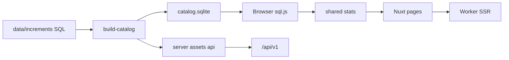

# 架构

[English](architecture.md) | **简体中文** | [繁體中文](architecture.zh-Hant.md) | [日本語](architecture.ja.md)

初音未来演唱会曲目统计：SQL 目录为源、浏览器内聚合，Worker 负责 SSR 与少量 API。

**没有 D1，也没有 R2。** 目录是构建出的 SQLite 文件（`public/data/catalog.sqlite`）。搜索只在本地目录上进行（Worker 不再按需查 VocaDB）。

## 技术栈

- Nuxt 4（`app/`）、Nuxt UI 4、Tailwind CSS 4
- 共享 TypeScript：`shared/`（统计、歌单、i18n、译名）
- 构建期 better-sqlite3；浏览器 sql.js
- 生产 Nitro preset：`cloudflare_module`

## 模块

| 路径 | 职责 |
| --- | --- |
| `data/schema.sql` + `data/increments/` | 目录事实来源 |
| `scripts/vocadb/*` 与派生/报表脚本 | 离线数据管道 |
| `scripts/build-catalog.ts` / `build-api.ts` | 产出 sqlite 与 `/api/v1` 资源 |
| `shared/*` | UI、API 构建与测试共用的计数规则 |
| `app/*` | 页面；客户端加载目录 |
| `server/api/v1/*` | 基于构建期 JSON 的动态筛选 |
| 反馈 / 后台 / 分析 | 维护者能力（Cloudflare 绑定） |

界面语言：`zh` / `zh-Hant` / `ja` / `en`（`shared/i18n/`）。

## 数据流

## Cloudflare 与本地

| 能力 | 需要 CF？ |
| --- | --- |
| 排行 / 时间线 / 搜索 | 否 |
| `pnpm test` / 重建目录 | 否 |
| 部署 Worker | 是 |
| 反馈 KV / Access 后台 / Analytics Engine | 是 |

见 [local-development.zh-CN.md](local-development.zh-CN.md) 与 [cloudflare.zh-CN.md](cloudflare.zh-CN.md)。

## 更深的文档

- 采编规则与文件格式：[data-pipeline.zh-CN.md](data-pipeline.zh-CN.md)
- 已知数据问题：[data-issues.md](data-issues.md)
- 历史设计笔记：[design.md](design.md)

## 维护者协作（可选）

本仓库常用 `~/projects/full-stack/miku-concert-stats.worktrees/<branch>` 下的 git worktree。外部贡献者可用普通 clone / 分支流程。并行 `vp dev` 时用 `--port` 选空闲端口即可。
