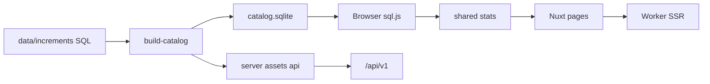

# 架構

[English](architecture.md) | [简体中文](architecture.zh-CN.md) | **繁體中文** | [日本語](architecture.ja.md)

初音未來演唱會曲目統計：以 SQL 目錄為源、瀏覽器內聚合，Worker 負責 SSR 與少量 API。

**沒有 D1，也沒有 R2。** 目錄是建構出的 SQLite 檔（`public/data/catalog.sqlite`）。搜尋只在本地目錄上進行（Worker 不再按需查 VocaDB）。

## 技術棧

- Nuxt 4（`app/`）、Nuxt UI 4、Tailwind CSS 4
- 共享 TypeScript：`shared/`（統計、歌單、i18n、譯名）
- 建構期 better-sqlite3；瀏覽器 sql.js
- 生產 Nitro preset：`cloudflare_module`

## 模組

| 路徑 | 職責 |
| --- | --- |
| `data/schema.sql` + `data/increments/` | 目錄事實來源 |
| `scripts/vocadb/*` 與派生/報表腳本 | 離線資料管道 |
| `scripts/build-catalog.ts` / `build-api.ts` | 產出 sqlite 與 `/api/v1` 資源 |
| `shared/*` | UI、API 建構與測試共用的計數規則 |
| `app/*` | 頁面；客戶端載入目錄 |
| `server/api/v1/*` | 基於建構期 JSON 的動態篩選 |
| 回饋 / 後台 / 分析 | 維護者能力（Cloudflare 綁定） |

介面語言：`zh` / `zh-Hant` / `ja` / `en`（`shared/i18n/`）。

## 資料流

## Cloudflare 與本地

| 能力 | 需要 CF？ |
| --- | --- |
| 排行 / 時間線 / 搜尋 | 否 |
| `pnpm test` / 重建目錄 | 否 |
| 部署 Worker | 是 |
| 回饋 KV / Access 後台 / Analytics Engine | 是 |

見 [local-development.zh-Hant.md](local-development.zh-Hant.md) 與 [cloudflare.zh-Hant.md](cloudflare.zh-Hant.md)。

## 更深的文件

- 採編規則與檔案格式：[data-pipeline.zh-CN.md](data-pipeline.zh-CN.md)（簡體中文）
- 已知資料問題：[data-issues.md](data-issues.md)
- 歷史設計筆記：[design.md](design.md)

## 維護者協作（可選）

本倉庫常用 `~/projects/full-stack/miku-concert-stats.worktrees/<branch>` 下的 git worktree。外部貢獻者可用一般 clone / 分支流程。並行 `vp dev` 時用 `--port` 選空閒埠即可。
