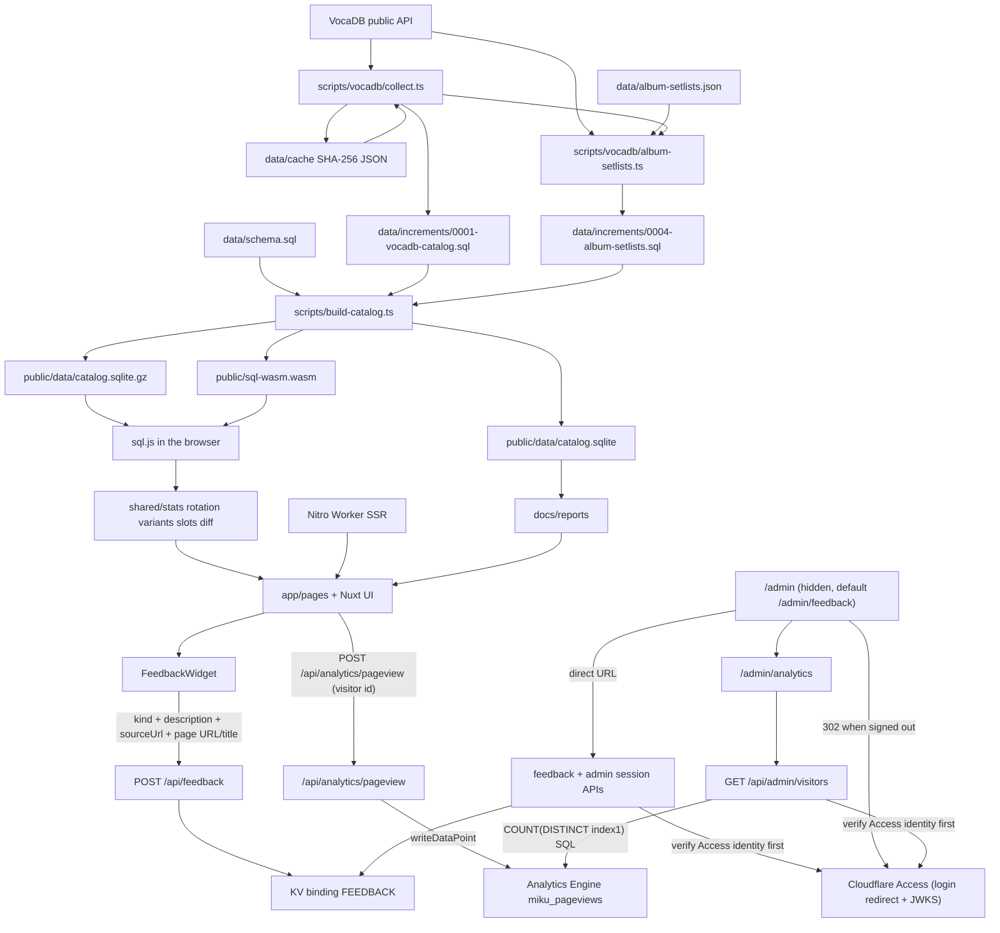

# Data pipeline and configuration notes

> Maintainer reference for how the catalog is collected, built, and wired. See [architecture.md](architecture.md) for the system overview, [local-development.md](local-development.md) for local commands, and [cloudflare.md](cloudflare.md) for deploy and admin setup. This document consolidates the former Simplified Chinese-only pipeline notes.

This project tallies setlists from Crypton-hosted Hatsune Miku concerts and compares repertoire across shows, series, and years in the browser. Day-to-day aggregation does not run on the server. The Cloudflare Worker only does first-paint SSR and a few dynamic `/api/v1`, feedback, and admin routes. Song search and stats run against the local catalog in the browser and no longer hit off-site APIs on demand.

Design constraints live in [design.md](design.md). This file describes how the current code actually runs. Confirmed but still-unfixed data defects are listed in [data-issues.md](data-issues.md).

Included series are fixed in `scripts/vocadb/collect.ts` as VocaDB release-event series ids (`SERIES_IDS`):

| id | Series name in the catalog |
| --- | --- |
| 81 | 初音ミク「マジカルミライ」 |
| 82 | MIKU EXPO |
| 173 | MIKU WITH YOU |
| 256 | 初音ミクシンフォニー |
| 219 | 初音ミクライブパーティー |
| 204 | SNOW MIKU LIVE! |
| 255 | 初音ミク×鼓童 |

**Manual additions go in one file.** `data/increments/0005-manual-catalog.sql` is the only manual-addition increment. Every statement is `INSERT OR IGNORE` and runs after `0001`, because `pnpm collect` first clears and rewrites the catalog tables. It covers shows and series that VocaDB lacks, or that the collector cannot reach:

- 2010-03-09 「ミクの日感謝祭39's Giving Day」（VocaDB event 2520, no upstream `seriesId`, `seriesNumber` 0), recorded by `STANDALONE_EVENTS` in `scripts/vocadb/collect.ts` as `初音ミクライブパーティー` 2010.
- Series 255 (初音ミク×鼓童): 2017 / 2018 / 2023 / 2026 have setlists; the 2020 show is marked cancelled upstream, with no date or setlist.
- MIKU WITH YOU 2026 Chengdu (2026-12-26, id `3000000001`): upstream series 173 only had Shanghai; Chengdu was announced when Shanghai closed, so the row has to be added by hand.
- デコミク LIVE starring 初音ミク『Hello』（VocaDB event 9401, empty `seriesId`, missed by the series loop), plus local series `900000000` and empty song list 24530.
- Standalone shows with no VocaDB event at all: ミクFES '09（夏）/ MIKU FES '24（春）、夏の終わりの39祭り、夏祭初音鑑（Osaka / Tokyo）、GALAXY LIVE 2020 / 2021、LAWSON 50th Anniversary Special LIVE、ポケモン feat. 初音ミク VOLTAGE Live, ids `3000000002`–`3000000010`, local series ids starting at `900000001`.

Performance ids that do not exist on VocaDB start at `3_000_000_000` (`LOCAL_PERFORMANCE_ID_BASE` in `shared/repertoire.ts`). `source_url` points at the schedule or announcement, not `vocadb.net/E/{id}`, and `vocadb_status` is `NULL`; the show page therefore labels the button “Show source”. Shows that have not happened yet get `upcoming` in `data/performance-setlists.json` under `statuses.<id>`, which is derived into `performance_status`. 夏祭初音鑑 per-song tables come from the matching nine files under `data/wiki-raw/`; schedule and session rows come from wiki or official after-reports in `0008`. It is a “preview + official” two-part run (Osaka 8/3–8/7, five days, 27 sessions; Tokyo 8/21–8/29, nine days, 38 sessions; 14 days and 65 sessions in total). The catalog folds those into matinee/evening rows and records the real session counts in the performance `note`. After `pnpm collect` writes the same upstream rows into `0001`, the matching statements become no-ops; shows with no VocaDB event stay in this file.

**Manual corrections go in a different file.** `data/increments/0011-manual-corrections.sql` holds every `UPDATE` / `DELETE` against upstream rows: the display name of 13120 becomes `MIKU WITH YOU 2026 in Shanghai` (upstream had only Shanghai then, and the two cities could not be told apart once Chengdu was added), plus two version-chain merges (`389595` → `10951`, `2925` → `295872`). It runs after `0001`, `0004`, and `0005`, so it still applies after `pnpm collect` rewrites the catalog. Every statement is idempotent.

`data/increments/0012-song-english-names.sql` is the **only** English-title file. It covers rows VocaDB left without an English name, and rows whose encyclopedia spelling disagrees with VocaDB (`アイ` `AI` → `EYE`, `げんてん` `Origin` → `Genten`, `ビバハピ` `Viva Happy` → `VIVA HAPPY`, and so on). All statements are repeatable `UPDATE`s. Since 2026-11-08 every empty `name_en` is filled here: VocaDB’s English name when it has one, otherwise romaji or the song’s own Latin title (`ジェミニ` → Gemini, `ロキ` → ROKI, `De Los Santos`). Hand-registered classical / Kodo titles (`2000000001`–`2000000023`) also get English titles in this file. The last increment that inserts `songs` rows is `0009` (two Blocks), so when this file runs in name order after `0001`, VocaDB songs, songs added in `0009`, and the local hand-registered songs in that file (`2000000024`–`2000000029`) already exist. Chinese titles stay only in `data/song-titles.zh-CN.json`. English titles go into `songs.name_en`, so `shared/lookup.ts` search can hit English as well.

`data/song-aliases.json` is the hand file for **Japanese display names and alternate spellings**. When upstream `songs.name` is unusable (for example 404329’s default name is the emoji `🔪、🔪、🔪`), the catalog is left alone and a `language: "ja"` alias is registered. `shared/song-aliases.ts` validates this; `japaneseAliasTitle` prefers the `ja` alias over `name_ja` / `name` for display, and `songAliasTitles` adds every alias to search (client `shared/lookup.ts`, and the `aliases` field from `scripts/build-api.ts`). `en` aliases are search-only; the canonical English name still comes only from `0012`. Chinese titles do not go in this file.

**Increment files are layered by who generates them**, not piled as dated micro-files:

- **Generated** (do not edit by hand; rerun the script): `0001` catalog collect, `0004` album-setlist slots, `0006` vocalists, `0007` producers, `0008` show setlists, `0009` encyclopedia songs (two Blocks), `0013` show-location countries (from `data/show-locations.json`).
- **Hand-maintained**: `0005-manual-catalog.sql` adds shows and series missing from VocaDB, `0011-manual-corrections.sql` corrects or merges upstream rows, `0012-song-english-names.sql` fills English titles.

The numeric prefix only decides run order. New manual data goes into the matching hand file; do not add a new `00xx-*.sql`. All three hand files run after `0001`, and their statements are idempotent.

## Stack

- **Nuxt 4.6**, with `srcDir` `app/`. `shared/`, `scripts/`, `tests/`, `server/`, and `data/` stay at the repo root. `app/**` imports pure logic through `~~/shared/*`.
- **Nuxt UI 4 + Tailwind CSS 4**. `nuxt.config.ts` registers `@nuxt/ui`. Color tokens in `app/app.config.ts` bind `primary: miku` and `secondary: magenta`; scales live in `@theme` in `app/assets/css/main.css`. Charts use Nuxt UI’s `UChart`, which wraps `@tanstack/charts` (a Nuxt UI peer; this repo installs `^1` explicitly and does not hand-write SVG charts).
- **Dark-first, following the system by default.** `@nuxtjs/color-mode` (registered by Nuxt UI) adds `.dark` on `html`. The header `UColorModeButton` toggles and remembers the choice.

## Directories and modules

### Collect and SQL

`scripts/vocadb/collect.ts` walks the `SERIES_IDS` (and `STANDALONE_EVENTS`) against the VocaDB public API, caches raw JSON under `data/cache/` by SHA-256, and emits `data/increments/0001-vocadb-catalog.sql`. `data/schema.sql` defines tables. Later increments layer generated and hand data as described above. `scripts/build-catalog.ts` applies schema + increments into `public/data/catalog.sqlite` and a gzip sibling.

### Dev server `vite.config.ts` and `scripts/dev.ts`

`pnpm dev` / `vp run dev` (`tsx scripts/dev.ts`) builds the catalog first, then starts Nuxt. `nuxt.config.ts` defaults to port `3939`; Nuxt picks the next free port when that one is taken. Read the printed `Local:` URL — do not pre-assign `--port`.

### Shared logic `shared/`

Counting rules, setlist slots, rotation, title/place/character lookup, and timeline aggregation live here so the UI, `/api/v1` asset build, and tests share one implementation.

### Pages, components, and the server

List pages share one table shell and character chips; a page only decides columns, rows, and cell content (issue #26):

- `TableSection.vue`: title / count / blurb plus a unified `UTable` shell. Default `fill` uses `useRankingTableHeight` to fill the viewport with a sticky header; `fill=false` is for in-card tables. It standardizes `th/td` padding, `ranking-scroll`, `USkeleton` loading, and `UEmpty`, and forwards named cell slots to `UTable`. While `loading` is true it does not print `count`, so a count computed from empty data does not flash next to the skeleton. Optional `virtualize` switches `UTable` to row virtualization (only the homepage ranking uses it, because it needs the fixed height from `fill`).
- `PageSkeleton.vue`: body skeleton for detail pages, holding the header and table positions until the catalog has been read.
- `CharacterChip.vue` / `CharacterChips.vue`: performer chips. Border and wash come from official colors in `characters.json`. Folding happens only at tablet width (Tailwind `md`..`lg`, 768px–1023px): the first `limit` (default 3) chips show, the rest go into a `+N` bubble. Below `md` and at `lg` and up, every chip wraps and `+N` is hidden. Breakpoints are class names (`md:hidden lg:inline` / `max-md:hidden lg:hidden`), not viewport JS, so SSR and hydration match. `fold="never"` is for headers and cards that can wrap at every width. `CharacterChips` passes the current-locale display name as `label`; `key` and colors stay on the canonical name. Roles with no localized name show the Japanese name. Non-character credits use `UBadge`.
- `SortableHeader.vue` + `useSortableHeader.ts`: shared ghost buttons and sort icons for sortable headers.
- `FilterField.vue`: `UFormField`-wrapped filter labels, replacing hand-written `<label>`.

`UTable` keeps the `meta.rowspan` / `meta.class` convention (`ShowSetlistTable`, `SetlistTable` merge replacement songs that share a slot number). The “data table” tab on `/raw` is still a hand-written `<table>`: columns come from the catalog schema, the same shell and empty state are reused, and cells stay raw.

| Route | File | Role |
| --- | --- | --- |
| `/` | `app/pages/index.vue` | Ranking. `UTable` + TanStack sorting with row virtualization. Counts by session (default) or by event; filters for series, year, broadcast, medley, character, and producer are written to the URL (`mode=event`, `producer`, `q`). Merged-version rows show “includes N versions” (N includes the original). The producer column shows names before `feat.`, each linking to `/producers/{name}`. The singer column is min-width 236px and only folds `+N` at tablet width. The show-count column is the deduped event count and is hidden in event mode. The song column is capped at 288px. |
| `/timeline` | `app/pages/timeline/index.vue` | Timeline charts aggregated in the browser by `shared/timeline.ts`: stacked session bars by series, character-song counts (optional chorus split; “Other” merges color only), new vs returning songs, a series gantt, and tour-city migration. Filters and the `chart` choice live in the URL. At `rail` (91rem) and above, the chart directory is a sticky left rail with filters beneath it; narrower viewports merge directory and filters into one lower-left floating button (`TimelineFilters.vue` / `TimelineFilterMenu.vue`). The sticky layer needs its own `z-30` so later `relative` controls in `<main>` cannot cover the panel. Wide panels apply changes instantly with no confirm button; narrow panels can fill the viewport. |
| `/series`, `/shows`, `/songs`, `/producers`, `/cities`, `/search`, `/report`, `/raw` | corresponding `app/pages/*` | Catalog browsing, search, setlist-diff report, and the dev-only raw browser (`/raw` is omitted from production builds). |
| `/admin/*` | `app/pages/admin/*` | Maintainer inbox, data overview, first-party analytics, system status. Hidden; unauthenticated visits are redirected by Access. |

### Public read-only JSON API `/api/v1`

Build-time assets from `scripts/build-api.ts` plus a few dynamic filters. The site itself reads `catalog.sqlite` in the browser; `/api/v1` is for external consumers.

### First-party visitor analytics (Analytics Engine)

The browser keeps a random visitor id in `localStorage` and `POST`s one page view per navigation to `/api/analytics/pageview`. The Worker writes `writeDataPoint` into the `PAGEVIEWS` Analytics Engine dataset (`miku_pageviews`). `/admin/analytics` queries distinct visitors through the Analytics Engine SQL API. Account vars and the analytics token stay in the dashboard / `.dev.vars`, not in git.

### Feedback and admin identity

`POST /api/feedback` stays public and does not check identity; on success it returns `{ ok, id }`. Admin list / detail / status routes all `await assertFeedbackIdentity(event)` in `server/utils/feedback.ts` before any KV access. Any failure (missing headers, empty bindings, bad signature, claim mismatch, unreachable JWKS) throws the same `401 Unauthorized` with `data: null` and no counts or reasons. Empty `ACCESS_TEAM_DOMAIN` or `ACCESS_AUD` also 401s (fail closed). Verified `sub` / `email` are used only inside the Worker and are not logged; the admin UI shows the email only through the Access-protected session route.

`GET /api/feedback/list` returns the newest 50 rows (max `limit` 200) newest-first, each with `status`. `GET /api/feedback/:id?receivedAt=<ISO>` reads one row. `POST /api/feedback/status` accepts `{ id, receivedAt, status }`, rewrites the same KV key with the same `FEEDBACK_TTL_SECONDS`, and only allows `open` / `resolved` (missing `status` on old rows is treated as `open`).

The inbox offers All / Open / Resolved filters, counts from the already-loaded page (no second request), and client-side search over description, page title, page URL, and source URL. There is no delete or archive: KV is an append-only log, rows expire 180 days after submit via TTL, and keeping the original description matters more than reclaiming space.

## Data flow

## Configuration and manifest files

How to fill production `wrangler.toml` bindings is documented in [cloudflare.md](cloudflare.md). Field meaning is recorded here.

### `wrangler.toml`

Besides `name`, `compatibility_date`, and `compatibility_flags`:

- `[[kv_namespaces]]`: `binding = "FEEDBACK"`, `id` from `pnpm exec wrangler kv namespace create FEEDBACK`. `nuxt build` copies this into `.output/server/wrangler.json`. Recreate and replace the id after changing accounts or deleting the namespace.
- `[vars] ACCESS_TEAM_DOMAIN` / `ACCESS_AUD`: Access team domain (for example `example.cloudflareaccess.com`, without `https://`; a leading `https://` is normalized) and the application Audience tag. Real production values belong in the Cloudflare dashboard or local `.dev.vars` (do not commit). **If either is empty, every admin API returns 401 with no payload**, so a missing fill only locks the admin UI; it does not leak feedback.
- Manual Access setup: in Zero Trust > Access > Applications, create a self-hosted application on the Worker hostname. Destination paths must include at least `/admin`, `/admin/*`, `/api/admin/*`, and `/api/feedback/*`, with a policy that allows only maintainer emails. Then put that application’s AUD and the team domain in `[vars]` and redeploy. `/admin` and `/admin/*` let Access finish the page login redirect at the edge and let the Worker-built login URL return to the right path. `/api/admin/*` covers the session API. Do **not** write `/api/feedback*`: that would also put public `POST /api/feedback` behind Access and visitors could not submit reports. `/api/feedback/*` covers only the admin `list` / `status` / `<id>` paths.

### Hand JSON manifests under `data/`

- `data/song-variants.json` — version groups to merge in rankings.
- `data/producer-flags.json` — producer attribution overrides.
- `data/song-notes.json` — per-song notes shown in the UI.
- `data/setlist-merges.json` — setlist merge decisions.
- `data/album-setlists.json` — official album programs used when a live setlist is missing; `scripts/vocadb/album-setlists.ts` emits increment `0004`.
- `data/show-locations.json` — venue / city / country fills; `0013` is generated from this file and only writes blank `country_code` values.
- `data/song-titles.zh-CN.json` — Simplified Chinese song titles (UI translation data; not removed by the English-docs policy).
- `data/song-aliases.json` — Japanese display aliases and extra search spellings, as above.
- `data/song-titles.zh-Hant.json` — Traditional Chinese song titles.
- `data/place-names.zh-CN.json`, `data/place-names.zh-Hant.json`, `data/place-names.en.json` — place-name translations.
- `data/series-titles.zh-CN.json`, `data/series-titles.zh-Hant.json`, `data/series-titles.en.json` — series-title translations.
- `data/characters.json` — canonical character names and official colors.
- `data/characters.zh-CN.json`, `data/characters.zh-Hant.json`, `data/characters.en.json` — character display names.
- `data/venue-names.en.json` — English venue names.

These translation JSON files are **user-facing localization**, not parallel repo docs. Keep them.

## Run, build, test, deploy

Local install and `pnpm dev` / `vp dev` are described in [local-development.md](local-development.md). `pnpm test`, `pnpm lint`, and `pnpm typecheck` do not need Cloudflare. `pnpm build` plus a production deploy does.

Production deploy is `npx wrangler deploy`. Non-`main` Worker Previews use `npx wrangler preview` (the old `versions upload` path is deprecated). `wrangler.toml` must include a `previews` block, which may be empty; previews do not inherit production bindings. A maintainer can publish a non-production URL with `pnpm exec wrangler preview` without the dashboard **Set up Worker Previews** / **Enable Preview Builds** switch. Those switches are only for automatic Workers Builds PR preview comments and are a one-time irreversible migration — do not enable them without approval. Details are in [cloudflare.md](cloudflare.md).

### GitHub Actions

`.github/workflows/ci.yml` runs lint, typecheck, tests, and catalog checks on pull requests and on pushes to `main`. `.github/workflows/weekly-collect.yml` is the scheduled VocaDB collect.

## Collaboration conventions

### Finish means commit

When a unit of work is done, commit it on the feature branch. Do not leave finished work only in the worktree.

### One worktree per development task

See `.cursor/rules/git-worktree.mdc` and `.cursor/skills/continue/SKILL.md`. Create `~/projects/full-stack/miku-concert-stats.worktrees/<branch>` from `origin/main` and register the folder in `miku-concert-stats.code-workspace`. Do not develop on the `main` worktree. Parallel local preview servers are started without a hand-picked port; report the URL Nuxt prints.

### Commit scope

`git add` only the paths this task changed. Do not `git add -A`. Use a short imperative English subject and no co-author trailer.

### Local server for page work

Start `vp run dev` (or `pnpm dev`) in that worktree and tell the reviewer the printed local URL. The server hot-reloads; a hard refresh is needed only after `public/data/catalog.sqlite.gz` is rebuilt. If a Nuxt lock conflicts across worktrees, `NUXT_IGNORE_LOCK=1` can bypass a stale `.nuxt` lock.

### Leave visual style checks to the reviewer

Do not open a browser or take screenshots only to self-check styling. Describe the files, classes, and knobs you changed, and let the reviewer look. Values the reviewer has already changed by hand stay as they set them. See `.cursor/rules/ui-style-review.mdc`.

`.nuxt`, `.output`, and `public/data/catalog.sqlite*` are build/dev artifacts, already gitignored, and must never be committed.
