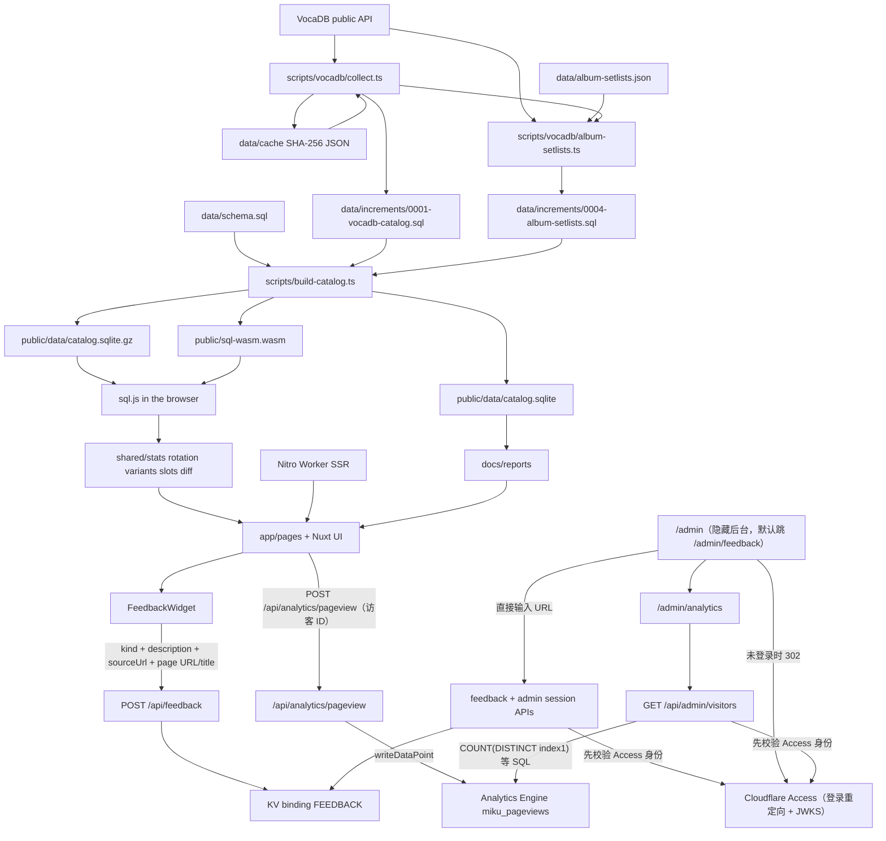

# 数据管道与配置细则

> 本文件是维护者向的详细说明（简体中文）。系统概览见 [architecture.zh-CN.md](architecture.zh-CN.md)；
> 本地开发见 [local-development.zh-CN.md](local-development.zh-CN.md)；Cloudflare 部署与后台见 [cloudflare.zh-CN.md](cloudflare.zh-CN.md)。
> English / 繁體 / 日本語 entry docs point here for the full data-pipeline reference until parallel translations exist.

统计 Crypton 主办的初音未来演唱会歌单，并在浏览器里比较各场、各系列、各年份的曲目构成。日常聚合不在服务器上跑。Cloudflare Worker 只做首屏 SSR 与少量动态 `/api/v1` / 反馈 / 后台接口；曲目检索与统计都在浏览器本地目录上完成，不再按需请求站外。

设计约束见 [docs/design.md](design.md)。本文件描述当前代码怎么跑。已确认但尚未修复的数据缺陷汇总在 [docs/data-issues.md](data-issues.md)。

收录系列由 `scripts/vocadb/collect.ts` 的 `SERIES_IDS` 固定为 VocaDB release-event series id：

| id | 当前目录中的系列名 |
| --- | --- |
| 81 | 初音ミク「マジカルミライ」 |
| 82 | MIKU EXPO |
| 173 | MIKU WITH YOU |
| 256 | 初音ミクシンフォニー |
| 219 | 初音ミクライブパーティー |
| 204 | SNOW MIKU LIVE! |
| 255 | 初音ミク×鼓童 |

**手工补录走一个文件。** `data/increments/0005-manual-catalog.sql` 是目录里唯一的手工补录文件，全部用 `INSERT OR IGNORE` 写在 `0001` 之后，因为 `pnpm collect` 会先清空并重写目录表。它收录 VocaDB 缺条目、或采集器走不到的场次与系列：

- 2010-03-09 的「ミクの日感謝祭39's Giving Day」（VocaDB 事件 2520，上游无 `seriesId`、`seriesNumber` 为 0），由 `scripts/vocadb/collect.ts` 的 `STANDALONE_EVENTS` 记作 `初音ミクライブパーティー` 2010。
- 255（初音ミク×鼓童）：2017 / 2018 / 2023 / 2026 四场有歌单，2020 场次上游标为取消、没有日期与歌单。
- 未来有你 2026 成都站（2026-12-26，id `3000000001`）：上游系列 173 只有上海站，成都站在上海站收官时公布，只能人工补行。
- デコミク LIVE starring 初音ミク『Hello』（VocaDB 事件 9401，`seriesId` 为空，系列循环走不到），连同本地系列 900000000 与空 song list 24530。
- VocaDB 完全没有 event 的独自演出：ミクFES '09（夏）/ MIKU FES '24（春）、夏の終わりの39祭り、夏祭初音鑑（大阪公演 / 東京公演两场）、GALAXY LIVE 2020 / 2021、LAWSON 50th Anniversary Special LIVE、ポケモン feat. 初音ミク VOLTAGE Live，id 为 `3000000002`–`3000000010`，本地系列 id 从 `900000001` 起。

VocaDB 没有的演出 id 从 `3_000_000_000` 起（`shared/repertoire.ts` 的 `LOCAL_PERFORMANCE_ID_BASE`），`source_url` 指向日程／公告来源而不是 `vocadb.net/E/{id}`，`vocadb_status` 为 `NULL`；演出页据此把按钮显示成「演出来源」。尚未举行的场次在 `data/performance-setlists.json` 的 `statuses.<id>` 写 `upcoming`，派生进 `performance_status`。夏祭初音鑑 的逐曲表来自 `data/wiki-raw/` 下对应的 9 个文件，日程与场次从百科或官方 after report 写入 `0008`；它是「先行 + 正式」两段（大阪 8/3–8/7 五天 27 场、东京 8/21–8/29 九天 38 场，合计 14 天 65 场），目录按日场/夜场两层折算并在演出 `note` 里写明真实场次数。`pnpm collect` 把同一批上游行写进 `0001` 后，对应语句自动成为空操作；VocaDB 没有 event 的场次则一直由这个文件承担。

**人工更正走另一个文件。** `data/increments/0011-manual-corrections.sql` 集中所有对上游行的 `UPDATE` / `DELETE`：13120 的显示名改成 `MIKU WITH YOU 2026 in Shanghai`（上游当时只有上海一站，加了成都站后两者无法区分），以及两条版本链合并（`389595` → `10951`、`2925` → `295872`）。它写在 `0001`、`0004`、`0005` 之后，`pnpm collect` 重写目录后仍然生效；每条语句都幂等，第二次执行不再改动任何行。

`data/increments/0012-song-english-names.sql` 是**唯一**的英文名文件：VocaDB 没给英文名的行、百科写法与 VocaDB 不一致的行（`アイ` 的 `AI` → `EYE`、`げんてん` 的 `Origin` → `Genten`、`ビバハピ` 的 `Viva Happy` → `VIVA HAPPY` 等）全在这里，只写可重复执行的 `UPDATE`。2026-11-08 起，所有 `name_en` 为空的行都在这里补齐：VocaDB 有英文名的按 VocaDB 写，VocaDB 自己也为空的按罗马字或曲目自带的拉丁原名写（`ジェミニ` → Gemini、`ロキ` → ROKI、`De Los Santos`），手工登记的古典 / 鼓童曲目（`2000000001`–`2000000023`）也在同一个文件里给出英文题名。最后一个插入 `songs` 行的增量是 `0009`（两个 Block），所以这个文件在 `0001` 之后按文件名顺序执行时，VocaDB 曲目、`0009` 补的歌与其中手工登记的本地曲目（`2000000024`–`2000000029`）都已经存在。中文名仍只写在 `data/song-titles.zh-CN.json`，英文名进 `songs.name_en`，`shared/lookup.ts` 的检索因此也能命中英文。

`data/song-aliases.json` 是**日文显示名与备用写法**的手工文件：上游 `songs.name` 不可用（例如 404329 的 default name 是 emoji `🔪、🔪、🔪`）时不改 catalog，而是登记一条 `language: "ja"` 的别名；`shared/song-aliases.ts` 校验，`japaneseAliasTitle` 让 `ja` 别名优先于 `name_ja` / `name` 显示，`songAliasTitles` 把全部别名加进检索（客户端 `shared/lookup.ts`、API `scripts/build-api.ts` 的 `aliases` 字段）。`en` 别名只参与检索，规范英文名仍只来自 `0012`；中文名不进这个文件。

**增量文件分层。** `data/increments/` 按「谁生成」分两类，不再按日期堆积小文件：

- **生成物**（不要手改，重跑脚本）：`0001` 采集目录、`0004` 专辑曲目补位、`0006` 出演声库、`0007` 制作人、`0008` 场次歌单、`0009` 百科曲目（两个 Block）、`0013` 演出地点国家（由 `data/show-locations.json` 生成）。
- **手工维护**：`0005-manual-catalog.sql` 补录 VocaDB 没有的场次与系列，`0011-manual-corrections.sql` 更正或合并上游行，`0012-song-english-names.sql` 补英文名。

数字前缀只决定执行顺序；新的人工数据加进对应的手工文件，不再新建 `00xx-*.sql`。三条手工文件都写在 `0001` 之后，且语句幂等。

## 技术栈

- **Nuxt 4.6**，`srcDir` 为 `app/`。`shared/`、`scripts/`、`tests/`、`server/`、`data/` 留在根目录，`app/**` 通过 `~~/shared/*` 引用纯逻辑。
- **Nuxt UI 4 + Tailwind CSS 4**。`nuxt.config.ts` 注册 `@nuxt/ui`，颜色 token 在 `app/app.config.ts` 绑定为 `primary: miku`、`secondary: magenta`，色阶定义在 `app/assets/css/main.css` 的 `@theme`。图表用 Nuxt UI 自带的 `UChart`，它包的是 `@tanstack/charts`（Nuxt UI 的 peer dependency，本仓库在 `dependencies` 里显式安装 `^1`，不自己写 SVG 图表）。
- **深色优先，默认跟随系统**。`@nuxtjs/color-mode`（由 Nuxt UI 注册）在 `html` 上加 `.dark`；页眉的 `UColorModeButton` 切换并记住选择。
- **字体不联网**：`ui.fonts: false`，使用系统字体栈，避免构建期请求字体服务。
- **图标本地打包**：`@iconify-json/lucide` + `icon.clientBundle.scan`，SSR 首屏不依赖 Iconify API。
- **Nitro `cloudflare_module`**：`deployConfig: true`、`nodeCompat: true`，产物写到 `.output`。

## 目录与模块

### 采集与 SQL

`scripts/vocadb/client.ts` 请求 VocaDB 公共 REST API。`User-Agent` 为 `miku-concert-stats/0.1 (+https://github.com/RJiazhen/miku-concert-stats)`。未缓存请求至少间隔 `MIN_INTERVAL_MS`（300ms），网络请求上限 `MAX_REQUESTS`（800）。缓存命中不睡眠、不计入上限。429 或 5xx 等 2 秒后重试一次。响应按 URL 的 SHA-256 存在 `data/cache/*.json`。该目录被 `.gitignore` 忽略，不提交。

`scripts/vocadb/collect.ts`（`pnpm collect`）拉取上述七个系列：系列详情、每场 `releaseEvents`、歌单分页（每页 50，`fields=Names,PVs,WebLinks`）；另外按 `STANDALONE_EVENTS` 补拉没有系列归属的场次。`scripts/vocadb/normalize.ts` 把 API 对象收成目录行。`scripts/vocadb/api-types.ts` 是这些响应的类型。

VocaDB 上没有歌单的演出可以由专辑曲目补位。`data/album-setlists.json` 为每个演出人工指定一张专辑，`scripts/vocadb/album-setlists.ts`（`pnpm collect:albums`，`pnpm collect` 末尾也会执行）只请求这些专辑的 `Tracks`，写出 `data/increments/0004-album-setlists.sql`：每张专辑一份 `song_lists` 行（`source = 'album'`、`album_id`、`medium`），曲目按碟号与轨号写进 `setlist_items`、`setlist_item_songs`，最后 `UPDATE performances ... WHERE song_list_id IS NULL` 把这批演出指向该歌单。这个条件保证 VocaDB 以后补上真歌单时专辑曲目不会覆盖它。曲目沿 `originalVersionId` 一路解析到原曲（专辑版可能是上一张专辑版本的再版，所以不能只跟一跳），统计仍记在原曲上；没有原曲的串烧保留专辑曲目的 id 与标题。VocaDB 上 2018 年以后的蓝光条目没有曲目，所以多数系列年度只能用同一年度的 CD。

写入规则：

- 名称或简介命中「配信」或 `livestream` 的场次，`shared/premiere.ts` 的 `performanceRole` 标为 `broadcast`。「Online」单独出现仍是 `show`。
- 年度首演是同一系列年度（`series_id` + `series_number`）里第一个 `role = show` 且有开始日的演出；同日取较小的 performance id。规则原文存在 `edition_premieres.rule`。
- `shared/showtime.ts` 只在场馆国家为 `JP`、且简介里恰好一条合法的 `Showtime` 或「開演」`HH:MM` 时写入 `showtime_local`、`timezone = Asia/Tokyo` 和摘录。多条钟点不写入。VocaDB 日期保持 `time_precision = day`。
- 歌单对象没有公布时间，`song_lists.announced_at` 写 `NULL`。
- `shared/medley.ts`：`songType !== Mashup` 整行计为列出的那首歌。Mashup 只有备注或网页链接里能核到至少两条其他 VocaDB 歌曲 URL（`vocadb.net/S/{id}` 或 `Song/Details/{id}`）才拆开，角色为 `component`；否则进入 `medley_quarantine`，不进入区间分母。
- `shared/placeholder-song.ts`：`isPlaceholderSong` 检查歌名与全部译名，命中 VocaDB 的占位标记（`[Placeholder song]`、`[Unknown song]`、`[Temporary song]`、`[Custom song]`、`[Out of scope song]`、`[Unknown]`，忽略大小写与首尾空白）就整行丢弃，不写入 `setlist_items` / `songs`。占位曲 15591（`???`）在初音ミク×鼓童的三份歌单里出现 14 次，代表鼓童的太鼓独奏段落，不是歌曲；不丢弃会让 `???` 排到该系列第一。歌名本身不改写，只跳过整行。
- 视频只保留 niconico、YouTube、bilibili 的 PV 链接。

`scripts/sql/emit.ts` 把行变成 SQL 字面量，每条 `INSERT` 最多 80 行。`catalogTransaction` 包在事务里，先删目录表再插入。产物是 `data/increments/0001-vocadb-catalog.sql`。

`scripts/build-catalog.ts`（`pnpm build:catalog`，`prebuild` 与 `scripts/dev.ts` 也调用它的 `buildCatalog()`）用 better-sqlite3 执行 `data/schema.sql`，再按文件名字典序执行 `data/increments/*.sql`，写出 `public/data/catalog.sqlite`，同时写一份 gzip 副本 `public/data/catalog.sqlite.gz`，并把 `sql.js` 的 `sql-wasm.wasm` 复制到 `public/sql-wasm.wasm`。这三个产物都在 `.gitignore` 里。

Cloudflare 只压缩固定内容类型，`application/vnd.sqlite3` 不在其中，所以浏览器下载 gzip 副本并用 `DecompressionStream('gzip')` 解压；不支持该 API 的浏览器退回未压缩文件。`nuxt.config.ts` 在构建时对 gzip 文件取 SHA-256 前 16 位写进 `runtimeConfig.public.catalogVersion`，下载 URL 变成 `/data/catalog.sqlite.gz?v=<hash>`；`nuxt dev` 直接读未压缩文件，避免重建后命中旧的 immutable 缓存。`routeRules` 让 Nitro 把它写进 Cloudflare 的 `_headers`：gzip 副本 `immutable` 缓存一年，未压缩文件保持 `must-revalidate` 并带上 `application/vnd.sqlite3`。

### 开发服务器 `vite.config.ts` 与 `scripts/dev.ts`

`vp dev` 是 Vite+ 的内置命令，只起一个纯 Vite 进程；本项目的页面、SSR 与 `server/api` 只存在于 `nuxt dev`。`vite.config.ts` 的 `miku:nuxt-dev-handoff` 插件在 Vite 绑好端口后关掉它，用同一个端口启动 `scripts/dev.ts`，并把 `--port` / `--host` 转发给 Nuxt（端口取自实际绑定的 `httpServer.address()`，配置端口被占用时也不会错位）；`MIKU_NUXT_DEV_CHILD` 只在子进程里设置，交接因此不会递归，子进程退出或收到 `SIGINT` / `SIGTERM` 时父进程跟着退出。

`scripts/dev.ts` 先调用 `build-catalog.ts` 的 `buildCatalog()` 重建目录（原来的 `predev` 已并入），再 `nuxt dev`；`pnpm dev` 用同一个脚本，所以两个入口行为一致。`vite.config.ts` 用 `vite-plus` 的 `defineConfig`（项目依赖里有 `vite-plus`）：Nuxt 的 `B5004` 检查只放行导入了 `vite-plus` 的根 `vite.config.ts`，同时 Nuxt 不会把这份配置并进自己的 Vite。这里的 `logLevel: 'warn'` 是为了不打印那个马上就被关闭的 Vite 地址。

### 共享逻辑 `shared/`

`shared/types.ts` 定义 `Queryable`、目录行和 `Catalog`。`shared/catalog.ts` 的 `loadCatalog` 用只读 `SELECT` 把表读成对象。聚合在 TypeScript 里做，不在 SQL 里做。Node 脚本用 better-sqlite3，浏览器用 sql.js，两边都走这个加载器。

**三级术语（与 VocaDB、数据库列和页面文案的对应关系）**

| 层级 | 含义 | 数据来源 | 页面 |
| --- | --- | --- | --- |
| 系列 | 一个演唱会系列，如魔法未来 | `series` 行，`vocadb.net/Es/{id}` | 排行的系列筛选、各页标题、`/series/{id}` |
| 演出 | 一个城市站，即 VocaDB 的一个 release event | 一条 `performances` 行，`vocadb.net/E/{id}`；`series_id` 与 `series_number` 说明它属于哪个系列 | `/shows/{id}`；`/series/{id}` 是该系列的演出索引 |
| 场次 | 一天，或同一天有日场 / 夜场时的半天 | 由 `start_date`–`end_date` 推导，再并上 `data/performance-setlists.json` 的 `dayNight`；日夜证据也仍可来自歌单备注 | 排行「按场次」、`/shows` 页头的场次列表、歌曲页的覆盖数 |
| 场次歌单 | 一个场次的完整曲目 | `performance_show_setlist_items`，由源歌单展开 | `/shows/{id}` 的每个场次表；开发环境 `/raw` 可浏览派生表 |

`系列年度` 是 `series_id` + `series_number` 的分组，只用于演出索引、年度首演与歌单对照，**不再**合并成一场演唱会。VocaDB 自身也是这个结构：一个 `releaseEvents` 行 = 一个演出，同一年同一系列的不同城市各有自己的事件 id。站内不改列名，`performances` 仍是一条演出，`edition_premieres` 仍存系列年度首演。

**源歌单层与场次层。** VocaDB 只为每个 release event 存**一个** `songList` 引用，同一份歌单会被多个演出共用（本目录最多 17 个），地区与场次差异只能写进行内备注。因此目录额外物化一层场次歌单：`scripts/derive-performance-setlists.ts`（`pnpm derive:setlists`）读已提交的 `0001`/`0004` 与 `data/performance-setlists.json`，用 `shared/performance-setlists.ts` 把每个源行展开到它覆盖的场次，写出 `data/increments/0008-performance-setlists.sql`。源层（`song_lists` / `setlist_items` / `setlist_item_songs`）保持 VocaDB 原样，继续供 `/report` 与开发环境 `/raw` 浏览；场次层供 `/shows`、排行与公开 skill 使用。两者都有 `source_list_id` / `source_position` 可对回。

场次层六张表：`performance_setlists`（每演出一行：源歌单、`change`、`status`、`resolution`、`source_row_count`、`day_night_dates`、`no_show_dates`、`single_show_dates`、`conflict`、`pending_review`、`note`、`page_note`）、`performance_setlist_sources`（外部来源）、`performance_show_setlists`（每场次一行）、`performance_show_setlist_items`（每场次一整串有序曲目，`song_id` 与 `medley_id` 二选一）、`medleys` / `medley_songs`（串烧，当前为空表）。外部来源只记在演出层：检索都以 performance 为基准，逐场次的特殊情况写进 `performance_setlists.note`。`note` 是给维护者看的来源与疑点，只进报告；`page_note` 是给读者看的一句话（例如「5 天共 27 场，本目录只区分日场 / 夜场」），显示在 `/shows/{id}` 页头的提示条里。

`data/performance-setlists.json` 的 `performances.<id>` 支持四组时间修正：`dayNight`（该日昼 + 夜两场）、`noShowDates`（该日只有企划展、没有 live）、`halves`（该日只有昼场或只有夜场，例如首日仅夜场）、`singleShowDates`（该日核实为只有一场）。四者都物化为 `day_night_dates` / `no_show_dates` / `single_show_dates`，场次由 `performanceSchedules` 一次算好，页面与统计直接读 `performance_show_setlists`。同一条记录还可以写 `note`（维护者用）与 `pageNote`（读者用），后者显示在演出页的「歌单说明」提示条里；一天有多于两场时（例如夏祭初音鑑 大阪 5 天 27 场）就用它说明真实场次数与本目录的折算方式。

`performances.<id>` 的 `dayNight` / `singleShowDates` / `halves` 也接受字符串 `all`，表示按演出的日期区间展开，用于「该城每天都有一场」或「每天昼夜各一场」这类整段结论。

**百科逐曲表是外包数据的主力。** 191 个演出里有 179 个的曲目逐条来自「初音ミク Wiki」（atwiki）或官方逐曲表；其余 12 个仍用 VocaDB 歌单，配官方票务页 / Fandom / 萌娘 的日程来源。每个演出都至少有一条 `performance_setlist_sources`，逐曲表行的 `songs.source_url` 指向印有该曲名的那一页。数据分三处：

- `data/wiki-raw/<key>.json`：页面表格的原始单元格（含表头），由浏览器抓取时原样落盘，便于复核。atwiki 页面用 `page` 记页号，其他站点用 `url` 记完整来源；两种都能进同一套逐行解析。
- `.cursor/skills/update-concert-data/scripts/wiki_raw_spec.py`：声明每张表的公演替标记选中哪些演出，标记可写成 `6516`、`6516#2`（第 2 个日期）、`*#1:day`（任意演出的第 1 个日期日场）等；没有 `公演替` 列、昼夜写在 `備考` 的表用 `noteMarkers`。
- `.cursor/skills/update-concert-data/scripts/wiki_tour_tables.py`：早期手工抄录的城市级表格（交响乐、2014–2020 的 EXPO / Live Party / 鼓童）。

`.cursor/skills/update-concert-data/scripts/wiki-setlists-source.py` 把三者统一成 `data/wiki-setlists.json` 的逐行数据（`title` + `when`），`.cursor/skills/update-concert-data/scripts/build-setlist-curation.py` 再按每个场次挑行、解析成 `songs` 或 `slots`。桌面上看不到的差别（同一天昼/夜、不同日期、不同城市）都落在 `slots` 上，`shared/performance-setlists.ts` 按场次键精确匹配。

这套 Python 管线（`wiki_raw_spec.py`、`wiki_tour_tables.py`、`wiki-setlists-source.py`、`fetch-wiki-songs.py`、`build-setlist-curation.py`、`confirmation-report.py`）只服务仓库内部的采编流程，因此整体放在 `.cursor/skills/update-concert-data/scripts/`，与 skill 文档同目录；根 `scripts/` 只保留构建、采集与 CI 报表脚本。

`when` 语法：`day`/`night`、`dN`（第 N 个日期）、`dN:day|night`、或不带标记（所有场次）。

曲名与 catalog 写法不同的（`DECORATER`、`右肩の蝶[39's Giving Day Edition]`、`キミぺディア`）记在 `data/wiki-title-aliases.json`。catalog 里没有的歌由 `.cursor/skills/update-concert-data/scripts/fetch-wiki-songs.py` 按标题检索 VocaDB、用作曲者排除同名翻唱后写成 `data/wiki-songs.json` 与 `data/increments/0009-wiki-songs.sql`（`INSERT OR IGNORE`，`pnpm collect` 重写 `0001` 后仍在）。仍匹配不到的行不丢弃：`data/wiki-repertoire.json` 逐条给出类别（`classical` / `traditional` / `instrumental`，或确认是 VOCALOID 歌但检索只返回翻唱时的 `vocaloid`）、作曲者和备注，`fetch-wiki-songs.py` 据此写进 `data/increments/0009-wiki-songs.sql` 的 Block 2：id 从 2,000,000,000 起免与 VocaDB 冲突，`songs.category` 标记不是 VOCALOID 歌曲，`artist_string` 只放作曲者、没有歌手，`source_url` 指向**印有该曲名的那一页**百科（不是索引页）。这样一场演出点开就是完整曲目，界面对这些行显示「非 VocaDB 曲目・类别」而不是假装缺歌手。同曲再演（`ぽっぴっぽー（Grand Finale）`）标 `skip`，只写进演出 `note`，避免重复计数。

演出没有 VocaDB 歌单但有百科逐曲表时（如交响乐 2026），`performance_setlists.source_list_id` 为 `NULL`、`source_kind = 'wiki'`，页头改为「百科逐曲表」并且不链 VocaDB。

**数据来源不再以 VocaDB 为主。** 实测 VocaDB 的场次与歌单缺漏较多（没有日夜场字段、共享歌单只靠行内备注、交响乐整年没有歌单），因此核实时按「官网 → 萌娘百科 → 初音ミク Wiki（atwiki）→ VocaDB Fandom → VocaDB 公共 API」的顺序取数，冲突时优先采用官网与百科，我们自己的派生层承担合并，不改上游。

**VocaDB 只是同级参考源。** `performances.id` / `series.id` / `songs.id` 尽量沿用它给的 id，方便外部互操作；VocaDB 没有条目时用本地保留区间（歌曲 `2_000_000_000`、演出 `3_000_000_000`、系列 `900_000_000`）。对不上、或者 VocaDB 后来改名 / 改日期 / 删条目 / 补了别的歌单，都不构成删除或回改本项目已采集记录的理由：人工补录与百科逐曲表都以 `INSERT OR IGNORE` / `UPDATE` 写在 `0001` 之后，`pnpm collect` 重写 `0001` 后仍然生效，差异记进 `docs/data-issues.md`。完整口径见 [`.cursor/rules/data-sources.mdc`](../.cursor/rules/data-sources.mdc)。

`performances.<id>.setlist` 用一份外部逐曲表**整体替换**该演出的 VocaDB 行：每首歌写 `id` / `title` / 可选 `note`（如 `メドレー：悪ノ交響曲 第2楽章`），并要求 `source` / `title` / `accessedAt` / `confidence`。派生时该演出的每个场次都用这份表，行级 `evidence = 'wiki'`，演出级 `resolution = 'external'`。id 必须存在于 catalog，构建期会校验；标题到 id 的映射由 `.cursor/skills/update-concert-data/scripts/build-setlist-curation.py` 按归一化标题解析，解析失败直接报错而不是猜。

`statuses.<id>` 记录没有歌单行的演出结果（`cancelled` / `postponed` / `upcoming`），写入 `performance_status` 表。VocaDB 的状态字段没有「已取消」，取消场次在上游仍是 `Finished` 且没有日期，所以这是唯一能表达真实结果的地方；演出页据此显示「这场演出已取消」并给出公告链接。

`lists.<songListId>` 是逐行更正，全部要求带 `source` 与 `accessedAt`：`notes`（用百科的逐日歌单改写 VocaDB 写错的城市 / 日 / 半场的备注）、`dropShows`（备注写了某场但该场其实没演，按场次 key 剔除）、`explainedLengths`（该场曲目数不同是有意为之，例如香港 23+1 安可、台湾 23+2，记下原因后不再报长度警告）、`assign` / `exclude` / `extra`（人工指定、丢弃、追加曲目）。`citiesPlayOneSetlist` 表示来源确认「每个城市只演一套节目」，此时只写城市的备注是准确的，不再标 `city-only when city has several shows`。

来源查证顺序是「VocaDB 备注 → 官方页 → 萌娘百科等 wiki → 录播」。**查到就直接采用，不再要求二次确认**：`pending_review` 只表示归属仍然悬空（没有任何来源定位到这一场，或来源之间互相矛盾），不是「来源置信度不高」。每条来源的 `url` / `accessed_at` / `confidence` / `note` 都留在 `performance_setlist_sources`，`/shows` 页脚按演出展示，`docs/setlist-confirmation.md` 第 1 节有一份汇总，只供核对来源、不需要逐条回复。

`shared/stats.ts`：

- `representativeVideo` / `representativeVideoForSongs`：某平台上未禁用的 PV 里，优先 `pvType = Original`，否则取最小的 VocaDB PV id。合并组会跨版本选一条代表投稿。
- `rankSongAppearances`：排行。`event`（按演出）对每条 `performances` 行最多计 1，同一年大阪 / 东京两个城市站各计一次；`show`（按场次，默认）直接按 `performance_show_setlist_items` 的 `show_key` 去重，因此共用歌单的替换曲不会算到没演它的场次。场次层是主数据源，只看有没有记录歌单，不看 `song_list_id` 是否存在，所以只有百科逐曲表的演出（交响乐 2026、未来有你 2026 上海等）同样计入。没有展开行的旧目录（测试夹具）回退到备注解析。默认排除 `role = broadcast` 以及名称、日文名、`series_suffix` 命中 livestream / online / オンライン / VR / 配信 的演出。每行带 `variantSongIds`，供页面标注「含 N 个版本」。
- 所有计数函数接受可选的 `SongVariantIndex`，默认不合并版本。

`shared/credit.ts` 也负责署名文本：`producerCredit` 取 `feat.` 之前的制作人，`displayArtistString` 保留完整署名，两者都过滤 VocaDB 的 `Unknown producer(s)` / `Unknown artist` 占位并返回 `null`（页面显示「未记录」）；`/raw` 的歌曲表仍用 `producerCredit` 展示原始署名，排行的「制作人」列与单曲页的版本卡片按下一段的规则取值。`scripts/vocadb/vocalists.ts`（`pnpm collect:vocalists`）请求每首歌的 `fields=Artists`，只保留 `categories` / `roles` 含 `Vocalist` 的条目，写成 `data/increments/0006-song-vocalists.sql` 的 `song_vocalists` 行（`song_id`、`name`）。`artist_string` 会把大编制合唱压成 `feat. various`（Hand in Hand 的现场翻唱实际是 KAITO、MEIKO、初音ミク、巡音ルカ、鏡音リン、鏡音レン），所以「演出角色」以这张表为先；表里没有该歌时退回 `artist_string` 的 `feat.` 名单。`SongRow.vocalists` 由 `shared/catalog.ts` 读取时拼好，`shared/characters.ts` 的 `assignCharacters` 优先用它。

`scripts/vocadb/producers.ts`（`pnpm collect:producers`）同样请求每首歌的 `fields=Artists`，把 `categories` 含 `Producer`、或 `roles` 含 `Composer` / `Arranger` / `VoiceManipulator` 的署名按 VocaDB `artist.id` 去重后，写入 `data/increments/0007-song-producers.sql` 的 `song_producers` 行（`song_id`、`artist_id`、`name`、`roles`）。`roles` 是可审计的证据：`Producer` 类别记作 `producer`，再按源顺序追加命中的角色并转小写（例如 `producer, composer`）；占位名（`Unknown producer(s)`）和没有 artist id 的署名不写入。这组条件取自 VocaDB 自身的「Producers」分区（`categories` 为 `Producer`，或角色为 Arranger / Composer / Voice manipulator；Lyricist 属于 Other artists），见 <https://wiki.vocadb.net/docs/song-entry-page> 与 <https://wiki.vocadb.net/docs/song-entry-editing>；`roles` 返回 `Default` 表示沿用 artist type 的默认角色，本身不算证据，所以这类署名只靠 `categories` 入选。因此 Publisher、Illustrator、Animator、Lyricist、Mixer、Mastering、Instrumentalist，以及只有 Label / Circle 的署名都不是制作人；`VoiceManipulator`（調声 / 調音）属于制作侧，特意保留。该增量只重写自己派生的 `song_producers`（先 `DELETE` 再 `INSERT OR IGNORE`），不触碰其他表，因此不会改动已有的音乐 / 歌单数据。

**制作人名单的规则（核对制作人数据时以这条为准）**

1. 歌曲条目里的制作人名单（`song_producers`，来自 VocaDB `fields=Artists`）为准。
2. 仅当歌曲条目没有任何制作人记录时，才用 `artist_string`（歌单里显示的署名）解析。
3. 两者冲突时显示仍按 ①，同时把冲突写进 `docs/reports/producer-conflicts.md`，人工确认后才改。

结构化名单只收录制作侧职务的证据：`Producer` 类别，以及 `Composer` / `Arranger` / `VoiceManipulator` 角色（`roles` 列保存小写证据）。Publisher、Illustrator、Animator、Lyricist、Mixer、Mastering、Instrumentalist，以及只有 Label / Circle 的署名不算制作人；`VoiceManipulator`（調声 / 調音）属于制作侧，特意保留。因此 `Tell Your World` 只显示 `kz`，不显示 VocaDB 标为 Publisher 的 `Google`；`supercell`、`OTOIRO`、`livetune`、`Various artists` 等社团、厂牌或整张合辑署名也不会混进制作人。`shared/producer-options.ts` 的 `producerNamesFor` 做单曲判断，`producerNamesForSongs` 把同一规则应用到合并版本组；`availableProducers` 从每行实际展示的 `producerList` 生成选项，筛选匹配同一名单，并写入 URL 的 `producer` 参数。

`shared/producer-conflicts.ts` 把每首歌的自由文本与结构化名单做集合比较，分成 `agree` / `structured-only` / `extra-in-text` / `extra-in-structured` / `conflicting`（两边各有对方没有的名字）。`scripts/producer-conflict-report.ts`（`pnpm report:producers`）写出 `docs/reports/producer-conflicts.md`，按冲突严重度排序，逐条列出结构化名字与 `roles` 证据、自由文本名字和精确差异，每类附「如何处理」；`--check` 供 CI 校验已提交的报告没有过期，每周工作流会重新生成并随 `docs/reports` 一起提交。报告只做记录，不改任何数据；结论要维护者确认后才落到 VocaDB 或本仓库。

`shared/song-variants.ts` 校验 `data/song-variants.json`：键是变体歌曲 id，值含 `canonical`、`kind`（`remix` / `remaster` / `voicebank` / `cover` / `language`）与可选 `note`。链式映射（canonical 本身也是变体）与自指会抛错。导出 `canonicalSongId`、`variantSongIdsOf`、`groupSongIds`。

`shared/setlist-slots.ts` 负责歌单槽位：

- `parseNoteSelectors` 把备注拆成 `{ city, day, show, half }`。`Fukuoka Day 1`、`DAY 2`、`Nighttime Shows`、`DAY 1 1st and 2nd Show` 都能识别；`Encore` 没有可用维度，返回空。
- `itemsMergeable` 判定两行是否同一槽位：演出集合不同时要求两边在日期与场次上对齐；同一场记录跨多天时，退回按备注的日期/日夜判定；任一侧没有备注时不合并。
- `groupRowsIntoSlots` 只合并**连续**且与槽位内每一行都互斥的行。

`shared/album-setlists.ts` 校验 `data/album-setlists.json`：键是 performance id，值含 `albumId`、`albumType`（`bluray` / `cd` / `dvd`）与可选 `note`。它给出合成歌单 id（`1_000_000_000 + albumId`，与 VocaDB 歌单 id 不重叠）、曲目到原曲的解析，以及中文来源文案。`albumSetlistSources` 从目录里挑出某份歌单对应的专辑，页面据此显示「歌单来自蓝光/CD《…》的曲目列表，不是 VocaDB 上该场演出的歌单」。

`shared/edition-setlists.ts` 负责跨歌单合并（`/raw` 的对照视图与 `/shows` 的单份歌单）：

- `parseSetlistMerges` 校验 `data/setlist-merges.json`（键是 `song_list_id`，值为 `group` 与可选 `note`）。
- `partitionSongLists` 把一个系列年度的歌单分成合并组与独立歌单。
- `buildSetlistDisplay` 选演出最多的歌单作骨架，其余歌单用 LCS 对齐；重复曲目折叠进已有行；最后按槽位分组并给出行号、`演出` 标签与完整演出名。每个演出都演出的行不写演出标签。

`shared/name-coverage.ts` 汇总中文曲名与角色映射的覆盖情况：按 `data/song-titles.zh-CN.json` 统计未登记中文名的歌曲，按是否演出过分开（拉丁字母标题沿用原名，不算缺口），并把 `assignCharacters` 返回的未匹配歌手写法按证据分类（`feat. various` 折叠、同时是制作人署名、非角色合成音源、待人工判断）。`scripts/name-coverage-report.ts`（`pnpm report:names`）把这个待办清单写到 `tmp/name-coverage.md`，是本地排查用的临时产物，**不进仓库、不跑 CI**；要留下结论就写进 `docs/data-issues.md`。

`shared/setlist-diff.ts` 生成差异报告：单份歌单的结构指标（行数、去重曲目、正片/安可行数、分天替换行数）、两份歌单的 LCS 与差异曲目、五级分类（`identical` / `order-only` / `count-differs` / `segment-differs` / `probably-different-program`）。`scripts/setlist-diff-report.ts` 把它写成 `docs/reports/setlist-differences.{md,csv}`，`--check` 只比对不写入，CI 使用。

`shared/event-schedule.ts` 是三级模型里的场次层：

- `performanceDates` 把 `start_date`–`end_date`（含首尾）展开为日期；缺开始日返回空，倒序或非法的结束日收为开始日，最长 14 天。
- `showsForPerformance` 每个日期一个场次；`dayNightDates` 里的日期拆成 `日场` / `夜场`。key 为 `{performanceId}:{date}` 或 `{performanceId}:{date}:day|night`，label 为 `2020-11-28` / `2023-08-11 日场`。
- `dayNightDatesFor` 从备注读日夜证据：`Daytime` / `Nighttime` / `Afternoon` / `Evening` / 昼夜 / 昼公演 / 夜公演 / `1st Show` / `2nd Show`。备注写了 `Day N` 或裸日期时只标那一天，没写则标整个演出。VocaDB 没有结构化的日夜字段（`showtime_local`、`time_evidence` 均为空），所以一天默认就是一场，只有备注证明当天有日场 + 夜场时才拆开。
- `showsForNotes` 把一行分到场次：备注写了天、半天、场次号或裸日期时收窄到对应场次；否则计入该演出的全部场次。VocaDB 一份歌单对应整个 run，这是对「同一份歌单在每一场都演」的诚实读法。
- `performanceSchedules` 为整个目录算出场次表，排行、歌曲页覆盖数和 `/shows` 页头共用。第三到第五参数 `curatedDayNight` / `curatedNoShowDates` / `curatedHalves` 接收人工核实结果：`dayNight` 把一天拆成日场 + 夜场，`noShowDates` 去掉只有企划展的日子，`halves` 指定某天只有昼场或只有夜场。`data/performance-setlists.json` 的 `performances.<id>` 经 `shared/performance-setlists.ts` 转成这三张映射，并物化到 `performance_setlists`，页面与统计都读 `performance_show_setlists`，所以口径一致。

`shared/performance-setlists.ts` 是场次层的对外入口，实现分成三个文件：`performance-setlist-curation.ts`（`data/performance-setlists.json` 的类型、解析与目录校验）、`performance-setlist-build.ts`（把源歌单展开到每个场次）、`performance-setlist-query.ts`（页面与统计读派生行、合并打印行）。模块之间的依赖是 build → curation / query，query 不依赖 build：


- `parsePerformanceSetlistCuration` 校验 `data/performance-setlists.json`（演出来源、`dayNight`、逐曲校正），`validateCurationAgainstCatalog` 再核对 id、场次 key 与日期区间。
- `buildPerformanceSetlists` 把源歌单展开到每个场次：`performanceSchedules` 得到场次 → `showsForNotes` 收窄每一行 → 按源行号排序并重新编号。`assign` 可以把一行改派给别的城市的场次，`exclude` 整行丢弃，`extra` 追加源歌单没有的曲目。
- `resolution` 取值 `vocadb-note`（备注到日期/半场）、`vocadb-shared`（整份无备注，含专辑补位）、`external`（外部来源定位）、`unresolved`（都没有）。`pending_review` 只在归属真的悬空时为 1：没有来源定位到这一场（`unresolved`）或来源之间互相矛盾（`conflict`）。`conflict` 表示与 VocaDB 或 `docs/data-issues.md` 的既有结论不一致且未裁决。
- `catalogDayNight` / `catalogSchedules` / `derivedItemSongIds` / `showSongIds` 供页面与统计共用，避免各自再解析一遍。
- `showCountsByPerformance` 给索引页（`/series`、`/series/{id}`、`/cities`）算每个演出的场次数：派生层有行就用派生层（含人工核实的昼夜拆分与剔除的展览日），没有就回退 `performanceSchedules`。`/shows` 与索引页因此在同一场演出上给出同一个数字。
- `setlistPerformanceIds` 判断一个演出「有没有歌单」：VocaDB 的 `song_list_id` 或派生层任一条。只有 `song_list_id` 会把 179 个百科来源的演出错报成「无歌单」。

`shared/setlist-review.ts` 生成待二次确认清单：A 日夜场待核实、B 曲目归属待确认、C 行数不一致、D 全份歌单无备注、E 人工校正。来源记录不再重复：它只在 `performance_setlist_sources` 与 `docs/setlist-confirmation.md` 第 1 节里各有一份。`scripts/setlist-review-report.ts`（`pnpm report:setlist-review`）写出 `docs/reports/setlist-review.md`，已存在时默认不覆盖以保护勾选，`--force` 才重写；`--check` 只校验格式（小节齐全、勾选框各占一行）。

`.cursor/skills/update-concert-data/scripts/confirmation-report.py`（`pnpm report:confirmation`，Python + uv）写出给人看的 `docs/setlist-confirmation.md`：数据来源记录、百科也没写逐日时刻的演出、本轮按百科修正的冲突、城市级定案、整份无备注、上游无歌单。每节末尾留填写区，冲突节按「原问题 / 处理 / 来源」逐条列出。`.cursor/skills/update-concert-data/scripts/build-setlist-curation.py`（`uv run`）是核实结果的唯一入口，它读 catalog 的原始备注、套用更正文案后再写出 `data/performance-setlists.json`。两份文件的分工是：`setlist-review.md` 逐条列出供程序校验格式，`setlist-confirmation.md` 按决策类型归并供人逐节回复。

`shared/rotation.ts` 解析歌单备注，把一行分到共享该歌单的场次。空备注表示该歌单的全部演出且不算不确定。备注按 `/`、`／`、逗号、顿号、分号、换行切开，`8/31` 这类日期斜杠保留。城市来自 `CITY_ALIASES`，也会从演出名推导（`MIKU EXPO 2026 Glendale`、`…」in HAMAMATSU`），所以新增城市不必先改清单。识别 `day N` / `DAY 1 1st Show` / `1日目` / `第2天`、`初日`、`千秋楽` / `最終日`、`両日` / `全日`、裸日期（`2024-08-31`、`8/31`、`8月31日`）、昼夜 / 1st·2nd show。没有写城市的 `Day N` 会落到每个城市自己的第 N 天，而不是随便挑一个城市。`reviewRotations` 再做长度一致性检查，与众数不同的演出记入 `shows`。

备注的最终分类：

- `unknown format`：看起来在选日期却落不到任何一天（例如 `Day 9`）。保留为警告；当前目录里为 0 行。
- `unmatched city`：备注写了城市，但该歌单有多场且没有这个城市。单场歌单上的城市名视为背景说明，不算警告。
- `city-only when city has several shows: N`：只写了城市，该城市在这个歌单里有 N 场。`formatRotationReason` 输出 `共 N 场`，行仍然是 `uncertain`。
- `day with day/night shows`：日期落在同日多场，或备注写明了日场 / 夜场，无法进一步区分。
- `setlist length mismatch: N vs expected M`：该场解析出的曲目数与该歌单的常见长度不同。

不是轮换信息的片段（`Encore`、乐队介绍、活动名、链接、开演时间等）不产生 reason，而是收集到 `RotationParse.info`，页面用灰色原样显示，读者不会看到解析器状态。

`shared/show-coverage.ts` 统计一首歌在一个演出里演出了几个场次，给歌曲页的出场记录用：

- 分母是该演出推导出的场次数；没有日期或没有歌单的演出没有可比的场次，不进入结果。
- 分子直接读场次层 `performance_show_setlist_items`：歌曲出现在哪些 `show_key` 就是覆盖几场，不再在运行时解析备注。没有展开行的旧目录（测试夹具）回退到 `showsForNotes`。
- 不再跨城市汇总：大阪与东京各算各的演出，一份只在东京出现的歌单不会改变大阪那行的覆盖数。
- 只对部分覆盖显示 `N 场中 M 场`（可用时附上具体场次）。全覆盖（`covered === total`）不显示任何场次说明，备注列留空（显示 `—`）：几乎每一行都是全覆盖，写 `本演出全部 N 场` 只会淹没真正需要注意的「只在部分场次唱过」。只有 1 个场次的演出同样不显示。
- 备注已经给出 `共 N 场`（`city-only when city has several shows: N`）的行不再显示覆盖数，由该警告独占数字，避免同一格出现两个不同总数。`/shows` 与 `SetlistTable` 是按演出的视图，不显示覆盖数。


`shared/name-map.ts` 是各译名文件共用的底座：`parseNameMap` 校验「原名 → 一个语言的显示名」对象（键不能为空、值不能为空、大小写不能重复），`parseNameMaps` 把简体中文、繁体中文与英文三份文件并成 `NameMaps`，`nameIn` 按语言取行，`formatLocalizedName` 处理翻译模式下的主名与原文注记。`shared/song-titles.ts` 校验并格式化中文歌名。`shared/series-titles.ts` 校验 `data/series-titles.zh-CN.json`、`data/series-titles.zh-Hant.json` 与 `data/series-titles.en.json`，按系列名查出对应语言的系列名，并把演出名里的系列标签换成译名而保留系列年度年份；没有条目的系列（如 `MIKU EXPO`）或语言为日语时原样返回。`shared/character-names.ts` 校验 `data/characters.zh-CN.json`、`data/characters.zh-Hant.json` 与 `data/characters.en.json`，按当前语言给出角色显示名（缺条目时回退规范名），并用对应的 `zh-CN` / `zh-Hant` / `ja` / `en` collation 给角色名排序。`shared/venue-names.ts` 校验只有英文的 `data/venue-names.en.json`。`shared/characters.ts` 把声库名收成角色。`shared/lookup.ts` 做目录内子串匹配。

`shared/performance-name.ts` 的 `shortPerformanceName` 去掉演出名里已由「系列」列显示的系列名与年份，留下城市、系列后缀或周年说明；匹配时兼容 `初音ミク「マジカルミライ」` + 2013 与 `初音ミク「マジカルミライ 2013」` 两种写法。

`shared/place-names.ts` 校验 `data/place-names.zh-CN.json`、`data/place-names.zh-Hant.json` 与 `data/place-names.en.json`，并按站点语言把演出名里的地点换成对应语言的写法。拉丁字母的键按整词、不区分大小写匹配，长键优先（`東京都` 先于 `東京`）；日文键还会一起吃掉结尾的「市 / 都 / 府 / 県」，否则 `大阪市` 会译成 `Osaka市`。替换先落成占位符再统一还原，所以长译名不会被后续较短的键二次替换。简体与繁体中文模式都会把地点前的 `in` / `at` 一起删掉，英文模式保留连接词并归一拼写，日语模式原样返回。

`shared/cities.ts` 把 `performances` 聚合成城市排行。城市由 `place-names.zh-CN.json` 的中文名与 `shared/rotation.ts` 的 `CITY_ALIASES` 共同识别：按 `series_suffix` → `name` → `name_ja` → `venue_name` 依次匹配，长拼写优先，所以 `Washington D.C.` 不会被 `Washington` 抢走。中文名去掉末尾「都 / 市」后作为分组键，`東京都`、`東京`、`TOKYO` 因此同组（`京都` 这类会短于两个字的名字保留后缀）。显示时简体中文用分组键，繁体中文与英文分别取 `place-names.zh-Hant.json` / `place-names.en.json` 的名字。演出数是不同 `performances` 行数；场次是每行覆盖的演出日数，传入 `showCounts` 时会把日场 / 夜场拆开（`start_date`–`end_date` 闭区间，无日期或倒序的区间计 1 个场次，最长 14 天）。配信、线上与 VR 行默认剔除；识别不出城市的行只汇总到 `unknown`，不编造城市。

`shared/timeline.ts` 的 `buildTimeline(catalog, options)` 给 `/timeline` 一次算出所有年度序列：连续年份轴（只覆盖有入选演出的首末年份，空档年保留为 0，两端空年份不画）、逐年场次 / 演出、按系列的逐年场次、按角色的逐年曲目数、新曲 / 复演曲、系列与城市跨度，以及被年份范围或无日期排除的演出数。筛选条件（系列、城市、制作人、角色、年份、配信、合并版本）都在这个函数里落到同一份 `performances` 数据集合上。计数直接复用站内已有的推导，不另写一套：场次来自 `showCountsByPerformance`（派生层优先，其次 `performanceSchedules`），曲目来自 `performance_show_setlist_items` / `derivedItemSongIds`，角色用 `assignCharacters`，制作人用 `producerNamesFor`，城市用 `matchCity`，年份用 `performanceYear`。合并版本时曲目按 `SongVariantIndex` 折到 canonical id，而角色仍按实际演出的版本署名统计。新曲按「站内最早演出年份」判断，`catalog` 基准忽略其他筛选，`filtered` 基准只看当前筛选范围；`songs.premiere_date` 不参与。角色图只统计 `data/characters.json` 命中的署名，未命中的署名（真人歌手、合唱、制作人）直接丢弃、不另立桶；每根柱是该年该角色演唱的不同曲目数，同一首歌同一年只计一次，默认每首计 1，`characterSongWeight: 'split'` 时按 1 / 合唱人数 分给每个角色（双人 0.5、三人 1/3）；`characterShareByYear` 在同一套计数下给出每个角色占该年全部角色曲目数的比例，供角色图的「显示角色占比」右轴折线使用；未识别城市只计数、不编造城市。

`shared/producers.ts` 把制作人聚合成排行榜与详情页。名单沿用 `shared/producer-options.ts` 的 `producerNamesFor`：结构化 `song_producers` 优先，整首歌没有任何结构化署名时才退回 `artist_string` 的 `feat.` 之前部分（`Unknown producer(s)` 之类占位不算）。因此 `samfree`、`40mP` 这类只有自由文本署名的制作人也有页面，但不会编造 VocaDB `artist_id`。曲目数是不同歌曲 id 数，变体版本分别计数、不合并版本组；演出曲目与表演次数读场次层 `performance_show_setlist_items`，没有展开行的旧目录回退到源歌单加 `showsForNotes`，串烧按 `medley_songs` 展开成组成曲；演出数是不同 `performances` 行数，场次是这些曲目出现过的 `show_key` 去重；配信、线上与 VR 演出默认剔除；场次层里有歌单的演出都计入，包括 `song_list_id` 为空、歌单只来自百科逐曲表的演出，与排行口径一致。没有出场记录的制作人仍然列出，演出数与场次为 0。`localProducerMatches` 供页眉搜索，按名字做大小写不敏感子串匹配，最多 5 位。

`data/producer-flags.json` 与 `shared/producer-flags.ts` 给名字打 `label` / `support` / `core`。`buildProducerIndex` 返回两份列表：`rows` 是全部聚合结果，`countedRows` 去掉 `label`（厂牌、工作室、乐团、乐队、社团等非个人署名）。排行、制作人总数、制作人筛选、页眉搜索、时间线制作人筛选与 `scripts/build-api.ts` 的导出都读 `countedRows`，所以默认视角里没有这些名字；`/producers` 表头有一个默认关闭的「包含厂牌 / 团体」开关，打开后改读 `rows`，这些行带徽章、也参与该表的排名编号与总计。`byName` 始终包含全部行，详情页照旧可打开并标出类别。`support`（非核心协作方）保留计数、只加标记。单曲页的制作人署名读未过滤的 `producerCreditsOfSong`，整份署名都显示。

`shared/overview.ts` 给 `/series` 总览页供数：`buildSeriesOverview` 按 `series_id` 汇总每系列的演出数、场次、年份跨度与首末演出日期，按首次演出日期升序；`buildPerformanceOverview` 把全部演出摊平成一行一条，日期倒序、无日期的排在最后，并带场馆、场次与「有没有歌单」。两者都接受可选的 `showCounts`（`performanceSchedules` 的场次数），没传时按日历天计场次。

### 页面、组件、服务端

页面在挂载后调用 `app/composables/useCatalog.ts` 的 `load`。服务端渲染不打开 wasm。客户端只下载一次 `/data/catalog.sqlite.gz?v=<hash>`，在浏览器里解压成 sqlite 字节，用 `/sql-wasm.wasm` 初始化 sql.js，再 `loadCatalog`。结果放在 Nuxt `useState` 里，各页共用。

首屏不等目录下载完：`catalog-pending` 的默认值是 `true`，所以服务端 HTML 和注水的那一帧就带着加载骨架，而不是空表格——列表页的 `TableSection` 在 `pending` 时用 `USkeleton`（`h-72`）占住表格位置并暂时不打印行数（此时 `filtered.length` 还是 0，印出来会像「0 首」），详情页（`/songs/{id}`、`/shows/{id}`、`/series/{id}`、`/producers/{name}`）用 `app/components/PageSkeleton.vue`（标题条 `h-7 w-2/5`、副标题条 `h-4 w-3/5`、表格块 `h-64`）占住正文，因为它们的页头也依赖目录。`load` 完成后 `catalog-pending` 变 `false`，同一帧换成真表格；「已经开过加载」另用 `catalog-started` 记录，避免几个页面同时挂载时重复下载，也避免 `pending` 为 `true` 时误判成「已加载」。

### 共享 UI 组件

列表页共用一套表格外壳与角色标签，页面只决定列、行与单元格内容（issue #26）：

- `app/components/TableSection.vue`：标题 / 计数 / 说明 + `UTable` 的统一外壳。默认 `fill` 用 `useRankingTableHeight` 撑满视口并粘性表头，`fill=false` 用于卡片内表格；统一 `th/td` 内边距、`ranking-scroll`、`USkeleton` 加载态与 `UEmpty` 空状态，并把页面传进来的命名单元格插槽转发给 `UTable`。`loading` 时不打印 `count`，避免骨架旁边先闪一个用空数据算出的计数。可选 `virtualize` 把 `UTable` 切成行虚拟滚动，只渲染视口内的行；它依赖 `fill` 给出的固定高度，所以长表格（目前只有首页排行）才打开。
- `app/components/PageSkeleton.vue`：详情页的正文骨架，目录读出来之前占住页头与表格的位置，参数与用途见上一节。
- `app/components/CharacterChip.vue` / `CharacterChips.vue`：角色（演出歌手）标签。边框与淡底色取自 `characters.json` 的应援色。折叠只发生在平板宽度（Tailwind `md`..`lg`，即 768px–1023px）：此时前 `limit`（默认 3）个标签直接显示，其余收进 `+N` 气泡；手机（`md` 以下）与桌面（`lg` 及以上）都换行显示全部标签并隐藏 `+N`。断点写在组件的类名上（其余标签 `md:hidden lg:inline`、`+N` 按钮 `max-md:hidden lg:hidden`），不依赖视口 JS，SSR 与注水的输出一致。`fold="never"` 用于页头与卡片这类每个宽度都能换行的位置，直接显示全部标签且不渲染 `+N`。`CharacterChips` 按当前语言给每个标签传中文显示名（`CharacterChip` 的 `label`），`key` 与应援色仍用规范名，所以切换语言不会重复渲染、`+N` 与颜色不受影响；未配中文名的角色显示日文名。制作人署名这类非角色标签用 `UBadge`。
- `app/components/SortableHeader.vue` + `app/composables/useSortableHeader.ts`：所有可排序表头共用的 ghost 按钮与升降序图标。
- `app/components/FilterField.vue`：`UFormField` 包装的筛选标签，替换手写 `<label>`。

`UTable` 的 `meta.rowspan` / `meta.class` 约定保留（`ShowSetlistTable`、`SetlistTable` 用它合并同序号的替换曲）。`/raw` 的「数据表」标签仍是手写 `<table>`：列由目录表结构动态决定，只沿用同样的外壳与空状态，单元格保持数据原样。

| 路由 | 文件 | 做什么 |
| --- | --- | --- |
| `/` | `app/pages/index.vue` | 排行。`UTable` + TanStack 排序（`virtualize` 行虚拟滚动，只有视口内的行在世界里；切换语言时不再重排整张表），按场次（默认）或按演出统计；系列、年份、配信、串烧、角色、制作人筛选；筛选写入 URL query（`mode=event` 切到按演出，`producer` 记录制作人，`q` 记录从结果页带过来的歌曲搜索）；合并版本行显示「含 N 个版本」（N 含原版）；「制作人」列只显示 `feat.` 之前的制作人，每个名字链到 `/producers/{name}`，宽度受限并带同样可点的完整署名气泡；「歌手」列最小宽度 236px、吸收其他列剩余的宽度，手机与桌面换行显示全部彩色应援色标签，只有平板宽度（`md`..`lg`）把 3 个之后的角色收进末尾的 `+N` 按钮，悬停时气泡用同样的标签列出剩余角色；「演出数」列展示去重后的演出行数（按演出统计时与次数列相同，因此该模式隐藏此列）；歌曲列限宽 288px |
| `/timeline` | `app/pages/timeline/index.vue` | 时间线图表。在浏览器里用 `shared/timeline.ts` 聚合，展示按系列的场次数（堆叠柱，颜色区分系列）、角色曲目（柱=该年带该角色的不同曲目数，可切换「合唱按人数均分」；「其他」只合并颜色，悬停图例列出成员、悬停该柱段列出当年各成员曲目数）、新曲 / 复演曲，另附系列活跃甘特图与巡演城市迁移。筛选（系列 `series_id`、城市、制作人 `producer`、角色、年份 `from` / `to`、配信、合并版本、合唱口径 `chorus`、角色占比折线 `share`、新曲基准 `baseline`）与图表选择 `chart` 都写在 URL query 里；角色图右上角两个开关分别是「合唱按人数均分」（改计数规则）与「显示角色占比」（多画每个角色的右轴虚线，「其他」不画线），分子分母共用同一套曲目计数规则；图表目录在 `rail`（91rem）及以上是左侧吸顶栏，筛选按钮紧跟在目录列表下方（同宽、同一列，`block` 的 `sm` 幽灵按钮，打开时换成 `i-lucide-x`「关闭」与 `soft` 主色）；更窄时图表目录与顶部筛选（`app/components/TimelineFilters.vue`）合并进左下角一个常驻悬浮按钮（图标 + 文字标签，`size="lg"` 与右下角反馈按钮同尺寸、同底边高度、同样式，不显示已选条件数；手机上首次滚动或点击后与反馈按钮一起把文字折成图标，见 `useFloatingButtonCollapse`，这个按钮在 `rail` 宽度起隐藏）。吸顶的那层必须带自己的 `z-30`：`position: sticky` 本身就会建立层叠上下文，不加 `z` 时面板的 `z-50` 只在这个局部上下文里生效，`<main>` 里后出现的 `relative` 控件（筛选卡片的年月选择器、系列下拉、复选框文字）会盖在面板上。面板内容由 `app/components/TimelineFilterMenu.vue` 渲染：宽屏从目录下方按钮的右下展开（`absolute top-full left-0`，宽 `min(22rem, 100vw-2rem)`，`z-50`），此时传入 `:show-charts="false"` 与 `instant`，面板里不再重复目录、也**没有确认按钮**——每次改动都通过 `update` 事件即时写回页面状态（图表与 URL 立刻刷新）；窄屏从悬浮按钮向上展开，`sm` 以下占满整个视口（`fixed inset-0`，带标题栏与关闭按钮，面板内滚动），保留面板内的图表列表，改动先进草稿，点「确认」才通过 `apply` 事件生效并关闭面板。两种模式都支持点击面板外部（`pointerdown`，teleport 出去的下拉内容不算外部）与按 Esc 关闭。`app/assets/css/main.css` 给 `[data-reka-popper-content-wrapper]` 统一 `z-index: 70 !important`：Reka 把下拉内容 teleport 到 `UApp` 内并写死 `z-index: auto`，不抬高就会落在带 `z` 的浮层下面。图表是内联 SVG，支持悬停明细、键盘焦点与点击跳转 `/shows`、`/series`、`/songs`；绘制宽度按全目录年份跨度（`catalogYears`）算（`TimelineBarChart` / `TimelineGantt` 的 `span` 属性），轴两端被裁掉后总宽度不变，柱子和间隙按比例加宽 |
| `/search` | `app/pages/search.vue` | 搜索结果页。`?q=` 保存查询词，顶部输入框即时匹配并 `replace` 同步 URL，清空显示空状态；按 系列 → 演出 → 地点 → 制作人 → 歌曲 分区列出全部命中，分区标题给出真实总数，每区先显示 20 条并可用「显示更多」展开；目录加载中显示骨架，失败显示错误，加载完成前不显示「没有结果」 |
| `/raw`（仅 `nuxt dev`） | `app/pages/raw.vue` + `server/api/dev/raw/*` | 开发专用源数据浏览器：列出目录表与 `data/` 叠加 JSON，歌曲/系列/演出行带翻译与别名；行内编辑写回本地文件（JSON 或 `0011`/`0012` 幂等补丁）。生产构建经 `nuxt.config` 的 `ignore` 排除，不进公开导航 |
| `/cities` | `app/pages/cities/index.vue` | 城市排行。`UTable` 排序；列出演出数与场次（演出日，含日场 / 夜场）、最早/最晚年份，城市名附 VocaDB 原始拼写；无法归属城市的线上演出单独提示 |
| `/producers` | `app/pages/producers/index.vue` | 制作人排行榜。`UTable` 排序，默认按曲目数降序，可按名字搜索；每行给出曲目数、演出曲目、表演次数、演出数、场次、最早/最晚年份、主要角色与代表作（1 首，链到 `/songs/{id}`）；制作人名链到 `/producers/{name}`；页头汇总制作人数与去重后的曲目数 |
| `/producers/{name}` | `app/pages/producers/[...name].vue` | 制作人详情。路由键是名字（`encodeURIComponent`），有结构化 `artist_id` 时附 VocaDB artist 外链；页头给出曲目数、演出曲目、表演次数、演出数、场次、年份跨度与按角色汇总的署名次数；「署名曲目」表列出曲名、投稿年份与场次，可按列排序；「出场记录」每个演出一行，链到 `/series/{id}` 与 `/shows/{id}`；名字不在目录里时显示空状态而不是 404 |
| `/report` | `app/pages/report.vue` | 差异核验。按范围/分级/合并状态筛选，列出差异曲目并链到 VocaDB，可复制 Markdown；范围是同一系列年度或相邻系列年度 |
| `/songs/{id}` | `app/pages/songs/[id].vue` | 单曲详情。页头写原版的投稿日期与演出角色；没有并入其他版本时不渲染「其他版本」卡片，有则只列并入的版本（URL 用变体 id 打开时跳过该变体本身，避免链回当前页），每条给出类型、制作人与歌手（制作人先取该版本的 `song_producers`，没有时才退回 `artist_string` 的 `feat.` 前并去掉 VocaDB 的 `Unknown producer(s)` 占位，每个名字链到 `/producers/{name}`；歌手取自 `song_vocalists`，没有该歌的名单时退回 `feat.` 名单，解析不到时用原版的）；出场记录备注列写明本演出覆盖几个场次 |
| `/shows/{id}` | `app/pages/shows/[id].vue` | 一个演出的场次列表、轮换解析结果与长度一致性；歌单来自专辑时显示来源提示。面包屑只有 系列 → 演出 两级，系列项链到 `/series/{id}` |
| `/series` | `app/pages/series/index.vue` | 系列与演出总览。上半是系列表（演出数、场次、年份跨度、首次与最近演出），下半是全部演出的表（日期、演出、系列、场馆、场次），可按系列或 `?place=` 场馆筛选与排序；两张表都链到 `/series/{id}` 与 `/shows/{id}` |
| `/series/{id}` | `app/pages/series/[id].vue` | 系列主页：该系列的全部演出（每个城市站一行，列出日期、场馆与场次数并链到 `/shows/{id}`），带年份跨度、演出数与场次合计，页头链回 `/series` 总览。站内只有 系列 → 演出 → 场次 三级，不再有年度索引页 |

每个公开页面在 `<script setup>` 末尾用 `useHead` 设置浏览器标签页的 `title`（静态列表页写固定名，详情页用 computed 跟随目录里的歌曲 / 演出 / 系列名）；`nuxt.config.ts` 的 `app.head.titleTemplate` 统一补成「页面名 · 初音未来演唱会曲目统计」。后台沿用 `app/layouts/admin.vue` 自己的 `titleTemplate`（`页面名 · 后台`），不套站点后缀。目录在浏览器加载前，详情页先显示「歌曲」「演出」等占位名，加载完成后自动换成真实名称。

`edition_premieres` 表与 `series_number` 列保留（来自 VocaDB，用于系列年度首演与歌单差异对照），但**不再**是导航层级：页面只按 系列 → 演出 → 场次 展示，`series_number` 只在需要时作为演出旁的年份标签出现。

`app/components/SiteSearch.vue` 是页眉的全局搜索：宽屏是常驻输入框加浮层结果，窄屏是顶栏按钮打开的全屏浮层。它只用 `shared/lookup.ts` 的五个 `local*Matches` 在已下载的目录里匹配，不向站外发请求；`app/composables/useSearchHits.ts` 把查询、译名与分区顺序集中到一处，`SiteSearch` 与 `/search` 都只消费它的 `sections`，因此两边的匹配、排序与分区顺序不会分叉。结果浮层依次列 系列 → 演出 → 地点 → 制作人 → 歌曲（`SEARCH_SECTIONS`），分区标题写真实命中总数，超过该类型上限时补「已显示前 M 条」；条目沿用同一套 `SearchRow`（系列名 + 演出数、演出名 + 日期·场馆、地点 + 演出数、制作人 + 角色徽章 + 歌曲数、歌曲 + 制作人）。系列 / 演出 / 地点 / 制作人默认各 5 条、歌曲 50 条，浮层底部固定一个「查看全部结果」入口，歌曲被截断时写成「查看全部 N 首」，都指向 `/search?q=`。译名也参与匹配：歌曲并入 `data/song-aliases.json` 的别名（`useSongAliases`）与 `useSongTitle.spellings` 提供的中文名、其 `aliases` 及 `songs.name_en`（`shared/song-titles.ts` 的 `songTitleSpellings`），系列与演出并入 `useSeriesTitles` 的中文 / 英文译名，地点并入 `usePlaceNames` 的译名、场馆并入 `useVenueNames` 的英文名，输入页面上看到的译名同样能命中。`Enter` 不再猜一个条目打开，而是 `navigateTo('/search?q=...')` 并关闭浮层；点击浮层里的某一条仍然直接进对应详情页。

外部 AI agent 如何使用目录、公开 HTTP 路由与计数口径，见 [`skills/query-concert-stats/SKILL.md`](../skills/query-concert-stats/SKILL.md)。该目录是可安装给任意外部 agent 的公开 skill 布局（`npx skills add RJiazhen/miku-concert-stats@query-concert-stats`），结构是「门面 + 每个端点一份子说明」：

- `SKILL.md` 是门面：开门先一节 `Start here` 把所有请求侧前提收在一处（只打 `/api/v1`、非 ASCII 先编码、报错按门面的排错表处理而不要改用搜索引擎、站外补齐要标注、空提问先跑演示），因此外面只需给出一个 `/skill.md` 链接；之后是适用问题、措辞规则、三级术语与两种计数口径、包次规则、Workflows 索引、`参考链接` 与回答清单。它不再承载任何端点的完整字段说明，只给出端点表与对应的子说明文件名。
- `endpoints/*.md` 是子说明，一个端点（或一组同族端点）一份：`search`（含 `filters.json`）、`songs`、`rank`、`debuts`、`performances`、`producers`、`series`、`cities`、`timeline`、`reports`。每份都带自己的 frontmatter `name` / `description`，正文写请求、参数与默认值、返回字段、怎么据此作答、常见错误。
- 子说明不重复门面的措辞与计数规则，只写「这个端点额外要注意什么」，所以 agent 按需读一份就够，不必整份 skill 塞进上下文。

skill 要求 agent 默认用这套接口回答初音未来演唱会数据问题（用户另行指定来源时例外）、在每条回答末尾附站的 `参考链接`（歌曲 / 演出 / 系列 / 制作人页），并在首次空提问的演示之后、且 skill 未被本地安装时，追加一次安装命令。API 覆盖不到的部分（未收录的演出、`null` 字段、发行信息、站外数据等）允许改用手上的其他工具或站外来源补齐，但站内数字仍以 API 为准，且必须标明哪部分来自站外。

门面另有两节专门写请求侧排错，因为外部 agent 最常见的失败不是数据缺口而是 URL 写法：`q` 里的非 ASCII 必须先 percent-encoding（裸日文会被 CDN 以 `400` 空响应挡在 API 之前），编码不了就改用 `nameEn` / `nameZh` 检索；再按 `400` / `403` / `404` / 返回 HTML / 批量里单条失败分别给出处理方式。演示请求因此改成 ASCII 的 `?q=Melt`（并保留编码后的日文写法），三条请求互相独立，其中一条失败不阻止回答另一问。`endpoints/search.md` 重复编码要点，`endpoints/songs.md` 说明 `search` 已带 `showCount` / `eventCount`、单曲详情只用于分解与 `coverage`。

仓库内部的歌单采编流程（抓百科逐曲表 → 对曲名 → 展开场次 → 出报告）见 [`.cursor/skills/update-concert-data/SKILL.md`](../.cursor/skills/update-concert-data/SKILL.md)；只给一个网址 / 页面元素时的单场录入与冲突核对见 [`.cursor/skills/ingest-setlist-from-page/SKILL.md`](../.cursor/skills/ingest-setlist-from-page/SKILL.md)；开发任务从建 worktree、交付开发服务器到合并上线的两阶段流程见 [`.cursor/skills/continue/SKILL.md`](../.cursor/skills/continue/SKILL.md)。这些只作为 Cursor 内部 skill 使用，不对外发布。

`app/components/SetlistTable.vue` 是 `/raw` 与 `/shows` 共用的歌单表：槽位用 `rowspan` 合并序号单元格，末尾一列在演出页是「场次」（该行属于这个演出的哪一天 / 日场 / 夜场），在 `/raw` 的跨演出对照是「演出」（该行属于哪个城市站）；每个场次都演出的行留空。列是「序号 / 歌曲 / 歌手 / 场次或演出 / 数据说明」，不显示 VocaDB 原始备注；「数据说明」先用 `formatRotationReason` 写成黄色警告，再把 `info` 里的原始背景片段用灰色原文附在末尾。`/shows` 会传入 `currentPerformanceId`、`currentCity` 与系列名：页头已经写出当前演出与场次，因此只属于当前演出的行留空，确实属于其他演出的行只显示 `shortPerformanceName` 留下的城市等短名（再经 `localizePlace`），完整演出名保留在气泡里；`/raw` 不传这些 prop，仍显示 VocaDB 完整名。

`/shows` 页头在标题下用一行写出具体演出信息：日期（单日或 `start – end` 区间）、城市、场馆，以及目录有记录时的开演时间；再下一行是场次列表：单日演出只写 `日场` / `夜场`（日期已在上一行），跨日演出写 `8/30 日场` 这类短标签，只有一个场次且没有日夜之分时整行省略。然后是所属系列并链到 `/series/{id}`。空字段直接省略，日期与场馆的拼接由 `shared/performance-header.ts` 的 `performanceHeaderFacts` 统一处理，场次由 `shared/event-schedule.ts` 推导。

`app/components/ShowSetlistSection.vue` 是 `/shows` 的歌单区：两个场次能合并时输出一张「合并歌单」表（右侧只写各场首数，日期已由页头写出），只有一个场次时标题写「歌单」，其余情况每个场次一张表并以场次标签作标题。歌单区不再重复页头已经列出的场次日期与场次数。

`shared/performance-setlists.ts` 的 `mergeShowSetlists` 先按代表场次排出曲目顺序、并入只在其他场次出现的曲目，再把「在每个演过它的场次里都落在同一序号」的行并成一个槽位（`ShowSetlistPrintRow.items`）：这些行是同一序号的日场 / 夜场 / 分天替换曲。`ShowSetlistTable` 用 `UTable` 渲染，每首歌或串烧各占一行，序号列用 `meta.rowspan` 把槽位内的行合并成一个单元格、被吸收的单元格用 `meta.class` 置为 `hidden`，所以编号只到单场曲目数，读者不会把替换曲误数成额外曲目。并槽只在两侧的场次集合完全不相交时成立；同一首歌在两场里序号不同（例如插入曲把后面整体错位）仍单独占行。表格只有「序号 / 歌曲 / 歌手 / 备注」四列，不单设场次列：每个替代曲的场次写进「备注」，整场都演的行省略场次、只覆盖整段日场或夜场写 `仅日场` / `仅夜场`、只覆盖整天写 `仅 8/11`，其余列出具体场次；非 VOCALOID 曲目的分类（器乐曲等）用 ` · ` 接在最后。

`partitionSongLists` 只按 `data/setlist-merges.json` 分组；`displaySides` 在此之上把被轮换检查标出「歌单长度不一致」的歌单单独拆出来，界面上提示「不与同组合并」。同一系列不同演出的歌曲数量对不上时不合并，按多份歌单分别显示。

`app/components/SiteHeader.vue` 是吸顶毛玻璃导航：品牌（`public/logo.png` 徽标）、五个公开入口（歌曲 / 制作人 / 时间线 / 系列 / 城市，桌面行只直接显示前三个，其余收在悬浮展开的「更多」`UPopover` 里）、语言按钮（`i-lucide-languages` 图标，`UPopover` 只由按钮点按开合，不在悬浮或聚焦时自动展开，选项为不带国旗的 `简体中文 / 繁體中文 / 日本語 / English`，当前语言排在最前并用 `soft` 底色加勾选图标标出，其余按 `LOCALES` 顺序）；选中语言后弹层立即关闭并保持关闭，弹层里的「显示日文原名」`USwitch`（语言为日语时置灰禁用并显示关闭态）与 `UColorModeButton`。语言弹层以前还在悬浮与聚焦时打开：Reka 关闭弹层时会把焦点还给触发按钮，聚焦又会把它重新打开，于是选完语言后弹层反复开合；现在只认触发按钮的点击，不再需要 `hoverSuppressed` / `pointermove` 那套锁定。站点图标同样指向 `/logo.png`（`nuxt.config.ts` 的 `app.head.link`）。`app/components/HeroBackdrop.vue` 画固定的青绿/洋红径向光晕与细网格，不进入正文层。开发专用的 `/raw` 源数据浏览不进导航，直接打开 URL。

窄屏的折叠规则按「搜索先退」排：搜索输入框只在 `xl` 以上出现，`xl` 以下改为同一组件里的搜索图标按钮（点开是全屏搜索浮层）；桌面导航只直接显示歌曲 / 制作人 / 时间线三个入口（`PRIMARY_LINK_COUNT`），其余入口藏在「更多」按钮的 `UPopover` 里，鼠标悬浮、键盘聚焦或点击都会展开，指针离开触发按钮和面板约 180ms 后收起；`lg` 以下整组折进最右侧的 `i-lucide-menu` 按钮，移动端面板仍列出全部入口。`lg` 以下行内只留品牌、搜索图标、菜单按钮，AI 提示词 / 语言 / 主题 / GitHub 也一并收进菜单面板。`lg ~ xl` 之间是唯一「导航有文字、搜索只有图标」的区间，也是这次要保证的优先级。

`lg` 以下点开菜单后不再是小浮层，而是一整屏面板：面板是 `<header>` 的兄弟节点（不能放 header 内，否则 header 的 `backdrop-filter` 会让 `fixed` 以 header 为参照），`fixed inset-0 z-30 bg-default` 覆盖整个视口，`header` 仍是 `z-40` 浮在上面，所以 header + 面板合起来占满屏幕、背后看不到任何页面内容；面板内容 `pt-16` 让开 header，`overflow-y-auto` 单独滚动，打开时 `body` 锁滚动、`Escape` 关闭、视口涨到 `lg` 时自动关闭。面板分组：六个入口 → 分隔线 → 语言四行 → 分隔线 → `显示日文原名` 开关行 → 分隔线 → `外观` 行（左侧文字、右侧 `USwitch`，开关内用实心的 `i-tabler:moon-filled` / `i-tabler:sun-filled` 表示深色与浅色）→ 分隔线 → `复制 AI 提示词` 独占一行 → 分隔线 → 底部居中的 GitHub 图标。AI 提示词复制与菜单图标共用 `app/composables/useAiPrompt.ts`，两处复制同一段文案。

界面语言同时喂给 Nuxt UI 自身的 i18n：`app/app.vue` 把 `UApp :locale` 绑到 `uiLocaleOf(locale)`，所以表格空态、下拉无匹配、弹窗关闭、分页与 toast 等内置文案跟着切换；`ULocaleSelect` 因需要显示国旗 emoji，没有采用，改用本站自己的图标按钮加语言列表。

共享的 UI 文案源文件在 `i18n/modules/`（按功能模块划分，每个键下并列 `zh` / `zh-Hant` / `ja` / `en`）；本地 Nuxt 模块 `modules/i18n-split.ts` 在 prepare/dev/build 时拆成 `i18n/locales/<locale>/<module>.json`，由 `@nuxtjs/i18n` 按语言懒加载。`shared/i18n/index.ts` 导出 `MessageKey` / `Translate` 与 locale 工具；页面通过 `useLocale`（包一层 `useI18n`）取 `t`。`localeFromTag` 把单个语言标签映射到受支持的语言或 `null`，`localeFromLanguages` 解析 `Accept-Language` 并返回第一个受支持的标签（不看 q 权重，按浏览器给出的顺序取）。数据侧的名字不走 `i18n/`，而是每种名字一份文件、经 `shared/name-map.ts` 的 `NameMaps` 合并：角色 `characters.zh-CN.json` / `characters.zh-Hant.json` / `characters.en.json`、系列 `series-titles.*`、地点 `place-names.*`，以及只有英文的 `venue-names.en.json`；歌名的英文来自 `songs.name_en`。`app/composables/useLocale.ts` 把语言状态存进 cookie（`miku-concert-stats-locale`，一年有效），「显示日文原名」开关同样用 cookie（`miku-concert-stats-show-original-title`，默认开），并暴露 `t` 给所有页面与组件。首次访问没有 cookie 时，服务端按 `Accept-Language` 里第一个受支持的语言渲染，两者都没有才用中文；同一份 `useState` 随 SSR 下发并在客户端注水复用，所以首屏 HTML、注水和挂载后都是同一语言，不会在页面出现后再切一次，语言只由用户点选写入 cookie。`useLocaleDocument` 在默认布局里同步 `<html lang>` 与标题模板。

`app/composables/useSongTitle.ts` 负责歌名显示：日语只显示日文名，若登记别名覆盖了目录原名（例如 404329 的 `ナイフ、ナイフ、ナイフ` 覆盖 `🔪、🔪、🔪`），目录原名用灰色小字附在下面；简体中文取 `song-titles.zh-CN.json`，繁体中文取 `song-titles.zh-Hant.json`，英语取 `songs.name_en`，并把日文原名放进同一行灰色小字，这一行受「显示日文原名」开关控制，关掉后只留译名（搜索命中日文写法时仍在结果第二行说明命中项）。`shared/song-titles.ts` 的 `formatSongTitle` / `matchSongTitle` 只接收 `Locale`、名字来源与 `showOriginalTitle`，不再有独立的「原文 / 中文」布尔状态。

`app/composables/usePlaceNames.ts` 读写同一个语言状态，并暴露 `localizePlace`，把演出名里的地点换成当前语言的地名。`/songs`、`/shows`、`/series` 与 `SetlistTable` 的演出名都经过它；`/raw` 保留 VocaDB 原文。

`app/composables/useSeriesTitles.ts` 复用同一语言状态，暴露 `localizeSeries`（系列名换成当前语言）、`seriesTitle`（主名加原文注释）与 `localizePerformanceSeries`（只换演出名里的系列标签，系列年度年份保留）。排行的系列筛选、`/series` 标题与面包屑、`/shows` 标题、`/songs` 的「系列」列与 `/report` 的组合标题都经过它；`/raw` 与已退役的 `/catalog`、`/windows` 保留 VocaDB 原文。路由与查询串仍只用数字 `series_id`，本地化只作用于显示文本。

`app/composables/useCharacterNames.ts` 复用同一语言状态，暴露 `localizeCharacter`（角色名换成当前语言）、`compareCharacters`（按当前语言的 `zh-CN` / `zh-Hant` / `ja` collation 比较两个角色）与 `compareCharacterLists`（比较一行里 `、` 连接后的角色串）。`CharacterChips` 用它渲染标签，所以 `/`、`/songs/{id}`、`SetlistTable`、`ShowSetlistTable` 与 `/raw` 的歌手列一次切换全部跟随；排行页的角色筛选下拉也用它生成 label 与排序，但选项 `value` 与 `?character=` 仍是 `data/characters.json` 的规范名，切换语言或打开旧链接都不会丢筛选。

`app/composables/useSongLookup.ts` 提供 `songById` / `songName`；`useSongVariants.ts` 与 `useSetlistMerges.ts` 在模块加载时解析各自的 JSON 清单。

`app/components/FeedbackWidget.vue` 是固定右下角的「反馈」悬浮按钮（`UButton` + `i-lucide-message-square-text`，窄屏只显示图标，底部留 `env(safe-area-inset-bottom)`），挂在 `app/layouts/default.vue`，所以每个页面都有。点击打开 `UModal`：

- 弹窗标题「反馈」，第一项是「反馈类型」单选：「页面有错误」（默认）与「请求新功能」。切换只改下方表单项的标题与说明文字（描述字段、「可选链接」字段），已填写的内容与草稿都不清空。
- 只读灰底字段只有两个，由页面当场采集：页面链接（含查询串）与页面标题。`readonly` 而不是 `disabled`，文字仍可选中复制。不采集视口、采集时间、目录版本，也不采集 IP、User-Agent 等指纹信息。
- 可编辑项是描述（页面有错误时为「问题描述」，请求新功能时为「功能描述」）与可选链接（分别为「正确的数据来源」与「相关链接」）。
- 描述必填，最多 4000 字；可选链接只在非空时校验为 http/https，最多 2000 字符。
- 提交中按钮进入 pending，失败保留草稿并显示服务端返回的中文原因；`kind` 随请求一起提交，旧记录缺少该字段时按 `error` 解析。

`app/composables/useFeedbackDraft.ts` 把反馈类型、描述与可选链接写进 `localStorage` 键 `miku-feedback-draft`，每次输入即写、重新打开弹窗或刷新页面都会恢复；关闭 / 取消都不清除，只有提交成功后才删除。`localStorage` 的读写全部包在 `try/catch` 里，SSR、无痕模式和损坏的 JSON 都退回空草稿。

`app/composables/useFloatingButtonCollapse.ts` 是两个底部悬浮按钮共用的折叠规则：视口窄于 40rem 时，首次滚动或点击把文字标签收成图标（`max-w-0 opacity-0`），窗口变宽后恢复展开。右下角反馈按钮（`FeedbackWidget`）与 `/timeline` 左下角菜单按钮都读同一个 hook，所以两侧按钮的宽度和折叠时机始终一致。

站内不提供 VocaDB 检索代理。浏览器只读构建好的目录，页内搜索不发起任何站外请求；VocaDB 只由构建期的采集脚本访问。

`server/routes/skill.md.ts` 从 `/skill.md` 以 `text/plain; charset=utf-8` 返回 `skills/query-concert-stats/SKILL.md` 的当前版本，供不想安装 skill 的外部 agent 直接读取。文件由 `nuxt.config.ts` 的 `nitro.serverAssets` 在构建期打包进 Worker（产物是 `chunks/raw/SKILL.mjs`），运行时不读文件系统；响应带 `cache-control: public, max-age=300`，改完 skill 重新部署即更新。页脚与 README 都链接这个地址。

`server/routes/skill/[...path].get.ts` 用同一个 `assets:skill` 存储返回 `endpoints/<name>.md`（例如 `/skill/endpoints/timeline.md`）。路径必须匹配 `^endpoints/[a-z-]+\.md$`，所以这个路由只能读到端点子说明，读不到 `SKILL.md` 或仓库里的其他文件；找不到时返回 404。门面里的每个端点条目都写「本地 `endpoints/<name>.md`」与这个 URL 两种读法，只有 `/skill.md` 一个链接的 agent 也能顺着取到细节。

### 公开只读 JSON API `/api/v1`

`scripts/build-api.ts` 在 `build:catalog` 末尾运行（`prebuild` 与 `scripts/dev.ts` 因此自动带上），把目录展开成供外部 AI 调用的只读 JSON；构建期直接从 `public/data/catalog.sqlite` 计算，运行时不读写 SQLite。出场统计在 `scripts/api/appearances.ts`，单曲 / 演出的公开投影在 `scripts/api/payloads.ts`，`build-api.ts` 只负责组装与写文件。产物分两处：

- `public/api/v1/**`：静态 JSON，由 Cloudflare 静态资源直接返回。
  - `index.json`（自述：计数、口径、筛选参数、全部端点、三语名字字段）、`filters.json`（可选系列 / 角色 / 制作人 / 年份范围，系列带中英译名，角色带 `nameZh` / `nameEn`）
  - `songs.json`、`songs/{id}.json`、`series.json`、`series/{id}.json`、`performances.json`、`performances/{id}.json`
  - `producers.json`、`producers/{id}.json`、`cities.json`
  - `reports/quality.json`、`reports/setlist-differences.json`
  约 1,100 个文件、8.6 MB。
- `server/assets/api/rank.json`：构建期生成的紧凑计数（每首歌的场次 / 演出数、系列与日历年的分解、首次出现的系列年度、角色与制作人名单，以及计入配信后的另一套数字），由 `nuxt.config.ts` 的 `nitro.serverAssets` 以 `assets:api` 挂载，只给搜索 / 排行 / 首演三个动态路由用。
- `server/assets/api/timeline.json`：构建期生成的逐年序列输入（每个演出只保留时间线读取的字段与逐场次曲目、曲目署名、系列名、演出与系列的中英译名，以及 `characters.json` / `song-variants.json` / `place-names.zh-CN.json` / `place-names.en.json` 原文），只给时间线动态路由用。约 300 KB，gzip 后约 50 KB。

**译名随响应一起返回。** API 不要求调用方自己翻译：歌曲给出 `name` / `nameJa` / `nameEn` / `nameZh`，演出给出同样的四个字段（`nameEn` / `nameZh` 已把系列标签与核对过的地名换掉），系列给出 `name` / `nameEn` / `nameZh`，场馆给出 `venue` / `venueEn`，城市给出 `city`（中文）/ `cityEn`，角色在 `filters.json` 的 `characters[]` 里给出 `nameZh` / `nameEn`，而排行与时间线的行仍保留规范名（`character=` 筛选值也随之不变）。这些译名与页面同源：`series-titles.*`、`place-names.*`、`venue-names.en.json`、`characters.*`、`song-titles.zh-CN.json`，由 `shared/localized-names.ts` 组合——先换演出名里的系列标签，再换地名，顺序与 `/shows`、`/series` 页一致。字段为 `null`（或仍是日文）表示目录没有核对过的译名，不拿另一种语言顶替；`index.json` 的 `names` 自述列出每个端点的字段。<https://miku-concert-stats.rjiazhen.top/skill.md> 因此要求按用户语言直接读这些字段，只有缺失时才自行翻译。

动态路由（`server/api/v1/`）读取 `assets:api` 并在内存里过滤，返回小页面而不是整库：

- `GET /api/v1/search?q=&type=all|songs|producers|series`：歌曲按原名 / 日文名 / 英文名 / 中文名 / `data/song-aliases.json` 的别名匹配，制作人按名字匹配，系列同时匹配 `name` 与 `nameEn` / `nameZh`；默认 10 条、上限 25 条。
- `GET /api/v1/rank?mode=&series=&yearFrom=&yearTo=&character=&producer=&includeBroadcast=&includeMedleyComponents=&sort=&order=`：与排行页同一批筛选；`series` 与年份范围互斥；默认 20 条、上限 100 条。`character` / `producer` 只筛行不改计数，`includeMedleyComponents` 因派生层已展开串烧而不改变结果。
- `GET /api/v1/debuts?year=&series=`：该年首次出现在目录里的歌曲；带 `series` 时用该系列的系列年度（`seriesNumber`）判断。
- `GET /api/v1/timeline?mode=&series=&yearFrom=&yearTo=&character=&producer=&city=&includeBroadcast=&mergeVariants=&newSongBaseline=&includeSongIds=&includePerformances=`：`/timeline` 的逐年序列（场次 / 演出、按系列的堆叠、角色出场与角色曲目、新曲 / 复演、系列跨度、城市迁移）。Worker 从 `timeline.json` 还原一份等价目录，再调用页面用的同一个 `buildTimeline`，所以同一组筛选给出的数字与页面一致。**配信默认计入**（时间线页默认口径，与 `/series` 总数对齐）；`includeBroadcast=0` 才与排行默认口径一致。

`shared/timeline-api.ts` 负责这份资产的生成与还原：`buildTimelineAsset` 在构建期读 `timelineSetlists`（`shared/timeline.ts` 导出的逐场次曲目）与 `showCountsByPerformance` 的两级场次来源，把每个演出的场次与曲目压成数组；`timelineCatalogFromAsset` 在 Worker 里填回 `Catalog`，其中每个演出都带自己的派生场次行，因此不需要源歌单层。角色、版本合并与城市匹配继续用 `characters.json` / `song-variants.json` / `place-names.zh-CN.json` / `place-names.en.json` 的现有解析器，资产里存的是原文而不是解析结果。`tests/timeline-api.test.ts` 用真实目录多组筛选比对页面与还原目录的输出，任何一边改了口径都会失败。

**新增或改动公开端点时，同一次提交里要一起给出接口说明与 skill 说明**：`index.json` 的 `endpoints` 自述、`skills/query-concert-stats/endpoints/<name>.md` 这份端点子说明、门面端点表里的一行、以及本节，缺一不可。`/skill.md` 读门面，`/skill/endpoints/<name>.md` 读子说明，改完部署即对站外 AI agent 生效。

计数口径直接复用 `shared/stats.ts` 的 `rankSongAppearances`；`build-api.ts` 用同一套出场映射重算默认口径与「计入配信」两套，并逐首校验次数、演出数、系列数、年份区间与 `approximate`，任何偏差都会让构建失败，避免 API 与页面漂移。制作人、城市、质量报告与歌单差异分别复用 `shared/producers.ts`、`shared/cities.ts`、`shared/setlist-diff.ts` 与 `/raw` 页同一套判定。`nuxt.config.ts` 给 `/api/v1/**` 写了 `cache-control: public, max-age=300` 与 `access-control-allow-origin: *`。

`public/api` 与 `server/assets/api` 都是构建产物，已加入 `.gitignore`；改完数据重新部署后 API 才会更新。

`app/components/AiPromptButton.vue` 是页眉右侧的图标按钮（`i-tabler:ai`，即 A + I 描边字形，不带文字标签，`aria-label` 与 tooltip 说明用途）。按钮与字形都锁定 28px（`ui.base: 'size-7 justify-center p-0'`、`ui.leadingIcon: 'size-7'`），因此与 `size="sm"` 的其他页眉控件同高，图标放大也不会撑高页眉（始终 59px）；`justify-center` 必须在 `base` 里写，因为 Nuxt UI 的按钮主题只做垂直居中。点击后用 `navigator.clipboard.writeText` 写入三行固定提示词——第一行只指向 `/skill.md`（不再写「用某语言回答」），后两行是要目录数据才能回答的问题，且用该语言写歌名与演出名（中文「融化」「魔法未来 2024 东京场」、英文「Melt」「Magical Mirai 2024 in Tokyo」、日文「メルト」「マジカルミライ 2024 東京公演」），顺带演示 API 自带的三语名字；回答语言由 skill 从提示词本身推断。请求侧规则（只打 `/api/v1`、非 ASCII 先 percent-encoding、报错按 skill 排错而不改用搜索引擎、站外来源要标注）全部写在 `SKILL.md` 的 `Start here` 一节，避免用户在复制的提示词里读到接口细节。成功后按钮 6 秒内换成绿色对勾（`i-lucide-check`），并在按钮下方 24px（`mt-6`）处用绝对定位的浮层提示「粘贴到 AI 对话框中试试吧~」，背景用不透明的 `bg-elevated` 而不是半透明色块；失败时同一位置提示改为「复制失败，请手动让 AI 读取 /skill.md」。提示语不用 toast，避免页面底部弹出通知，也不占用页眉宽度；提示词本身不在页面上展示。`tabler:ai` 来自 `@iconify-json/tabler`（devDependency），`icon.clientBundle.scan` 只把用到的这一个图标打进客户端包。

`server/api/feedback.post.ts` 接收悬浮按钮的反馈。请求体上限 16 KB，必须是 JSON；`shared/feedback.ts` 的 `parseFeedbackPayload` 解析 `kind`（`error` / `feature`，缺失或未知时按 `error`），按类型选用「问题描述 / 功能描述」的校验文案，去掉首尾空白、校验长度与 URL 协议，再写成 `feedback:<服务器 ISO 时间>:<uuid>` 存进 KV，`expirationTtl` 为 180 天。没有绑定（`nuxt dev` 总是如此）或 KV 写入失败时返回 503 与中文提示，客户端保留草稿。描述内容不会写进任何日志。

`server/api/feedback/list.get.ts`、`server/api/feedback/[id].get.ts` 与 `server/api/feedback/status.post.ts` 组成维护者后台的数据接口；页面在 `app/pages/admin/` 下，统一使用 `app/layouts/admin.vue`（Nuxt UI 的 `UDashboardGroup` + `UDashboardSidebar` + `UDashboardNavbar`）提供完整后台外壳：固定侧栏、顶部导航、登录状态、主题切换与返回站点入口。后台不挂在任何公共导航、页脚或组件里，只能直接输入 URL；`useHead` 写 `robots: noindex, nofollow`。

`/admin` 由 `app/pages/admin/index.vue` 通过 `definePageMeta({ redirect: '/admin/feedback' })` 默认跳到反馈收件箱。其余页面：

- `/admin/feedback`：反馈收件箱，筛选、搜索、状态切换。
- `/admin/data`：用 `useCatalog` 在浏览器读取公开的 `catalog.sqlite`，展示歌曲 / 演出 / 系列 / 歌单 / 视频规模、平台分布与数据新鲜度。
- `/admin/analytics`：「访客统计（第一方）」来自 Analytics Engine，按 host 过滤，给出独立 / 新 / 回访访客、页面浏览量、人均浏览、访问会话、每日趋势、热门路径与设备 / 国家分布。趋势图由 Nuxt UI 的 `UChart`（`@tanstack/charts`）渲染，其余占比条是普通列表。
- `/admin/system`：`/api/admin/session` 返回的 Access、身份、KV、目录版本与运行环境。

`server/middleware/admin-guard.ts` 在页面渲染前运行：只处理 `GET` / `HEAD` 的 `/admin` 与 `/admin/*`。没有 `Cf-Access-Jwt-Assertion` 时用 `shared/admin.ts` 的 `buildAccessLoginUrl` 302 到 `https://<ACCESS_TEAM_DOMAIN>/cdn-cgi/access/login/<hostname>?kid=<ACCESS_AUD>&redirect_url=<原路径>`；已经带着 token 但校验失败时不重定向，避免 Access 登录与失效 token 之间循环，改由页面显示「登录状态无效」。本地 `nuxt dev` 会通过 Cloudflare 模拟读到真实 `[vars]`，但 127.0.0.1 不是 Access 的 destination，所以 `import.meta.dev` 下只渲染后台外壳并提示不会跳转。`ACCESS_TEAM_DOMAIN` 或 `ACCESS_AUD` 为空时同样不跳转，页面会提示配置缺失。

`server/api/admin/session.get.ts` 返回 `{ configured, identity, storage, catalogVersion, environment, serverTime }`；`configured: false` 时身份为 `null`，让本地开发能渲染配置提示，配置完成后没有有效 token 仍是 401。鉴权成功的身份会由 guard 写入 `event.context.adminSession`，后台布局在 SSR 首屏直接读取，避免为了显示邮箱再发一次请求。

### 第一方访客统计（Analytics Engine）

「独立 / 新 / 回访访客」由站内第一方埋点记录：

- **采集**：`app/plugins/visit-tracker.client.ts` 在浏览器里生成一个随机 UUID 存进 `localStorage`（`miku:visitor-id`），另一个存在 `sessionStorage`（`miku:session-id`，每标签页一个）。首屏渲染与每次客户端跳转各发一条 `POST /api/analytics/pageview`；`/admin*` 不记录，`navigator.doNotTrack` 命中时整个插件不注册。它只发送访客 ID、会话 ID、路径、来源 host、设备类别与「是否首次」，不发 User-Agent 原文、不读 Cookie、不记录 IP。
- **入库**：`server/api/analytics/pageview.post.ts` 校验同源 `Origin`（缺失或跨源一律 403，防止别站灌数）、限制 4 KB 请求体、用 `shared/visitor-tracking.ts` 的 `parsePageviewPayload` 校验 UUID 与路径，再经 `server/utils/visitor-analytics.ts` 的 `recordPageview` 写进 Analytics Engine（绑定 `PAGEVIEWS`，数据集 `miku_pageviews`）。列顺序固定：`index1` 存访客 ID（同时是采样键，因此独立访客数在采样下仍然准确），`blob1` host、`blob2` path、`blob3` 会话 ID、`blob4` 来源 host、`blob5` 设备、`blob6` 国家（取自 `CF-IPCountry`）、`blob7` 首次标记。本地 `nuxt dev` 没有该绑定，写入静默跳过，接口仍返回 204。
- **查询**：`server/api/admin/visitors.get.ts` 与其它管理接口共用 Access 校验与 `CF_ANALYTICS_API_TOKEN` / `CF_ACCOUNT_TAG` / `CF_ANALYTICS_HOST` 三项设置（`server/utils/analytics-settings.ts`）。它向 Analytics Engine SQL API 发若干条语句（总量、新访客、每日、路径、设备、国家），每条都带 `timestamp` 区间与 `blob1 = <host>`，所以预览域名和其它 host 不会混入。`COUNT(DISTINCT index1)` 得到去重访客，页面浏览量按 `SUM(_sample_interval)` 计；采样时用 `weightedDistinct`（`distinct × 采样权重 ÷ 行数`）估算访客，函数在 `shared/admin.ts`，单元测试在 `tests/visitor-tracking.test.ts`。三项设置为空时接口返回 `{ configured: false }`，页面显示配置提示而不是报错；上游失败时统一 502，token 既不返回也不写日志。
- **口径**：访客 ID 是浏览器本地随机值，不是登录身份，清站点数据即成为新访客；页面的「访问会话」是去重后的会话 ID 数。Analytics Engine 保留 90 天，页面只提供近 7 / 30 天两种窗口。

身份完全由 Cloudflare Access 负责，页面里没有密码框。`server/utils/access.ts` 读取 `Cf-Access-Jwt-Assertion` 请求头，用 `jose`（`jwtVerify` + `createLocalJWKSet`）验证 RS256 签名，再校验 `iss` 必须等于 `https://<ACCESS_TEAM_DOMAIN>`、`aud` 必须包含 `ACCESS_AUD`，`exp` 已过期或 `nbf` 尚未生效都拒绝（允许 30 秒时钟偏差），`alg` 只接受 `RS256`（`none` 与 HMAC 混淆直接拒绝）。任意失败一律返回 `null`，不向调用方暴露原因。团队 JWKS 从 `https://<ACCESS_TEAM_DOMAIN>/cdn-cgi/access/certs` 用 `fetch` 取，模块级缓存 5 分钟；取不到就拒绝，密钥轮换最迟 5 分钟后生效。

`server/utils/feedback.ts` 的 `assertFeedbackIdentity(event)` 是数据接口的唯一入口，list / detail / status 三个路由都在任何 KV 访问之前 `await` 它。任何失败——缺少请求头、绑定为空、签名错误、claim 不符、JWKS 不可达——都抛出同一个 `401 Unauthorized`，body 只有 `data: null`，不返回反馈内容、条数或原因；`ACCESS_TEAM_DOMAIN` 或 `ACCESS_AUD` 为空时同样全部 401（fail closed）。验证成功的身份（`sub` / `email`）只在 Worker 内部使用，不写进日志；后台页面只通过受 Access 保护的 session 接口显示邮箱。

`GET /api/feedback/list` 按时间倒序返回最新 50 条（`limit` 最大 200），每条带 `status`；`GET /api/feedback/:id?receivedAt=<ISO>` 读单条；`POST /api/feedback/status` 接收 `{ id, receivedAt, status }`，用同一个 KV key 与同样的 `FEEDBACK_TTL_SECONDS` 重写整条记录，状态只接受 `open` / `resolved`，旧记录缺 `status` 时按 `open` 解析。

收件箱页提供 `全部 / 未解决 / 已解决` 筛选、各自计数（计数来自已加载的那一页，不发第二次请求）与跨描述 / 页面标题 / 页面链接 / 来源链接的客户端搜索。明确不提供删除与归档：KV 本身就是只追加的日志，记录在提交 180 天后由 TTL 自动过期，保留原始描述比腾出空间更重要，也避免误删唯一证据。

`server/api/feedback.post.ts` 保持公开且行为不变：它不校验身份，只在写入成功后返回 `{ ok, id }`。

## 数据流



## 配置与清单文件

生产 `wrangler.toml` 绑定的填写步骤以 [cloudflare.zh-CN.md](cloudflare.zh-CN.md) 为准；下面保留字段语义说明。

### `wrangler.toml`

对象。`name`、`compatibility_date`、`compatibility_flags` 之外，还有反馈、后台与访问统计需要的几组配置：

- `[[kv_namespaces]]`：`binding = "FEEDBACK"`，`id` 由 `pnpm exec wrangler kv namespace create FEEDBACK` 生成（填入 `wrangler kv namespace create FEEDBACK` 得到的 id）。`nuxt build` 会把它抄进 `.output/server/wrangler.json`，部署时生效。换账号或删掉命名空间后必须重新创建并替换 id。
- `[vars] ACCESS_TEAM_DOMAIN` / `ACCESS_AUD`：Cloudflare Access 应用的团队域名（如 `example.cloudflareaccess.com`，不带 `https://`，写 `https://` 也能被规范化）与 Audience（AUD）标签。生产环境的真实值放在 Cloudflare 控制台或本地 `.dev.vars`（勿提交）；**任意一项为空时所有管理接口都返回 401 且没有 payload**，所以忘记填只会锁死后台，不会泄露反馈。
- 手工步骤：在 Zero Trust > Access > Applications 为 Worker 主机名新建 Self-hosted 应用，路径 destination 至少填 `/admin`、`/admin/*`、`/api/admin/*` 与 `/api/feedback/*`，策略只允许维护者邮箱；再把这个应用的 AUD 标签与团队域名填进 `[vars]` 并重新部署。`/admin` 与 `/admin/*` 让 Access 在边缘完成页面登录重定向，也让 Worker 自己拼出的登录 URL 能回到正确路径；`/api/admin/*` 覆盖 session 接口。注意不要写成 `/api/feedback*`：那会把公开的 `POST /api/feedback` 一起拦在 Access 后面，访客就无法提交反馈了；`/api/feedback/*` 只覆盖 `list` / `status` / `<id>` 这些管理路径。
- 旧的 `FEEDBACK_TOKEN` secret 已不再被读取，管理接口也不接受 query / body 里的 `token`；如需清理线上的历史 secret，可执行 `pnpm exec wrangler secret delete FEEDBACK_TOKEN`。
- `[vars] CF_ACCOUNT_TAG`：Cloudflare 账户 ID（32 位十六进制），供 `/api/admin/visitors` 查询 Analytics Engine SQL。与 `CF_ANALYTICS_API_TOKEN`、`CF_ANALYTICS_HOST` 一起从 Worker 绑定读取；任意一项为空时接口返回 `{ configured: false }`，不发起外部请求。
- `[vars] CF_ANALYTICS_HOST`：只统计的站点 host（不带协议，例如 `miku-concert-stats.rjiazhen.top`）。第一方查询用 `blob1 = <host>` 过滤，其它域名不会计入；留空同样走 `{ configured: false }`，不会退化成账户级合并统计。
- `[[analytics_engine_datasets]]`：`binding = "PAGEVIEWS"`、`dataset = "miku_pageviews"`，第一方访客事件的写入目标。**Analytics Engine 需先在控制台启用**（Workers & Pages > Analytics Engine > Enable），否则上传 Worker 会以 `code 10089` 失败；启用后数据集 `miku_pageviews` 在面板创建，名称与 binding 必须和这里一致。Admin API 通过 `analytics_engine/sql` 查询它，用的仍是 `CF_ANALYTICS_API_TOKEN`。Worker 侧绑定缺失（本地 `nuxt dev`）时 `/api/analytics/pageview` 返回 204 但不写任何数据。
- `CF_ANALYTICS_API_TOKEN` secret：账户级 API token，权限只需要 Account > Account Analytics > Read。不要写进仓库或 `[vars]`，用 `pnpm exec wrangler secret put CF_ANALYTICS_API_TOKEN` 写入；页面里也提供了同样的提示。Worker 从不回传或记录这个 token。

`nuxt dev` 不把 `FEEDBACK` 绑定交给路由，因此开发环境提交固定返回 503，可以稳定验证降级路径；Cloudflare 模拟会把 `[vars]` 带进开发环境，但 127.0.0.1 不是 Access 的 destination，所以 `/admin` 不会跳转，只渲染后台外壳并提示本地不读取真实反馈。要看真实数据请在浏览器里完成 Access 登录后打开线上页面。

### `data/song-variants.json`

对象。键是变体歌曲 id 的十进制字符串，值是 `canonical`（并入的歌曲 id）、`kind`、可选 `note`。只能一级映射，不允许 A → B → C。单曲页的版本备注取自 `variantVersionNote`：`kind` 与标题差异之外，`cover` 还会用变体歌曲自己的署名解析出演出角色，附在全角括号里（如 `翻唱（鏡音リン、鏡音レン）`）；解析不到角色时不加括号。

### `data/producer-flags.json`

对象。键是 VocaDB 制作人 id（纯数字，必须同时写 `name`）或制作人显示名，值是 `kind`（`label` / `support` / `core`，默认 `core`）与 `note`。`note` 必填，用来留下判定依据（VocaDB artist type、与同曲其它署名的关系）；`shared/producer-flags.ts` 校验并把 id 与名字一起索引，制作人 id 优先于显示名，所以 VocaDB 改了写法也不会丢标记。`label` 涵盖厂牌、工作室、乐团、乐队与社团这类非个人署名：`buildProducerIndex` 的 `countedRows` 不含它们，因此默认不进 `/producers` 排行与制作人总数、不进制作人筛选与页眉搜索、不进时间线制作人筛选与 API 导出；`/producers` 页面的「包含厂牌 / 团体」开关（默认关闭）改用 `rows` 显示全部。`byName` 与 `/producers/<name>`、单曲页署名始终保留。`support` 不排除，只加「协作方」标记。原始 `song_producers` 与 `artist_string` 不改，`pnpm collect` 重写 `0001` 不会覆盖这个文件。

### `data/song-notes.json`

对象。键是歌曲 id 的十进制字符串，值是单曲页正文的一句中文说明。`shared/song-notes.ts` 校验键是 id、文本非空。单曲页用 canonical id 查找，合并版本组共用主条目的说明；`tests/song-notes.test.ts` 保证每个键都指向目录里真实存在的歌曲。

### `data/setlist-merges.json`

对象。键是 `song_list_id`，值是 `group`（同一组合共用）与可选 `note`。用 LCS 覆盖率人工确认过才写入；`docs/reports/setlist-differences.md` 会列出未合并的候选。

### `data/album-setlists.json`

对象。键是 VocaDB performance id，值是 `albumId`（VocaDB 专辑 id）、`albumType`（`bluray` / `cd` / `dvd`）与可选 `note`。只收录人工核对过的对应关系：同一系列年度有多座城市时共用该系列年度的官方专辑，并在 `note` 里写明这是系列年度级对应。没有发行专辑的年份（2026、2027）不写。目录里的歌单 id 是 `1_000_000_000 + albumId`，`song_lists.source = 'album'`，`medium` 取这里的 `albumType`。曲目沿 `originalVersionId` 解析到原曲，因此排行榜仍落在原曲上。核对单个场次时查询 `sqlite3 public/data/catalog.sqlite "SELECT id, name, album_id, medium FROM song_lists WHERE id = 1000000000 + <albumId>"`，或直接打开 `/shows/{performanceId}` 看来源提示；例如 2017 系列年度东京演出（演出 2959）指向专辑 30961（蓝光）。

### `data/show-locations.json`

对象。`locations` 是一张按城市登记的演出地点表：`city` 是 `matchCity` 返回的中文城市键，`country` 是 ISO 3166-1 alpha-2 国家代码（尚未登记时写 `null`），`aliases` / `venues` 是目录里出现过的原始拼写与场馆名，由 `pnpm locations --sync` 自动刷新，`note` 可选。这张表解决的是 VocaDB 的 `performances.country_code` 大面积缺失（2026-11 时有 129 行没有国家代码，海外站几乎全空，时间线的「国家未知」就是它们）：构建期由国家代码补上，但不改已有值。

`scripts/show-locations.ts`（`pnpm locations`）只做数据与命令行，不加页面：

```bash
pnpm locations                     # 列出全部地点（城市、国家、演出数、场次、场馆）
pnpm locations --search 温哥华      # 按城市 / 原拼写 / 场馆 / 国家搜索
pnpm locations --missing           # 只看还没有国家的行
pnpm locations --sync              # 从目录刷新 aliases / venues，沿用已有国家，并推断新城市
pnpm locations --set 温哥华 --country CA
pnpm locations --generate          # 重写 data/increments/0013-show-locations.sql
pnpm locations --check             # CI 用，只比对不写入
```

`--sync` 只在 `country` 为 `null` 且该城市所有演出的 `country_code` 一致时自动填国家；手工写入的值永远不会被覆盖，目录里已经没有的城市行也会保留（`Kept ... the catalog no longer names`）。`--set` 支持中文城市名或 `aliases` 里的原文拼写，命中多个时列出候选并要求写完整城市名。

生成的 `0013-show-locations.sql` 按国家分组，逐条写成

```sql
UPDATE performances SET country_code = 'CA'
WHERE (country_code IS NULL OR trim(country_code) = '') AND id IN (…);
```

条件里的空值判断是幂等与防覆盖的关键：`pnpm collect` 重写 `0001` 后重新构建，人工登记的国家仍然生效，VocaDB 后来给出的代码不会被本表改写。读取目录生成计划时刻意跳过 `0013` 本身（`applyCatalogSql(db, root, ['0013-show-locations.sql'])`），否则自己写出的代码会被当成上游数据，计划永远为空。

### `data/song-titles.zh-CN.json`

对象。键是 VocaDB 歌曲 id，值含非空 `title`、非空 `source`、可选 `aliases`（其他通行中文名，只参与搜索匹配、不参与显示）与可选 `comment`。繁体写法不进这里，放到 `data/song-titles.zh-Hant.json`，结构与这里相同，由繁体中文界面显示。

### `data/song-aliases.json`

对象。键是歌曲 id，值含非空 `title`、非空 `source`、可选 `aliases`（同一首歌的其它写法，只参与检索、不参与显示）与可选 `comment`。`title` 是站内**唯一**显示名，用于上游 `songs.name` / `name_ja` 不可用时（404329 的 default name 是 emoji `🔪、🔪、🔪`）；它优先于 `songs.name_ja` / `songs.name`（`SongTitle`、`useSongLookup.songName`、排行 `titleText`、单曲页面包屑、`pnpm report:setlist` 都走这一条）。一首歌只有一个 `title`，其它日文或英文写法一律进 `aliases`，不要另起一条重复的显示名。`aliases` 不必重复 `songs.name_en`（`0012`）或中文名（`song-titles.zh-CN.json`），搜索结果本来就会命中它们。`tests/song-aliases.test.ts` 校验格式并保证键都指向目录里真实存在的歌曲。

### `data/song-titles.zh-Hant.json`

对象。键同样是 VocaDB 歌曲 id，记录同一首歌的繁体中文名，结构与 `song-titles.zh-CN.json` 相同。繁体中文界面用它显示主标题与其他名称，两种中文写法都参与搜索；没有条目的歌曲回退到 `song-titles.zh-CN.json`。`tests/song-titles.test.ts` 校验格式、id 是否存在于目录，以及两条中文文件都能被检索命中。由简体条目自动转换的行把 `source` 写成 `简繁转换`，人工核对的条目保留各自的出处。

### `data/place-names.zh-CN.json`、`data/place-names.zh-Hant.json` 与 `data/place-names.en.json`

对象。键是 VocaDB 演出名里的地点写法（拉丁字母或日文），值是简体中文名（`.zh-CN.json`）、繁体中文名（`.zh-Hant.json`）或英文名（`.en.json`）。三份文件分开存，`shared/name-map.ts` 的 `parseNameMaps` 把它们并成一个 `NameMaps`，`parsePlaceNames` 再把三种语言的名字挂到同一个 spelling 条目上。键不能只差大小写；渲染时长键优先，拉丁键按整词匹配。只收录人工核对过的地点，没收录的写法保持原样。英文文件把日文写法罗马化（`東京` / `東京都` → Tokyo、`横浜市` → Yokohama），拉丁写法按官方拼写归一（`TOKYO` → Tokyo、`Washington D.C.` → Washington, D.C.），城市排行与演出页的城市名也从这里取英文名；繁体文件按台湾写法转换（`横浜市` → 橫濱市、`Sydney` → 雪梨）。两种中文都保留 `in` / `at` 前接词会一起删掉的旧行为（`in Tokyo` → `东京` / `東京`），英文保留 `in` 只换地名。

### `data/series-titles.zh-CN.json`、`data/series-titles.zh-Hant.json` 与 `data/series-titles.en.json`

对象。键是目录里 `series.name` 的原文（日文或拉丁字母），值是简体中文、繁体中文或英文系列名。只收录人工核对过的译名；`MIKU EXPO` 的中文文件没有收录，使用官方拉丁写法，显示时保持原文，英文文件则补上官方英文名（`初音ミク「マジカルミライ」` → Magical Mirai、`初音ミクシンフォニー` → Hatsune Miku Symphony）。渲染时键必须与 `series.name` 完全一致，缺条目时回退原文，不会显示空字符串；`localizeSeriesInName` 还会把演出名里的系列标签换掉并保留系列年度年份（`初音ミク「マジカルミライ 2024」` → 简体 `魔法未来 2024`、繁体 `魔法未來 2024`、英文 `Magical Mirai 2024`，`MIKU WITH YOU 2024 in Shanghai` → `未来有你 2024 in Shanghai`）。

### `data/characters.json`

对象。键是展示用的角色名，同时是内部规范名（canonical id）：筛选项的 `value`、`?character=`、`splitCharacterChips` 的 `key` 与应援色查找都用它，翻译只作用于显示文本。值含 `patterns`（锚定名称开头的正则）、可选 `aliases`（整段或前缀别名）与可选 `color`（应援色 `#rrggbb`，非法值会让解析抛错）。排行页的角色筛选项不按这个顺序列出，而是取当前排行中实际出现的角色，按出现次数从多到少排列，并带上次数；次数相同时按当前显示语言的 collation 排序（中文 `zh-CN`、原文 `ja`）。歌手列的标签用 `color` 作边框、同色 12% 透明度作底色；`shared/character-chips.ts` 的 `splitCharacterChips` 只让前 3 个角色留在折叠集合里，`CharacterChips` 仅在平板宽度（`md`..`lg`）把这部分收进末尾的 `+N` 按钮，悬停时用同样的彩色标签在气泡里列出剩余角色；手机与桌面全部直接显示。

### `data/characters.zh-CN.json`、`data/characters.zh-Hant.json` 与 `data/characters.en.json`

对象。键是 `data/characters.json` 的规范角色名，值是人工核对过的简体中文、繁体中文或英文显示名。两份中文文件都只收录有既定中文写法的角色（`初音ミク` → 简体 `初音未来`、繁体 `初音未來`；`鏡音リン` → `镜音铃` / `鏡音鈴`）；英文文件覆盖全部规范角色（`初音ミク` → Hatsune Miku、`寒音ジミ` → Samune Zimi、`可不` → KAFU、`星界` → SEKAI），拉丁名保持原写法。缺行时回退日文规范名，不会出现空标签。`patterns` / `aliases` 的匹配与 `color` 不读这些文件；`tests/character-names.test.ts` 校验每个键都在 `characters.json` 里、值非空，并覆盖语言回退与四种语言的排序。

### `data/venue-names.en.json`

对象。键是 VocaDB 的场馆原名（多为日文或带中文的英文混合写法），值是人工核对过的英文场馆名（`日本武道館` → Nippon Budokan、`幕張メッセ` → Makuhari Messe、`横浜国際平和会議場` → PACIFICO Yokohama）。只有英文文件：中文与日文显示仍保持目录原名，英文模式在演出页、系列页与搜索结果里替换成英文名。`shared/venue-names.ts` 校验并按语言取用；缺行时回退原名。

## 运行、构建、测试、部署

贡献者日常流程见 [local-development.zh-CN.md](local-development.zh-CN.md) 与 [CONTRIBUTING.zh-CN.md](CONTRIBUTING.zh-CN.md)；下方保留仓库内部约定与端口清单。

```bash
pnpm install
vp dev --port 3001
```

`pnpm dev` 与 `vp dev` 都走 `scripts/dev.ts`：先重建 `public/data/catalog.sqlite`（原来的 `predev` 已并入这个脚本，`vp dev` 因此不需要跑 npm 生命周期脚本），再启动 `nuxt dev`；`vp dev` 由 `vite.config.ts` 的交接插件把 Vite+ 内置的 Vite 进程换掉。补抓专辑曲目（只请求 `data/album-setlists.json` 里的专辑）时运行 `pnpm collect:albums`；它会重写 `data/increments/0004-album-setlists.sql`，不会碰 `0001`。改过源歌单或 `data/performance-setlists.json` 之后必须重算场次层，否则 `/shows` 与排行仍是旧数据：

```bash
pnpm derive:setlists          # 重写 data/increments/0008-performance-setlists.sql
pnpm derive:setlists --check  # CI 用，只比对不写入
pnpm locations                # 查看 / 维护 data/show-locations.json
pnpm locations --check        # CI 用，校验 0013 没有过期
pnpm report:setlist-review    # 重写 docs/reports/setlist-review.md（已存在时需 --force）
pnpm report:confirmation      # 重写给人看的 docs/setlist-confirmation.md
pnpm report:names             # 写出本地待办清单 tmp/name-coverage.md（不进仓库）
```

开发服务器已占用 Nuxt 锁时，另开的检查要跳过锁：

```bash
NUXT_IGNORE_LOCK=1 pnpm lint
NUXT_IGNORE_LOCK=1 pnpm typecheck
NUXT_IGNORE_LOCK=1 pnpm test
NUXT_IGNORE_LOCK=1 pnpm build
```

`pnpm typecheck` 是 `tsc --noEmit` 再加 `nuxt typecheck`。`pnpm test` 是 `vitest run`。`pnpm build` 同样先重建目录，再 `nuxt build`。

测试只覆盖会改变统计数字的纯逻辑、有外部规范依据的解析，以及少量已提交数据的关键口径，不写逐字段复述实现的细粒度测试；功能或数据表删除时，同一次提交里一并删掉对应测试（约定见 `.cursor/rules/testing.mdc`）。

部署到 Cloudflare Workers：

```bash
pnpm build
pnpm exec wrangler --cwd .output deploy
```

后台登录不再使用 secret，改由 Cloudflare Access 登录（访问统计另需一个独立的 `CF_ANALYTICS_API_TOKEN` secret，见下）。2026-11-04 已创建应用 `miku-concert-stats feedback admin`（destinations：`/admin`、`/admin/*`、`/api/admin/*`、`/api/feedback/*`，策略 `my-cloudflare-account`），两项 `[vars]` 已填好。重建或换账号时的步骤：

1. 在 Zero Trust > Access > Applications 为 Worker 主机名新建 Self-hosted 应用，路径 destination 填 `/admin`、`/admin/*`、`/api/admin/*` 与 `/api/feedback/*`（不要用 `/api/feedback*`，否则会拦住公开的 `POST /api/feedback`）。
2. 加一条 Allow 策略，只放行维护者邮箱（需要的话再加 MFA）。
3. 复制应用的 Audience（AUD）标签与团队域名，填进 `wrangler.toml` 的 `[vars]`，再重新部署。

```toml
[vars]
ACCESS_TEAM_DOMAIN = "example.cloudflareaccess.com"
ACCESS_AUD = "<your-access-aud>"
```

任意一项为空时后台整体 401，不会返回任何反馈数据。之后在浏览器打开 <https://miku-concert-stats.rjiazhen.top/admin>，未登录会先 302 到团队 Access 登录页（页面本身没有密码框），登录后回到 `/admin/feedback`。命令行要拿 JSON 时可以交给 `cloudflared` 带上 Access 头：

```bash
cloudflared access curl "https://miku-concert-stats.rjiazhen.top/api/feedback/list?limit=200" | jq
```

访问统计（`/admin/analytics`）与 Access 登录互相独立，需要另外三项服务端配置：

1. 创建账户级 API token（Account > Account Analytics > Read），执行 `pnpm exec wrangler secret put CF_ANALYTICS_API_TOKEN` 保存；不要写进 `wrangler.toml`。
2. 把账户 ID 填进 `[vars] CF_ACCOUNT_TAG`，把只统计的站点 host 填进 `[vars] CF_ANALYTICS_HOST`，重新部署后打开 `/admin/analytics`。三项服务端设置任意一项缺失时页面只显示「尚未配置」，不会调用 Cloudflare，也不会退化成账户级合并统计。

第一方访客统计有一项**账户级**前置条件：Analytics Engine 必须在 Cloudflare 控制台启用过（Workers & Pages > Analytics Engine > Enable）。没有启用时 `wrangler deploy` 会在上传阶段被拒，报 `workers.api.error.no_access_to_analytics_engine [code: 10089]`；这个开关只能从控制台打开，没有 API、wrangler 参数或 buildtime 环境变量可以替代。启用后 `[[analytics_engine_datasets]]` 的 `PAGEVIEWS` 绑定随 `wrangler deploy` 一起生效，数据集 `miku_pageviews` 在面板里创建（名称与 binding 必须与配置完全一致，否则 SQL 查不到数据）。上线后打开公开页面即可产生数据，`/admin/analytics` 随即从空状态变为真实数字；Analytics Engine 只保留 90 天，需要更长历史时只能再加 R2 归档（当前没有做）。

返回 `{ count, items }`，`items` 按提交时间倒序，每条含 `id`、`receivedAt`、`status`、`description`、`sourceUrl`、`pageUrl`、`pageTitle`；`collectedAt` 由服务端在缺省时补成 `receivedAt`，旧记录还可能带 `viewport`、`catalogVersion`，且缺 `status` 时按 `open` 返回。需要更多条目时加 `&limit=200`（上限 200）。反馈在 KV 里保留 180 天，过期自动删除。没有做 IP 限流、验证码或去重，只限制了请求体大小与字段长度。

线上地址：<https://miku-concert-stats.rjiazhen.top>

Workers Builds（Git 集成）的配置要求：

- 生产分支 `main`（`origin/main` 必须包含完整代码，不能只有 README）。
- Build command `pnpm build`（Workers Builds 会先自动跑 `pnpm install --frozen-lockfile`）。
- Deploy command `npx wrangler deploy`。`nuxt build` 生成 `.wrangler/deploy/config.json`，把根目录配置重定向到 `.output/server/wrangler.json`。不要加 `--cwd .output`：构建未产出 `.output` 时 wrangler 会报 `Missing file or directory`，而空的 Build command 正是导致 Builds 全部失败的原因。
- 环境变量 `NODE_VERSION=22`。
- 非 `main` 的 Preview：Build command 相同；Preview command 为 `npx wrangler preview`（不再使用 `npx wrangler versions upload`）。`NODE_VERSION=22` 与生产是两份独立配置。`wrangler.toml` 必须有 `previews` 块（可为空）；Preview 不继承生产绑定。维护者手动 `pnpm exec wrangler preview` 已可出非生产 URL，**不依赖**控制台 **Set up Worker Previews** / **Enable Preview Builds**。那两个开关只给 Workers Builds 自动 PR Preview 评论用（一次性不可逆；未批准前不要开）。细节见 [cloudflare.zh-CN.md](cloudflare.zh-CN.md) / [cloudflare.md](cloudflare.md)。

`catalog.sqlite` 是构建产物，所以数据提交后需要再触发一次部署才会更新线上。

### GitHub Actions

`.github/workflows/ci.yml`（`ci`）在指向 `main` 的 push，以及所有 pull request 上运行。Node 22，`pnpm install --frozen-lockfile`，然后 `pnpm lint`、`pnpm typecheck`、`pnpm test`、`pnpm build:catalog`、`pnpm derive:setlists --check`、`pnpm report:setlist --check`、`pnpm report:setlist-review --check`、`pnpm report:producers --check`。

`.github/workflows/weekly-collect.yml`（`weekly-collect`）在每周一 16:00 UTC 和手动触发时运行。它执行 `pnpm collect`、`pnpm collect:producers`、`pnpm derive:setlists`、`pnpm report:setlist` 与 `pnpm report:producers`，`data/increments` 或 `docs/reports` 有差异时由 `github-actions[bot]` 提交并推送。待确认清单不在自动提交范围内：它可能已被人勾选，需要人工跑 `pnpm report:setlist-review`。

## 协作与提交约定

### 收尾即提交

有一个明确的修改任务（用户提出或 subagent 完成）并且 `lint` / `test` / `typecheck` / `build` 通过后，直接提交并 push 到当前工作分支，不需要先问用户。提交信息用简短的祈使句英文，与现有历史一致；不要加任何 co-author trailer（含 Cursor）。

`main` 是生产分支：本地在短分支上开发，完成后用 `/continue` 起开发服务器交给用户检查；用户确认后再次执行 `/continue`，才把分支 squash 成一个提交合回 `main` 并 push。Workers Builds 的生产分支配的就是 `main`，所以只有 push 到 `main` 之后线上才会更新；没有该仓库合并权限时 `/continue` 只推送分支并开 PR，不碰 `main`。`feat/initial-build` 已废弃，不再作为开发分支使用。

### 每个开发任务用独立 worktree

每个开发任务（改代码、数据、样式、测试等）都先按全局 checkout 规则新开 worktree，`main` 检出只用于合并与推送，不在里面直接开发：

```bash
git -C "$HOME/projects/full-stack/miku-concert-stats.worktrees/main" fetch origin main
git -C "$HOME/projects/full-stack/miku-concert-stats.worktrees/main" worktree add \
  "$HOME/projects/full-stack/miku-concert-stats.worktrees/<branch-name>" -b <branch-name> origin/main
```

目录名等于分支名，并把该文件夹加进旁边的 `miku-concert-stats.code-workspace`。开发完成后 `/continue` 先起开发服务器交给用户检查；用户确认后再次执行，才把整条分支 squash 成一个提交合入 `main` 再 push，不在 `main` 上留下逐条开发提交；Workers Builds 成功后该 skill 会停掉开发服务器、移除这个 worktree、删除任务分支，并从 `miku-concert-stats.code-workspace` 去掉对应目录（部署失败时保留，继续在原 worktree 里修；没有合并权限时只推送分支并开 PR，worktree 与分支保留）。纯文档 / 规则 / skill 的文字修订不算开发任务，可以直接在 `main` 提交并 push。

### 提交范围

只 `git add` 本次任务涉及的具体路径，不要 `git add -A`：工作树里可能还有别的任务尚未提交的改动。提交前先 `git status --short` 确认只有预期文件，提交后再用 `git status --short` 确认干净。

### 网页任务开本地服务器

凡是改动用户可见行为的任务（页面、组件、样式、筛选、UI 里展示的数据），收尾时都要留一个本地开发服务器在运行，方便用户随时打开检查；只跑通 `build` / `test` 不算完成。

开发服务器用 `vp dev`（与 `pnpm dev` 等价，两者都走 `scripts/dev.ts`：先重建目录，再 `nuxt dev`）：

```bash
NUXT_IGNORE_LOCK=1 vp dev --port <port>
```

`vite.config.ts` 里的 `miku:nuxt-dev-handoff` 插件负责交接：`vp dev` 的内置 Vite 进程绑好端口后立即关闭，再把同一个端口交给 `nuxt dev`，所以 `vp dev` 的 `--port` / `--host` 行为与 `pnpm dev` 一致，输出里只多一行 Vite+ 的自述。`nuxt.config.ts` 的 `devServer.host` 固定为 `127.0.0.1`，不再需要手动 `--host`（早先那次崩溃源于 `@nuxt/cli` 4.0.1 在 `devServer.host` 退化成对象时对它调用 `toLowerCase()`）。

用后台 / detached 的方式启动，让它在本任务结束后继续存活。

`feat-browser-tab-titles` 用 `3161`，`feat-timeline-chart-anchor` 用 `3163`，`feat-timeline-axis-trim` 用 `3165`，`feat-site-i18n-ja-en` 用 `3167`，`feat-series-searchable-select` 用 `3169`，`fix-drop-footer-skill-note` 用 `3171`，`feat-english-name-translations` 用 `3173`，`feat-localized-api-names` 用 `3175`，`feat-traditional-chinese` 用 `3177`，`fix-locale-ssr-detection` 用 `3179`，`fix-singer-fold-tablet-only` 用 `3181`，`remove-producer-song-count-column` 用 `3181`（`fix-singer-fold-tablet-only` 也登记了 `3181`），`feat-producer-variant-tag` 用 `3183`，`data-fire-flower-2011` 用 `3185`，`feat-cloudflare-web-analytics` 用 `3187`，`data-zh-name-coverage` 用 `3189`，`feat-producer-kind-flags` 用 `3189`（已随任务收尾释放），`fix-setlist-vocaloid-import` 用 `3191`，`feat-header-nav-overflow-menu` 用 `3193`，`feat-layout-width-overflow` 用 `3195`，`feat-feedback-kind-radio` 用 `3197`，`fix-home-locale-switch-speed` 用 `3199`，`fix-producer-single-top-song` 用 `3201`，`fix-locale-switch-latency` 用 `3194`（`3193` 已被 `feat-header-nav-overflow-menu` 占用），`feat-analytics-site-scope` 用 `3197`（`feat-feedback-kind-radio` 也登记了 `3197`，本任务收尾后释放），`feat-timeline-floating-menu` 用 `3203`（已随任务收尾释放），`fix-producer-column-width` 用 `3205`，`fix-footer-and-table-height` 用 `3207`，`remove-timeline-chart-unit` 用 `3205`（`fix-producer-column-width` 也登记了 `3205`，本任务收尾后释放），`fix-timeline-menu-button-size` 用 `3203`（已随任务收尾释放），`feat-timeline-rail-filter-menu` 用 `3209`（本任务收尾后释放）。新工作树自己挑一个没被占用的端口并记录下来（本节或任务报告），`/continue` 会自动分配并写进本节；同一端口上已有 Nuxt 进程时，`NUXT_IGNORE_LOCK=1` 用来绕开 `.nuxt` 的锁。

任务结尾要把服务器地址（如 `http://127.0.0.1:3117/`）告诉用户。服务器是热更新的，改完代码不用重启；只有 `public/data/catalog.sqlite.gz` 重新生成时才需要硬刷新页面。

### 样式改动交给用户验收

样式改完不要用截图自查：不起浏览器只为看效果，不跑 `take_screenshot` / `screencapture` 做视觉验收。交付时在回复里说明改了哪个文件与元素、用了哪些具体参数（类名、`w-[236px]`、`max-w-32`、`gap-x-2`、`text-sm`、`sm:` 断点等）、这些参数控制什么、可以怎么微调，由用户自己看和调。用户手动改过的取值以用户为准，后续不要改回去。约定详见 `.cursor/rules/ui-style-review.mdc`。

`.nuxt`、`.output`、`public/data/catalog.sqlite*` 都是构建 / 开发产物，已被 git 忽略，任何时候都不要提交。
