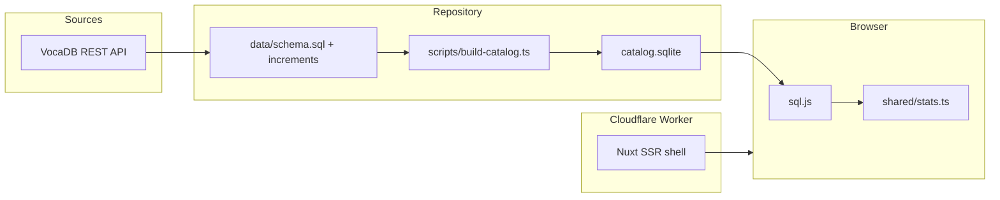

# Hatsune Miku Concert Setlist Statistics — Design

> Historical design notes from early scoping. Current runtime behavior lives in
> [architecture.md](architecture.md); prefer that file for ongoing development.

This document fixes scope, data boundaries, and module boundaries. Show start times are written only when sourced; when data is missing the UI stays empty rather than inventing values.

## Goals and scope

Build an SSR site deployable on Cloudflare Workers that catalogs setlists for Crypton-sponsored Hatsune Miku concerts and lets the browser compare repertoire across 场次, 演出, series, and years.

In scope (VocaDB series ids; category Concert):

| Series | VocaDB series id |
| --- | --- |
| 初音ミク「マジカルミライ」 | 81 |
| MIKU EXPO | 82 |
| MIKU WITH YOU | 173 |
| 初音ミクシンフォニー | 256 |
| 初音ミクライブパーティー | 219 |
| SNOW MIKU LIVE! | 204 |

Each record stores series, 演出, setlist rows, songs, uploads, and observations, with **concert calendar date** and **edition premiere** kept separate. Edition premiere is the first dated 演出 with role `show` for that `series_id + series_number`; 场次 whose name or description match broadcast / livestream are tagged `broadcast` and do not count as premiere. VocaDB `date` is day-only, stored as `time_precision = day`. Local `HH:MM` and `Asia/Tokyo` are written only when the description cites `Showtime` / `開演` and the venue country is JP (Japan has no DST). Setlist publication time is not on the public API setlist object; the field stays empty.

Mashups (`songType = Mashup`) are split into component songs before counting. Rows without verifiable components go into an unsplit quarantine and do not count as one track in interval stats.

## Non-goals

- No activities, clubs, or projects outside the table above.
- No play counts or estimates on any platform. No niconico unofficial view APIs, no Bilibili view counts; VocaDB description “殿堂入り” text is not data.
- No routine aggregation on Workers. Workers only do first-paint SSR and on-demand missing-song lookup.
- No downloading or redistributing third-party covers, lyrics, or official logos.

## Approach and trade-offs

**Nuxt 3 + Nitro `cloudflare-module`.** Vue (arrow-function constraints) and Workers SSR. Versus Next.js / vinext, one fewer React-compat runtime layer; Nitro emits the Worker directly. Versus a static site, one on-demand lookup route remains. Cost: stats run on the client; first paint is shell-only until the catalog downloads.

**SQL increment files are source; SQLite is build output.** Reviewable SQL is committed to Git. The browser opens built `catalog.sqlite` read-only via sql.js, then aggregates with the same TypeScript on the client. No second SQL for aggregation, to avoid wasm SQL drifting from test SQL. Cost: full DB download; acceptable at roughly two hundred 演出 across six series today. No better-sqlite3 on the server (native modules cannot run on Workers). Cloudflare does not compress `sqlite`, so the build also writes `catalog.sqlite.gz` for browser-side decompression.

**VocaDB is a peer reference, not the standard.** `https://vocadb.net/api/`, JSON, custom User-Agent, ≥ 300 ms between requests, cached raw responses. DB content is CC BY per [VocaDB License](https://wiki.vocadb.net/docs/license); pages link back. Ingest order: official site → 萌娘百科 → 初音ミク Wiki → VocaDB. `performances.id` / `series.id` / `songs.id` reuse VocaDB ids when possible; reserved local ranges when absent; when VocaDB disagrees, keep collected data—do not rewrite upstream or ourselves. If this project has a setlist for a 演出, that 演出 enters stats regardless of upstream setlist presence. Cost: most showtimes missing; date precision stops at day.

## Online 演出 designation

Online, livestream, and VR 演出 with no physical venue do not use geographic country codes. They use `performances.country_code = ONLINE` (not ISO 3166-1 alpha-2), counted separately from city-based 演出, shown as their own “online” bar segment on the timeline city-migration chart without affecting domestic Japan, overseas, or true unknown country. List maintained in `data/increments/0014-online-designation.sql`; `pnpm collect` rewrites `0001`, but `0014` runs after `0001` and `0013` so designation is not lost.

## Modules and responsibilities

| Module | Responsibility |
| --- | --- |
| Collect | Fetch series, 演出, setlists, songs, PVs; tag broadcast 场次; parse sourced showtimes; quarantine unsplit mashups |
| SQL | Schema, escaped increments, apply to SQLite |
| Stats | Count by 场次 / 演出, group across series and years, merge variants |
| Site | SSR shell, client catalog read, filters and charts, attribution |
| Search | In-page search matches downloaded local catalog only; no off-site queries |
| Workflow | CI lint, typecheck, tests, catalog build; weekly collect and commit SQL on diff |

## Paths

New (this branch from empty repo):

- `docs/design.md`
- `package.json`, `pnpm-lock.yaml`, `tsconfig.json`, `nuxt.config.ts`, `eslint.config.mjs`, `vitest.config.ts`, `wrangler.toml`, `.gitignore`, `.github/workflows/ci.yml`
- `data/schema.sql`, `data/increments/0001-vocadb-catalog.sql` (written by collect)
- `scripts/vocadb/client.ts`, `scripts/vocadb/normalize.ts`, `scripts/vocadb/collect.ts`
- `scripts/sql/emit.ts`, `scripts/build-catalog.ts`
- `shared/types.ts`, `shared/premiere.ts`, `shared/showtime.ts`, `shared/medley.ts`, `shared/stats.ts`, `shared/catalog.ts`
- `tests/premiere.test.ts`, `tests/showtime.test.ts`, `tests/medley.test.ts`, `tests/catalog.test.ts`
- `app.vue`, `layouts/default.vue`, `assets/css/main.css`
- `pages/index.vue`, `pages/raw.vue`, `pages/shows/[id].vue`
- `components/SiteHeader.vue`, `components/CatalogView.vue`, `composables/useCatalog.ts`

Modified:

- `README.md`: how to run and VocaDB attribution. Root README and `docs/README.zh-CN.md` / `docs/README.zh-Hant.md` / `docs/README.ja.md` remain visitor-facing multilingual entry points.
- All other repo docs under `docs/` (architecture, local dev, Cloudflare, contributing, data pipeline, etc.) are English-only. Former parallel `*.zh-CN.md` / `*.zh-Hant.md` / `*.ja.md` files are not kept; unique notes from translations merge into the English file before deletion. In-app UI strings and `data/` song/place/character display names are unchanged.

Read-only references:

- Idea notes above
- [VocaDB Public API](https://wiki.vocadb.net/docs/public-api), [Events](https://wiki.vocadb.net/docs/events), [License](https://wiki.vocadb.net/docs/license)
- [Cloudflare Workers full-stack routing](https://developers.cloudflare.com/workers/static-assets/routing/full-stack-application/)

`public/data/catalog.sqlite` (and browser gzip copy `catalog.sqlite.gz`) and sql.js wasm are build copies, not committed source.

## Data flow



Edition premiere rules are computed in `shared/premiere.ts` before SQL write and stored in `edition_premieres` (name kept; meaning is first 演出 of a series edition year) for review.

## Risks and verification

| Risk | Mitigation |
| --- | --- |
| VocaDB date is UTC midnight, not show start | Precision `day`; clock time requires excerpt from description |
| Multi-city edition; late broadcast mistaken for premiere | Exclude `broadcast`; premiere is earliest `show` |
| Mashup counted as one song | Quarantine without components; exclude from denominator |
| Weekly job saturates API | Six series, ≥ 300 ms gap, custom UA; fail over budget instead of shard spam |
| Stats or native sqlite on Workers by mistake | Aggregate client-only; server routes use `fetch` only |

Verification:

- `pnpm test` covers premiere, showtime parse, mashups, variant merge, count semantics
- Catalog tests in `pnpm test` open committed SQL and assert 2014 マジカルミライ premiere is Osaka `2014-08-30`, not Tokyo `2014-09-20`
- `pnpm lint`, `pnpm typecheck`
- Browser smoke: home filters, song, 演出, series, producer pages

## Song appearance ranking

The ranking page counts how many times each song appeared. Aggregation stays pure functions in `shared/stats.ts`, reading loaded catalog rows (prefer 场次 layer `performance_show_setlist_items`; fall back to `setlist_item_songs` / `setlist_items`, plus `songs`, `performances`, `series`); no separate SQL.

Counts are not VocaDB-authoritative: if this project has a setlist for a 演出 (upstream list, album fill, or wiki-only table with empty `song_list_id`), that 演出’s tracks enter ranking, song appearances, and producer stats.

Three levels align with VocaDB: series (`series`) > 演出 (one `performances` row = one VocaDB release event = one city stop) > 场次 (one calendar day, or separate day/night 场次 same day).

Two count modes:

- `show` (by 场次, default): read `performance_show_setlist_items`, dedupe by `show_key`. Three-day tour = 3; same-day matinee + evening = 2; undated 演出 has no 场次. Legacy catalogs without expanded rows fall back to `event-schedule.ts` and note parsing (notes naming day / half-day / 场次 number count only those 场次; else one row counts all 场次 of that 演出); unresolved 场次 get approximate counts marked uncertain.
- `event` (by 演出): each `performances` row counts at most once. Osaka and Tokyo same year each count once; no merge by `series_id` + `series_number`.

Filters:

- Series id list; omit or empty = all series.
- Closed year range on `start_date` calendar year. Undated 演出 excluded when any year bound is set.
- `includeBroadcast` false excludes `role = broadcast` and 演出 whose name, Japanese name, or `series_suffix` match livestream, online, オンライン, VR, ＶＲ, 配信. Descriptions are not on `performances`; `performance_links.description` is usually link titles (e.g. “Online Live Information” on an in-person stop) and does not drive exclusion.
- `includeMedleyComponents` false counts only `setlist_item_songs.role = listed`. `component` counts only when true. Unsplit mashups are not in `setlist_item_songs`; neither mode counts them.

Each row outputs song id, name (`songs.name`), producer credit, count, distinct 演出 count, earliest and latest year. Songs with count 0 are omitted. Default sort: count desc, song id asc. `seriesCount` remains in the return value but is not shown; the performance-count column uses `performanceCount` (distinct 演出 rows; same in both modes).

The ranking page is this sortable table with mode, multi-series, year, broadcast/VR, and medley-component controls. Coverage note: default is 场次 counts; 演出 mode counts each city stop once.

## Setlist notes and per-场次 parsing

`setlist_items.notes` holds VocaDB setlist-row free text. Collect already writes this column; raw responses live in `data/cache`; committed `data/increments/0001-vocadb-catalog.sql` includes these notes (e.g. setlist 17933’s 「愛の詩」 and 「サイハテ」). Empty notes mean every 演出 under that setlist played the song. No re-fetch for this.

`shared/rotation.ts` parses notes into 场次 sets. City names align to 演出 sharing that `song_list_id` (name, Japanese name, venue, `series_suffix`). `Day N` is the Nth distinct date in that city by sorted dates from `start_date` through `end_date` inclusive. Multi-day 演出 still maps those days to one 演出 record.

When uncertain, keep identified 场次 and record why: city only but multiple 演出 or days; day with matinee/evening or note says daytime / nighttime / 1st / 2nd show; unparseable format; city matches no 演出.

Within one setlist, count setlist rows per 场次 after parsing. 场次 whose row count differs from the mode get `setlist length mismatch: X vs expected Y`; affected rows (with notes or excluded from a 场次) are marked uncertain.

场次-based ranking uses parse results; `showsForNotes` narrows a row to 场次 meant by `Day N` / matinee / evening. Unreliable counts show “≈”; hover lists 演出 with unconfirmed 场次 counts. The page also lists unresolved rows and 演出. `/shows/:id` shows 场次 list, raw notes, and parse results; `/series/:id` lists all 演出 in the series and links from ranking and 演出 pages.

Appearance uses Nuxt UI color mode: system default, dark when no system preference. `@nuxtjs/color-mode` sets `html.dark`; header `UColorModeButton` toggles and remembers. Dark is the art-direction baseline: near-black with teal `#39C5BB` and magenta `#E12885` radial glow; light theme required. Glow on fixed `-z-10`, not in content, for contrast.

## Chinese song titles

`data/song-titles.zh-CN.json` is keyed by VocaDB song id (decimal string keys). Do not add songs without confidence.

```json
{
  "1326": {
    "title": "世界第一公主殿下",
    "aliases": ["世界属于我", "世界第一的公主殿下"],
    "source": "vocadb-alias",
    "comment": "可选"
  }
}
```

`title` is required and is the sole displayed Chinese name on site. Optional `aliases` list other common Chinese renderings: shown on an “other names” line under the Chinese primary title and searchable (e.g. searching 「世界末日舞厅」 still finds `title` 「世末舞厅」); no duplicate aliases or aliases equal to `title`. Traditional forms go in `data/song-titles.zh-Hant.json` (same `title` / `aliases` / `source` shape) for zh-Hant UI.
`source` records provenance, priority order: `官方中译` (official channel / album Chinese title) > `vocawiki` / `萌娘百科` / `vocadb-alias` (community names) > `人工核定` (hand translation); `简繁转换` only for instrumental same-Han titles. Katakana spellings of English (`クリスタルスノウ` → Crystal Snow, etc.) use English in the Chinese slot and set `songs.name_en` (patch in `data/increments/0012-song-english-names.sql` when VocaDB lacks it); do not mix English into Chinese title or `comment`; same for official romanizations (`ロキ` → ROKI). Optional `comment` for what does not fit in `title` / `aliases`. Do not register when Chinese title equals `songs.name` (same display, inflates map); exception when aliases must be searchable (`番凩` aliases 「落叶秋风」「对霜风」). `shared/song-titles.ts` validates and loads by id; tests require every id in committed catalog.

Japanese display names are not SQL-overridden: when upstream `songs.name` is unusable (404329 default emoji `🔪、🔪、🔪`, wiki lists `ナイフ、ナイフ、ナイフ`), register `title` in `data/song-aliases.json`; `shared/song-aliases.ts` validates and prefers it over `name_ja` / `name`. One `title` per song; other JP/EN spellings in `aliases` on “other names”; `songs.name_en` (`0012`) also there; Chinese from `song-titles.zh-CN.json` in Chinese mode. Do not duplicate `name_en` or Chinese in `aliases` (deduped in resolver). Catalog `name` / `name_ja` stay upstream; `pnpm collect` rewriting `0001` does not touch this file.

Header “Chinese song titles” switch (`USwitch`) stored in `localStorage` `miku-concert-stats-song-lang` (`zh` / `original`). Default: Chinese when `navigator.language` starts with `zh`. SSR/hydration show original first, then client reads choice to avoid mismatch. With Chinese on and translation present, translation is primary, original gray below; else original only. All pages use `SongTitle`. Song page lists other names via `SongTitleAliases` (fold at 4+ as `+N`); search rows use `SongSearchResultTitle` with highlighted matching alias on second line.

## 演出 roles (vocalists)

`data/characters.json` maps canonical character names to match rules to merge voicebank variants. Keys are display names such as `初音ミク`. Values have `patterns` (regex anchored at start), optional `aliases` (full or prefix, e.g. English names), optional `color` (cheer color `#rrggbb` for chip border and 12% fill). `初音ミク Append (Unknown)`, `初音ミク V4X (Original)`, `初音ミク V4X (Dark)` resolve to `初音ミク`. Unmatched names stay unmatched; no `color` means no colored chip.

Per-song vocalists prefer `song_vocalists`: `scripts/vocadb/vocalists.ts` (`pnpm collect:vocalists`) requests VocaDB `fields=Artists`, keeps entries with `Vocalist` in `categories` or `roles`, name from entry `name` or nested `artist.name`, emitted to `data/increments/0006-song-vocalists.sql`. `artist_string` collapses large choruses to `feat. various` (Hand in Hand live covers list KAITO, MEIKO, 初音ミク, 巡音ルカ, 鏡音リン, 鏡音レン), so this table is the source for on-stage roles. Without a row, fall back to text after first `feat.` in `songs.artist_string`, comma-split; producers before `feat.` are not roles.

Derived at catalog read time, no extra SQL column. Ranking, 演出, series index, and song pages show “Vocalists”. Ranking can filter by one character.

`shared/credit.ts` handles credit strings: `producerCredit` before `feat.`, `displayArtistString` full string; both strip VocaDB placeholders (`Unknown producer(s)`, etc.); all-placeholder returns `null` → “Not recorded”. Header search and `/raw` song table use these; song page “other versions” cards use producer rules below. Ranking “Producer” column prefers structured `song_producers`, else `producerCredit` for that row (including merged variant groups). Publisher, Illustrator, label/circle credits are not producers; `VoiceManipulator` (調声 / 調音) kept.

Producer evidence order: official album/page credits, then VocaDB `song_producers` from `fields=Artists`, `artist_string` only when no producer on the song. VocaDB vs other sources: do not auto-pick; display structured list; conflicts in `docs/reports/producer-conflicts.md` from `pnpm report:producers` until maintainer resolves.

Producer pages (`/producers`, `/producers/{name}`) use the same rules. Song count = distinct song ids (variants counted separately, no variant-group merge); “songs performed” and “performance count” read 场次 layer (legacy note parse; medley components); 演出 count = distinct `performances`; 场次 deduped by `show_key`; broadcast, online, VR excluded by default. 演出 with setlist at 场次 layer count, including empty `song_list_id` wiki-only setlists, matching ranking totals for the same producer filter. Free-text names without `artist_id` show name only, no fake VocaDB link; producers with zero appearances still listed. Default sort: song count desc. Header nav, ranking producer column, song “other versions”, header search link to `/producers/{name}`. Free-text fallback matches ranking, so names like `DECO*27`, `kz` on songs without structured producers can exceed `song_producers`-only SQL counts—expected.

## Implementation steps

1. **Schema and pure functions** — `data/schema.sql`, `shared/premiere.ts`, `shared/showtime.ts`, `shared/medley.ts`, `shared/stats.ts`, and `tests/*`.
2. **Collect and SQL** — `scripts/vocadb/*`, `scripts/sql/emit.ts`, `scripts/build-catalog.ts`; one collect run produces `data/increments/0001-vocadb-catalog.sql`; `tests/catalog.test.ts`.
3. **Site** — Nuxt pages, `composables/useCatalog.ts`, credits and empty states.
4. **Release automation** — `wrangler.toml` (optional empty `previews`), CI, weekly workflow; README. Non-`main` Worker Preview needs top-level `[previews]` (may be empty; no inline `previews = { }` after `[[...]]`); previews do not inherit prod `FEEDBACK` / `PAGEVIEWS`. `keep_vars = true` so dashboard-only non-secret Variables omitted from git (`ACCESS_TEAM_DOMAIN`, `ACCESS_AUD`, `CF_ACCOUNT_TAG`, `CF_ANALYTICS_HOST`) survive `wrangler deploy`; secrets are already preserved. Prod: `npx wrangler deploy`; non-`main` preview: `npx wrangler preview` (`versions upload` deprecated). Ops: [cloudflare.md](cloudflare.md).

## Variant merging

`data/song-variants.json` is a hand-checked list of same-song remix, remaster, voicebank, cover, and language variants. `shared/song-variants.ts` rejects chains and self-maps. Stats take `SongVariantIndex`: normalize to canonical id before dedupe by 演出 or 场次; pick representative upload in group; ranking rows include `variantSongIds`; UI “includes N versions” counts original (`variantSongIds.length + 1`). Song page “other versions” lists merged variants only (hidden when none; variant URL skips self). Type, producer, vocalists per variant: `song_producers` first, else producer before `feat.`, strip `Unknown producer(s)`; vocalists from variant `song_vocalists`, else `feat.`, else canonical roles. Canonical upload date and roles stay in header. Duplicates outside the list are not auto-merged; `/raw` “suspected duplicate, not merged” lists candidates.

## Setlist slots and cross-region merging

Replacement tracks in the same slot appear as adjacent VocaDB rows with different numbers. `shared/setlist-slots.ts` decides if two rows share a slot: when 演出 sets differ, dates and 场次 must align; multi-day single records use note day/matinee/evening; merge only when both sides have notes. Only consecutive rows mutually exclusive with every row in the slot merge.

**场次 layer (from 2026-11-05):** Source setlist is not directly “this 演出’s setlist”. `pnpm derive:setlists` expands each row via `showsForNotes` into `performance_show_setlist_items`; multi-day 演出 get full programs per day; matinee/evening split within a day. Source layer (`song_lists` / `setlist_items` / `setlist_item_songs`) stays VocaDB-shaped; `/raw` cross-演出 compare and `/report` read it.

**演出-level merge (from 2026-11-06):** `/shows` folds mergeable 场次 into one table. `mergeShowSetlists` orders by representative 场次, inserts 场次-only songs, then merges rows that share the same slot index in every 场次 they appear. Matinee/evening rotation and day swaps share slot numbers; `ShowSetlistTable` uses `UTable` `meta.rowspan` (absorbed cells `hidden` via `meta.class`); one row per song so replacements are not extra tracks. Four columns, no dedicated 场次 column; which 场次 a substitute applies to goes in “Notes” (`matinee only` / `8/11 only` / etc.; omit when all 场次). Instrumental tags after ` · `. Of 70 mergeable 演出, 64 have slot count equal to single-场次 length; six differ due to inserts or length mismatch. Merge requires disjoint 场次 sets; misaligned indices stay separate rows.

External confirmation order: VocaDB notes → official page → wikis → recordings; adopt when found; store URL, access date, confidence, one-line note in `performance_setlist_sources`, footer on `/shows`, archive in `docs/setlist-confirmation.md` §1 without per-line sign-off. Per-场次 notes live in 演出-level `note`, no 场次-level source table.

Different 演出 setlists in one edition year (e.g. 2019 マジカルミライ Tokyo vs Osaka) appear side by side only in `/raw` via `data/setlist-merges.json`; not one merged edition setlist. Rotation length mismatch splits display. `shared/edition-setlists.ts` uses largest 演出 setlist as skeleton, LCS-align others, fold duplicate songs and merge 演出 sets. `rowspan` for slots; trailing “演出” column when row is not universal.

## Setlist difference reports

`shared/setlist-diff.ts` compares edition-year setlist pairs (and adjacent years): row counts, main/encore counts, shared/unique songs, LCS coverage, merge flag. Grades: `identical`, `order-only`, `count-differs`, `segment-differs`, `probably-different-program`. `pnpm report:setlist` writes `docs/reports/setlist-differences.{md,csv}`; `--check` for CI; `/report` renders same logic in browser with Markdown copy. Adjacent years are reference only.

## UI

Nuxt 4 + Nuxt UI 4 + Tailwind 4. App code under `app/`; `shared/` at repo root; pages import `~~/shared/*`. Sticky frosted header; public nav: Songs / Producers / Timeline / Series / Cities; `/raw` dev-only catalog browser (ignored in prod build, not in nav). Ranking uses `UTable` and TanStack sort; filters in URL query for refresh and share.

Language control top-right: current locale on the button (简体中文 / 繁體中文 / 日本語 / 한국어 / English). Menu lists current first, then `LOCALES` order. Locale in cookie; per-locale “show original title” at menu bottom; disabled in Japanese.

## Korean UI locale (issue #46)

The site adds Korean (`ko`, self-name 한국어) as a fifth interface language. `LOCALES` order is `zh`, `zh-Hant`, `ja`, `ko`, `en`.

This change covers UI copy only:

- Every existing message key in `i18n/modules` includes a Korean string (full locale key coverage). Previous locales keep their existing strings and behavior.
- The header language picker lists 한국어 with the same control as the other languages: the current language name is visible on the button, the menu lists the active language first, then the rest in `LOCALES` order.
- The choice is stored in the existing cookie `miku-concert-stats-locale` under the current `@nuxtjs/i18n` `detectBrowserLanguage` settings. Routing stays `no_prefix`: there is no `/ko` path prefix and no locale query parameter.
- A first visit with no cookie starts in Korean when the browser `Accept-Language` prefers Korean (`ko`, `ko-KR`, and other `ko-` tags). An existing cookie still wins over the browser language. Unsupported languages still start in Chinese (`zh`), the site's source language.
- `<html lang>` is `ko`. Nuxt UI built-in strings use `@nuxt/ui`'s Korean locale.
- The "show original title" switch stays enabled in Korean, because Korean is not the catalog original language. It stays disabled only in Japanese.

Proper names and catalog titles are out of scope unless a reliable source already exists:

- Do not invent Korean song titles, series names, place names, venue names, or character names.
- Do not add unsourced `data/*ko*` name-translation files in this change.
- When Korean has no sourced display name, keep the original catalog spelling (typically Japanese), the same fallback Japanese already uses. English and Chinese name files are not used as a stand-in for unsourced Korean.

The UI-only change left catalog names unsourced. A later sourced batch, described below, adds checked Korean titles and character labels without inventing the rest.

## Sourced Korean names (first batch)

This pass adds sourced Korean display names for a subset of songs and characters. It does not invent names, and a name that was not inspected is not treated as “no Korean name exists.”

Songs: 51 of 590 catalog songs (51 of 563 VocaDB-sourced songs) use a live-verified VocaDB community Hangul alias in `data/song-titles.ko.json`, with source `vocadb-community-alias`. These are community catalog names, not official translations. Official Korean song titles were not found in this pass. Song 8241 (番凩) is excluded because it has two distinct Hangul aliases. 416 VocaDB catalog songs were not inspected for `Names` in this batch; they keep the original catalog spelling until a later sourced pass. The 27 non-VocaDB songs were out of scope here.

Characters: 7 of 22 catalog characters have a sourced Hangul label in `data/characters.ko.json`.

- 初音ミク, 鏡音リン, and 鏡音レン: the Korean Google Play listing for Crypton’s official MIKUNAVI app (official-app-store evidence; authorship of that Korean text is not independently confirmed) plus agreeing VocaDB community aliases.
- SeeU: official SBS A&T HISTORY page (`시유`).
- 重音テト, 可不, and 星界: VocaDB community aliases only.

巡音ルカ is unresolved (Play listing `메구린 루카` versus VocaDB `메구리네 루카`) and stays on the original catalog spelling. The other 14 characters also keep the original spelling. Variant product strings are not truncated into a character display name. Series, places, venues, and cities stay on the original-name fallback in Korean.

Each accepted row records a source class, source URL, and — for VocaDB rows — API URL and name field, in `docs/research/korean-names/`, so an audit does not rely on an uncited bulk list. When Korean has no sourced row, the site still shows the original catalog spelling and does not borrow English or Chinese names.

List pages share the song-ranking table pattern: `TableSection` (title, `UTable`, sticky header, `ranking-scroll`, skeleton, empty), `SortableHeader` for sort dropdowns. Vocalists always `CharacterChips` (cheer border/fill, `+N` after 3); non-character tags like producers use `UBadge`; filters use `FilterField` (`UFormField`). Exception: `/raw` “data tables” with dynamic columns and hand-built table, same shell/empty state. See `docs/architecture.md` shared UI components.

Timeline stacked 场次/series chart: year-only drill-down—clicking bar or gap above/between bars toggles year detail below; bars do not navigate to series or keep selection styling. City-migration and character song-year charts behave the same for bars/points vs year band. Series via top filter or `/series`; gantt still spans series.

Those three charts: hover and expanded year details list only series/segments/characters (and line points) with non-zero values that year; zeros omitted from detail lists; year picker, tooltips, and chart totals (stack height, axis, header aggregates) unchanged. Covered by focused tests (`TimelineBarChart` `hoverValues`, year footnotes `showsYearPerformances` / `characterYearRows` / `cityYearRow`).

## Mobile chart fullscreen (issue #49)

On a narrow viewport, the timeline charts (stacked shows/series, character songs, new/returning songs, touring cities, and the series-activity gantt) can require horizontal scrolling, because the drawing uses a 720px minimum width.

A dedicated, touch-safe ghost (borderless) button on the chart card — not a tap on a bar, line point, or gantt strip — opens that chart in a viewport-filling dialog. The dialog shows only the chart plotting area. The in-card title, explanatory note, filter or action controls, and year-details footer stay on the page card and are not repeated in fullscreen. Download and close controls sit as a borderless overlay in the plot stage's top-right corner (always visible on narrow viewports and in fullscreen; hover/focus on desktop), outside the export capture root. The legend/hint row keeps right clearance equal to the chrome width so labels wrap instead of sitting under the buttons, and the stage keeps left padding so the series legend does not meet the viewport edge. The plot is fitted to the remaining space so it does not need horizontal scrolling. Vertical scrolling may remain for a tall gantt.

On a compact portrait viewport, opening fullscreen first requests browser fullscreen on the dialog (required by many engines before orientation can lock), then calls the Screen Orientation API to lock landscape. The plot fills whatever viewport the browser reports after that; there is no CSS rotate fallback. Desktop-wide or already-landscape viewports skip both requests and simply fill the remaining space. Locks and browser fullscreen are released when the dialog closes. Browsers that reject the APIs (including typical iOS Safari tabs) keep the current orientation and still show a fitted portrait fullscreen plot with the same top-right chrome.

Existing bar, point, and gantt-strip click behavior is unchanged on this base: this change does not add or remove series navigation or selected-bar recoloring. Escape, the close control, and returning the card to the page exit fullscreen. The page behind does not scroll while the dialog is open.

## Chart JPEG export (issue #50)

Each timeline chart card has a control that downloads that chart as a real JPEG (`image/jpeg`), not a PNG or a screenshot of the page. The file uses a solid background taken from the card surface (falling back to the active light/dark canvas) so transparent SVG areas do not become black, and title/legend ink uses the theme's highlighted text rather than muted gray. Series colors that are stored as CSS variables are resolved through computed style before painting so swatches and bars keep their on-screen hues. The download includes the plot and, when present, the in-card title and legend. The JPEG uses the chart's full natural drawing bounds (the SVG width, viewBox, and any overflowed scroll width), not only the slice visible in a narrow card, so later years and series that sit in horizontal overflow still appear. User-selected filters are preserved in the drawing and appended to the `.jpg` filename when any filter chips are active. Existing bar, point, gantt-strip, year-band, hover, and fullscreen behavior is unchanged.

Placement keeps the controls outside the export capture root so they do not appear in the JPEG:

- On a desktop-width card, download and fullscreen sit as a ghost overlay at the top-right of the chart area and are shown when the card is hovered or a control is focused.
- On a narrow viewport, the same overlay stays visible at all times.
- In the fullscreen dialog, download and close sit as the same always-visible top-right overlay on the padded plot stage.

Clicks, pointer-downs, and keyboard activation on the export control stop propagation so they cannot select a year, navigate, or toggle fullscreen. Accessible labels are provided in every current UI locale.

## Blank concert date labels

When a performance has a catalog `start_date`, the UI always prints that date (and the `end_date` range when it differs). Known dates are never replaced by a status word.

When the date is missing, the date field shows only one of two labels, in every current UI locale:

- **Cancelled** (`已取消` / `已取消` / `中止` / `취소` / `Cancelled`) — only when `performance_status` has a hand-checked `cancelled` row with a source. The current catalog has 13 such performances: twelve MIKU EXPO 2020 North American stops (ids 2853–2861, 2878–2880) and 初音ミク×鼓童スペシャルライブ２０２０～結～ (2886), each sourced from the official cancellation announcement.
- **Undetermined** (`尚未确定` / `尚未確定` / `未定` / `미정` / `Date undetermined`) — any other missing date. This is not a cancellation. The current catalog has one such row: 初音ミクシンフォニー 2027 東京 (13210), a VocaDB Draft event with no date and no `performance_status` row.

The date field never uses `尚未演出`, `这场演出尚未举行`, or any “not yet performed” wording. A dated future show that is marked `upcoming` (for example MIKU WITH YOU 2026 in Chengdu, 3000000001, on 2026-12-26) still shows its real date; the existing show-page status alert may still explain that the performance has not taken place yet.

These labels appear in every user-facing date field: the show header, series lists, search hits, song and producer appearance tables, setlist show labels, and timeline year-detail lists when a date is absent. Sorting, year charts, and 场次 counts continue to treat a missing `start_date` as undated.

## Header social links

After language and theme in the header bar: GitHub, X, Bilibili left to right. Bilibili must sit immediately right of X, link `https://b23.tv/IITMbFk`, accessible name “k9009's Bilibili profile” (localized). Tabler brand icon `i-tabler:brand-bilibili`, same size/color/`target="_blank"`/`rel="noopener noreferrer"` as other external links. Narrow menu row: Bilibili right of X.

## Header search

Search lives in the header, not its own page. Wide: persistent input, overlay with catalog hits and “view all”; narrow: icon opens full-screen overlay. Local catalog only, no in-page VocaDB. Overlay order: series (`localSeriesMatches` → `/series/{id}`), 演出 (`localPerformanceMatches` → `/shows/{id}`), places (`localPlaceMatches` → `/series?place={venue}`), producers (`localProducerMatches` → `/producers/{name}`), songs → `/songs/{id}`; Chinese titles match too. Ranking producer column: structured `song_producers`, else text before `feat.`; names link to detail; truncated with hover for full credit. Vocalists column: cheer chips, 3 visible, rest in `+N` popover. “演出 count” column is distinct 演出 appearances (mode-independent); series count not shown. `/raw` song table: `producerCredit` and parsed vocalists, not raw `artist_string`.

## Dedicated homepage (issue #60)

The site root `/` is a dedicated landing page, separate from the song-appearance ranking that previously occupied `/`. The ranking remains available at `/rank`. The header logo stays on `/`; the Songs nav item and “view ranking” links point at `/rank`. Existing withdrawn-page redirects (`/catalog`, `/compare`, `/windows`, `/correlation`) still go to `/`, which is now the homepage.

The homepage now includes the poster banner deferred from [issue #67](https://github.com/RJiazhen/miku-concert-stats/issues/67). It replaces the earlier text-only Recent concerts list and is the first primary content on the landing page, below the global site header and navigation only. The previous large homepage title and eyebrow repeated the site name already present in the header; they are not shown. An `sr-only` page `h1` remains so the document still has an accessible heading. Upcoming concerts stay a text list below the statistic tiles. Concert calendar dates still come from `performances.start_date` / `end_date` and are never labelled as data-update times.

After the banner, a compact numerical overview shows four core catalog counts, in this document and visual order on every viewport: songs, 场次, 演出, and series. The tiles use short labels, icons, and values already computed by `buildSiteWideStats`. There is no visible Site-wide statistics section heading in any locale; the tiles stay in an accessible group named with that phrase for assistive technology.

Each of those four tiles is a single keyboard-focusable in-site `NuxtLink` covering the whole card, with a hover and focus ring that stays compatible with the compact light and dark treatments. The destinations are existing routes only; this change does not invent a 场次 index or any other new page:

- Songs → `/rank`, the song-appearance ranking.
- Shows (场次) → `/series`, the existing Series and performances overview. There is no dedicated 场次 list or 场次 section heading, so this tile opens that overview at the top of the page. The `/shows/{id}` path is a 演出 detail page, not a list of individual occurrences, and is not used as this tile's destination. The timeline remains the year-by-year 场次 charts and is still reachable from the feature modules, but it is no longer this tile's destination.
- Performances (演出) → `/series#performances`, which scrolls to the visible Performances table heading on that overview.
- Series → `/series#series`, which scrolls to the visible Series table heading on the same page.

The `/series` page keeps its existing page heading and table behaviour. The Series and Performances tables each have a visible, localized level-2 heading (`series.tableTitle` and `series.performancesTitle`) with a stable, locale-independent fragment id (`series` and `performances`). Hash navigation to those headings uses the same sticky-header clearance as the timeline charts (`scroll-mt-24`), so the heading stays in view below the site header. Setlist coverage, cancelled rows, broadcast/online rows, and the concert calendar date range remain available in that helper and in other page logic, but they are not shown as homepage tiles. The overview does not invent figures, and it does not include a descriptive paragraph.

The homepage does not show a “recently updated statistics data” section. Catalog `retrieved_at` / `accessed_at` summaries stay out of the landing page; they are not used as setlist-update times either. Section introductory paragraphs — eligibility rules, navigation explanations, and poster-intake instructions — are not rendered on the page. Visible section titles remain for Upcoming and the later feature modules. The banner has no visible heading or description, the statistics tiles have no visible section title, and the Related concert links section is not shown. Concise stat and concert labels, sourced concert status badges, empty states, and catalog-load errors remain, so uncertainty is not presented as confirmation.

### Homepage setlist banner (issue #67)

The homepage banner is a poster carousel of *recently held* 演出 that already have an available setlist. It is not a “recently catalogued programmes” list. A historical concert does not appear merely because its setlist was recently backfilled into this catalog. `retrieved_at`, `accessed_at`, and `announced_at` (currently always null) are never treated as programme-update times, and a catalog revision timestamp is not used for eligibility or ordering.

Selection reuses the existing Recent-concert eligibility already used by `buildRecentConcerts`:

- The 演出 has a concert calendar `start_date`.
- It is not cancelled or postponed.
- It has already started, using the same recorded date and showtime rules as Upcoming (see below). Official advertised clock times are not invented when `showtime_local` is missing.
- It has an available setlist, using the same `setlistPerformanceIds` rule as the series indexes and the homepage statistics.

Those 演出 are then bounded to a 12-month lookback from the page-load clock, comparing the later of `start_date` and `end_date` (when present) with the UTC calendar date twelve months earlier. The 12-month window is a homepage “recently held” bound: long enough that a mid-year festival edition such as Magical Mirai can still appear when fewer later dates exist, and short enough that a historical backfill such as the 2014 WOWOW special cannot qualify. The list is sorted by concert `start_date` newest first (then performance id) and capped at five slides.

On current `main` at 2026-11-23, that produces these five 演出, newest first:

- 12227, MIKU EXPO 2026 Paris, 2026-11-22.
- 12940, 初音ミク×鼓童スペシャルライブ～響演～, 2026-11-20 – 2026-11-21.
- 12226, MIKU EXPO 2026 Düsseldorf, 2026-11-20.
- 12225, MIKU EXPO 2026 Berlin, 2026-11-17.
- 12224, MIKU EXPO 2026 Amsterdam, 2026-11-15.

12223 MIKU EXPO 2026 Brussels (2026-11-14) and 12222 MIKU EXPO 2026 London (2026-11-12) remain inside the 12-month window and keep their official poster mapping, but they sit outside the five-slide cap.

3000000012 (初音ミク×TOUCH！WOWOW2014 スペシャルライブ) is excluded: its programme was added to the catalog on 2026-11-22, but the concert itself is a 2014 backfill, not a recently held event. The committed file `data/setlist-catalog-revisions.json` remains as research provenance for genuine programme-add or programme-change dates when they are known; those dates are not shown on the banner. A “setlist added to this catalog on …” badge would be misleading here, because most recent concerts entered with the initial catalog rather than a later programme revision, and because the banner is ordered by concert night, not by catalog work. Tour membership is recorded in `data/tours.json`. The banner does not group or select slides by tour.

Each slide has one in-site link to the existing concert detail route `/shows/{id}`, where `{id}` is the catalog 演出 id produced by `showPath` (the same performance-to-show routing used elsewhere on the site; ids are not guessed). The concert title and a visible “View concert details” affordance (`home.viewConcert`) are that single link, so the destination is discoverable and accessible without a second URL. The link’s hit area also covers the poster above the fact chips; arrows and dots stay outside it. A horizontal swipe or drag does not follow the link; a small non-drag movement still activates it. It shows the localized concert name, the concert calendar date or range, the venue when known, the start clock time only when `performances.showtime_local` is recorded (the current banner 演出 all lack a catalog clock time, including Expo Europe dates whose official site lists 20:00 — that official time is not copied onto the slide), the setlist song count, and—when every listed song has `length_seconds`—an estimated listed-song duration. The duration chip’s visible text is only the formatted time (for example `1 hr 39 min`); it does not include words such as “About” or “of listed songs.” The truthful qualification that this is an estimate of listed-song length, not the concert’s running time, is kept on the chip’s `title` tooltip and in the visually hidden accessible label. The timer icon stays on the chip. Event duration is omitted: the catalog has no sourced event-length field. Unknown values, including a duration when any listed song lacks a length, are omitted rather than guessed. Each visible fact chip (date, start time, venue, song count, and duration, when present) includes a decorative Lucide icon from the same set used elsewhere on the site (`i-lucide-calendar`, `i-lucide-clock`, `i-lucide-map-pin`, `i-lucide-music`, `i-lucide-timer`). Icons are `aria-hidden` because the chip already has a visually hidden label and readable text.

The banner has no visible section heading or description; assistive technology uses a short accessible name on the region. There is no on-slide “main visual” text link. Artwork credits and source URLs stay in `data/tour-posters.json`, this design note, and the intake READMEs, not as a visible link on the slide.

The homepage uses a dedicated `home` layout so the banner can sit edge to edge under the site header, at the full browser width, outside the `max-w-body` and horizontal padding that still wrap the statistic tiles, Upcoming, and feature modules. Other pages keep the default contained layout. The banner has no side inset or side rounding, and the layout must not introduce horizontal overflow on desktop or mobile (including the `100vw` / scrollbar pitfall).

Slide changes use a visibly progressing horizontal slide of both the outgoing and incoming slides (about 500 ms, steady ease) in the direction of travel, including wrap-around from last to first and first to last. The incoming slide is parked off-screen on the incoming side first when it is not already there, then both slides move together so intermediate positions are actually painted; arrow, dot, swipe, and autoplay navigation all use this same motion, without a layout jump. Slides stay stacked in a viewport of stable height. This motion is gated only on the `prefers-reduced-motion` media query: when that query is `reduce`, the change is instant and autoplay is off; a test or browser default of `no-preference` is not treated as a request to reduce motion.

On pointing devices that have hover and a fine pointer, the previous/next arrows stay hidden until the banner is hovered, or until a control inside it has keyboard focus (`:has(:focus-visible)`). A mouse click can leave `:focus` on an arrow; that residual pointer focus must not keep the arrows visible after the pointer leaves, so the arrows are not shown on blanket `:focus-within`. The control is not blurred to hide them. Keyboard users who Tab into the banner still see the arrows while `:focus-visible` remains inside it. The arrow layer itself does not intercept clicks on the show-page link: only the previous/next buttons receive pointer events, and only while the arrows are visible. On touch / coarse-pointer viewports the arrows stay hidden; changing slides does not depend on hover. Horizontal swipe or drag still changes one slide; a vertically dominant gesture leaves page scrolling alone; a small movement still activates the concert title CTA; dots and arrows are not treated as swipe handles. Dots remain visible and usable.

When there are at least two slides and the user has not requested reduced motion, the banner auto-advances every 5 seconds while idle. Autoplay starts only after client mount, so the server render and the first client render match. There is no pause/play or stop-animation control. Hovering the banner, a stationary pointer inside it, and lingering focus do not keep autoplay paused. Actual pointer movement, a click, a key, or a touch on the banner resets the idle clock; the next automatic advance is 5 seconds after that last interaction, not a further interval stacked on top of the 5 seconds. Autoplay does not advance during an active drag, touch, or held key. It also stays off while the page is hidden. After those in-progress gestures end, or the page is visible again, the 5-second idle clock starts from that moment. Manual slide motion (arrows, dots, swipe, and keyboard) is unchanged and is not suppressed. Autoplay is not used when there is only one slide, or when `prefers-reduced-motion` is `reduce`. Timers and listeners are cleared on unmount.

Poster backgrounds are local files addressed by tour id in `data/tour-posters.json`, resolved as 演出 → `data/tours.json` → tour poster, not by guessing a filename from the performance id. Each mapping records the source URL, access date, optional artist credit, and a short rights note. Several 演出 on the same tour share one official visual. Current placeholders include:

- Tour `hatsune-miku-x-kodo-2026` (演出 12940): `https://kyouen-kodo-miku.com/img/main-visual.jpg` (公式サイト main visual; illustration by ゼンマイブック), stored at `public/posters/hatsune-miku-x-kodo-2026.jpg`.
- Tour `miku-expo-2026-europe` (演出 12222–12228, 12449): the official hero character visual `https://mikuexpo.com/europe2026/images/hero_chara.webp` from `https://mikuexpo.com/europe2026/`, art by suzunosuke © CFM, stored once at `public/posters/miku-expo-2026-europe.webp`.
- Tour `wowow-2014` (演出 3000000012) keeps its official Piapro mapping for intake/provenance, but it is not a banner slide.

These are identification images for an unofficial catalog. They are not official endorsement. A slide without a mapped image uses a calm gradient placeholder and is still fully usable. When the user later drops a corrected poster into the intake area, the mapping is updated to that local file; the carousel does not hot-load unmapped drops by filename.

A project-local, persistent intake area lives at `poster-intake/` in the repository root (not `/tmp`). Image files there are gitignored; the English README files are tracked. One directory is created for each *existing* catalog series or standalone concert group that is relevant to current or nearby recent posters, using a stable slug from the catalog name, without inventing a tour:

- `poster-intake/hatsune-miku-x-kodo/` — series 255 初音ミク×鼓童, including the 2026 響演 edition (performance 12940).
- `poster-intake/miku-expo/` — series 82 MIKU EXPO, including the 2026 Europe edition currently on the banner.
- `poster-intake/miku-with-you/` — series 173 MIKU WITH YOU, a recently held edition that sits just outside the current five-slide cap.
- `poster-intake/hatsune-miku-symphony/` — series 256 初音ミクシンフォニー, likewise recently held and inside the 12-month window.
- `poster-intake/magical-mirai/` — series 81 初音ミク「マジカルミライ」.
- `poster-intake/snow-miku-live/` — series 204 SNOW MIKU LIVE!.
- `poster-intake/hatsune-miku-touch-wowow-2014/` — standalone group 900000007; retained for the existing official visual, not as a current banner slide. The catalog itself says this is not a tour.

The README in each folder states the target catalog series or group, the performance ids already on the carousel when applicable, accepted intake formats (`jpg`, `png`, `webp`), a naming convention keyed by tour id from `data/tours.json`, a recommended portrait-friendly official source (important subject in the upper two-thirds, because the banner crops with `object-fit: cover` and a top focal point into the wide stage), how a dropped file is wired through `data/tour-posters.json` into `public/posters/`, and delivery guidance for shipped assets: **WebP** is the recommended format under `public/posters/`; target **maximum width 1800px** (downscale wider sources to width ≤ 1800; never upscale); run **`pnpm posters:compress`** (`scripts/compress-poster.ts`) to encode before commit.

The banner stays the full page width on every viewport. Official posters are cropped with `object-fit: cover` and a top focal point, then centered in the stage. The cover image — not the carousel — has an adjustable maximum width, set by the CSS custom property `--home-banner-poster-max-width` on `.banner-root` in `app/components/HomeSetlistCarousel.vue` (default `1100px`). The stage background uses `--home-banner-stage-bg`, which follows the site theme: `#05070d` in dark mode (the same as `body` in `.dark`) and `var(--color-neutral-50)` in light mode (the same as `body` on a light page), so the areas beside a capped image match the page. A left-and-right gradient fade sits on the poster frame itself (`.poster-side-fade`), so the blend starts at the actual capped image edges rather than only at the viewport edges; the fade distance is `--home-banner-side-fade-width` (default `clamp(2.5rem, 12vw, 6rem)`). A separate bottom readability mask (`.poster-readability-mask`) uses that same stage color and stays full banner width. Its vertical range follows the actual `--home-banner-poster-max-width` setting rather than a fixed `1100px` breakpoint. While the cover is still full-bleed — the stage is at or narrower than the cap — the fade stays tall (mid stop `42%`, transparent at `78%`) so the title, chips, and show-page CTA stay readable over the artwork. Once the stage is wider than the cap and the side background is visible, the fade shortens (mid stop `26%`, transparent at `48%`), because the lower stage background is no longer a reading concern and a tall veil would hide more of the poster than needed. Those stops are `--home-banner-readability-mid`, `--home-banner-readability-end`, `--home-banner-readability-mid-capped`, and `--home-banner-readability-end-capped` on `.banner-root`. The left and right fades are unchanged. Title, CTA, and fact-chip ink use `--home-banner-ink` (light on dark, dark on light) so type does not disappear over a light fade; chips use `--home-banner-chip-bg` and `--home-banner-chip-ring`. Arrow buttons stay dark frosted controls with light icons, which remain visible in both themes. The image uses width `100%` as well as the max-width cap, so on a viewport narrower than the cap it shrinks to the banner, the side fades sit at the image (viewport) edges, and nothing overflows. Slide-change `transform` stays on `.carousel-slide` only; the image is centered with auto margins, not a competing transform. There is no separate configuration UI: change those custom properties in that stylesheet. The banner is responsive on desktop and mobile. Controls and the active slide are keyboard-focusable, and the poster has an accessible description that includes the concert name.

The banner is the first primary content after the global header, then the statistic tiles, then Upcoming, in both the document and the visual reading order on every viewport. The earlier standalone Recent text list is no longer shown; `buildRecentConcerts` remains as the eligibility helper, and the banner applies the 12-month lookback and five-slide cap on top of it.

Upcoming still lists dated 演出 that have not started yet, soonest `start_date` first, as a text list: localized name, concert calendar date, venue when known, optional sourced status, and a link to `/shows/{id}`. A concert has started only from recorded catalog fields; the page never invents a start clock time, timezone, or `performance_status` value:

- Undated, cancelled, and postponed 演出 are omitted from Upcoming and from the unused recent-concert helper.
- When both `showtime_local` and `timezone` are present, the concert has started at or after that local start instant.
- When a timezone is recorded without a clock time, the concert has started once `start_date` is on or before the current calendar date in that timezone.
- When no timezone is recorded, dates stay day-precision and are compared with the current UTC calendar date. A date-only concert on that UTC date is treated as started, because a venue-local midnight is not recorded and must not be assumed.
- A hand-checked `upcoming` status may still appear as a badge; it does not override the date or showtime comparison.

The unused `buildRecentConcerts` helper still keeps only 演出 that have a setlist, using the same `setlistPerformanceIds` rule as the series indexes and the homepage site-wide statistics: a VocaDB `song_list_id`, or a derived wiki or curated row in `performance_setlists`. Checking `song_list_id` alone would drop Wikipedia-only stops that have no VocaDB song list, and would also treat a bare `song_list_id` as a setlist even when that list has no songs. The Upcoming section does not require a setlist.

The homepage main heading matches the site title (`common.appName`) in every current UI locale, for example 初音未来演唱会曲目统计 and Hatsune Miku Concert Statistics. The song ranking page at `/rank` uses the page title (曲目排行 / Song ranking), not the site title.

Site-wide statistics reuse the same counting rules as the series and performance indexes (`reviewRotations`, `showCountsByPerformance`, `setlistPerformanceIds`). The compact overview displays only the four core counts from those totals, in the order songs, 场次, 演出, series.

Related concert links are classified from actual catalog rows, with no invented URLs. The classification helper is kept for later use, even though the landing page does not render the section yet:

- Official website: `performance_links` whose description clearly says Official Website or Official Webpage, or whose URL host is a confirmed official concert domain. The confirmed domains are `mikuexpo.com`, `snowmiku.com`, and `magicalmirai.com`. A match is only the exact parsed hostname or a legitimate subdomain of one of those registrable domains, compared case-insensitively after a trailing DNS dot is stripped. Substring lookalikes such as `notmikuexpo.com`, `evilmikuexpo.com`, or `mikuexpo.com.evil.test` never count, and a host is never inferred from the URL path.
- Website (official status unconfirmed): descriptions that start with `Website` whose host is not one of those confirmed domains. Other official-looking labels such as Official Blog or official highlight videos are not treated as official websites. A description that already says Official Website or Official Webpage is not downgraded when the host is outside the confirmed list.

The Related concert links section is temporarily hidden on the homepage in every locale: no cards, empty state, placeholder, or tour-grouped presentation is shown. Underlying catalog rows and helpers (`classifyPerformanceWebsiteLink`, `buildRelatedConcertLinks`, and the compact host label) stay in place. A later change will show these links grouped by tour; that work is deferred and is not implemented here. Tour membership itself is now recorded in `data/tours.json` (see [issue #62](https://github.com/RJiazhen/miku-concert-stats/issues/62)). Official websites stay attached to individual 演出 until that later pass.

Bilibili concert recordings stay classified in catalog helpers (`collectBilibiliRecordingLinks`, `isBilibiliConcertRecordingUrl`) with the existing rules: only 演出-level links (`performance_links` or `performance_setlist_sources`) whose URL is a Bilibili `/video/` page count; song PVs in `videos`, profile or space pages, and opaque `b23.tv` short links (including the header Bilibili profile) do not. The homepage does not list those recordings or show an empty recordings state. The header Bilibili profile icon is unchanged.

The homepage also lists feature-module navigation to `/rank`, `/producers`, `/timeline`, `/series`, and `/cities`. Copy exists for every current UI locale (`zh`, `zh-Hant`, `ja`, `ko`, `en`).

## Official schedule corrections and WOWOW 2014 metadata (issue #66)

External comparison sites may be used only as a private research aid to notice missing or inverted facts. They are not recorded in this repository as sources, citations, or provenance links. Every kept change must stand on an official page or on a primary/independent source already used by the catalog (typically 初音ミク Wiki for programmes). Official schedule pages are not song-order proof.

`data/performance-setlists.json` remains the curated source of truth; `data/increments/0008-performance-setlists.sql` is regenerated with `pnpm derive:setlists` and is not hand-edited. Existing song IDs and wiki setlist objects are preserved. Barcelona 2020 (performance 2790) stays without a curated setlist because four recording identities are still unresolved.

Two counting rules must be reported separately, measured on a catalog rebuilt from committed increments:

- **Derived show rows**: `performance_show_setlists` length. Research snapshots called this 447 on `d713f12`.
- **Index / site-wide 场次**: `showCountsByPerformance` (derived schedules win; performances with no derived rows fall back to the note/date-range schedule). The homepage on the same base measured 456. The nine-show gap is a counting-semantics difference, not two databases.

After the official schedule batch, measured totals were 453 derived show rows and 463 site-wide 场次 (the +6 derived rows plus WOWOW's one date-range fallback). After the WOWOW programme is derived, that concert gains one derived show row (453 → 454). It already counted as one site-wide 场次 by date-range fallback, so the site-wide total stays 463.

Schedule sources (official / organizer pages) and programme sources (existing 初音ミク Wiki tables, which have no per-show `when` values and are therefore event-level shared programmes) are kept distinct:

- 1924 MIKU EXPO 2016 Mexico City, El Plaza Condesa. Schedule: https://mikuexpo.com/na2016/ (`.cont-mexico`: June 4 day 2:30pm and night 8:30pm FINISHED; June 5 day 2:30pm FINISHED; June 5 night 8:30pm CANCEL). Programme: https://w.atwiki.jp/hmiku/pages/67134.html (27 songs). Keys: `1924:2016-06-04:day`, `1924:2016-06-04:night`, `1924:2016-06-05:day`. `1924:2016-06-05:night` must not exist.
- 2947 Hatsune Miku × Kodo 2017, NHK Hall. Schedule: https://www.kodo.or.jp/blog/news/20170110_11807.html (March 4 19:00; March 5 13:00 and added 19:00). Programme: https://w.atwiki.jp/hmiku/pages/67219.html (existing 22-song event-level table). The official announcement establishes the added March 5 evening show only; it is not a programme source. No independent half-specific setlist for that added night is recorded in the catalog. The 22-song wiki table, already used for the other two shows of this concert and with empty `when` fields, is applied at event level. That is a documented remaining gap, not a claim of per-show verification. Keys gain `2947:2017-03-05:night`.
- 2517 Magical Mirai 2014 Osaka (2014-08-30). Schedule: https://magicalmirai.com/2014/ticket_osaka.html (INTEX Osaka Hall 5, START 12:30 / 17:00; Hall 4 exhibition is not a concert). Programme: https://w.atwiki.jp/hmiku/pages/67113.html (25 songs).
- 2518 Magical Mirai 2014 Tokyo (2014-09-20). Schedule: https://magicalmirai.com/2014/ticket_tokyo.html (Tokyo Metropolitan Gymnasium main arena, START 13:00 / 18:00). Programme: https://w.atwiki.jp/hmiku/pages/67113.html (25 songs).
- 4056 MikuPa Tokyo (2012-03-08). Schedule: https://info.miku.sega.jp/489 (START 14:00 / 19:00), distinct from the March 9 Thanksgiving finale already catalogued as 3000000011. Programme: https://w.atwiki.jp/hmiku/pages/67152.html (33 songs).
- 2524 MikuPa Hong Kong (2012-10-02). Schedule: https://blog.piapro.net/2012/10/post-576.html (KITEC Star Hall, 15:00 and 20:00). Programme: https://w.atwiki.jp/hmiku/pages/67153.html (25 songs).
- 2525 MikuPa Taiwan (2012-10-06). Schedule: https://sonymusic.com.tw/news/%e5%ae%87%e5%ae%99%e6%9c%80%e5%bc%b7%e8%99%9b%e6%93%ac%e5%81%b6%e5%83%8f%e5%88%9d%e9%9f%b3%e6%9c%aa%e4%be%8610%e6%9c%886%e6%97%a5%e4%be%86%e5%8f%b0%e9%96%8b%e5%94%b1/ (Taipei Show / 台北展演二館, 14:00 and 19:00). Programme: https://w.atwiki.jp/hmiku/pages/67153.html (25 songs).

WOWOW 2014 follows the existing exact-name standalone series policy in `0005-manual-catalog.sql`. It is not a MIKU EXPO stop, not the 2014-11-22 television broadcast, and not a generic “Other Official Events” bucket. Local IDs 900000007 and 3000000012 are used. Facts stored: name 初音ミク×TOUCH！WOWOW2014 スペシャルライブ, 2014-11-01, チームスマイル／豊洲PIT, Tokyo, JP, scheduled start 18:00 Asia/Tokyo, `time_precision` remains `day`. The derived show key is `3000000012:2014-11-01`.

The organizer announcement https://prtimes.jp/main/html/rd/p/000002279.000001355.html is schedule and concert-identity evidence only. It is not song-order proof and is not cited as a programme source.

Programme sources, rechecked 2026-11-22:

- Official retrospective https://blog.piapro.net/2014/11/z1411081-1.html confirms the concert was held, names “Sharing the world” as the opening number and the first Japan-live performance of that all-English song, then mentions メルト and Yellow among the following popular numbers, and later 秘密警察. It does not publish a complete eight-song order by itself.
- Two independent same-day attendee reports publish the same complete eight-song order: https://mikudoc.blogspot.com/2014/11/wowow_1.html and https://nat.hatenadiary.com/entry/20141101/p1. The reports also agree that this was a short approximately 30–35 minute, eight-song live.

The imported order, with recording identities resolved from those title lists plus VocaDB original-version relationships and this catalog's existing Expo 2014 usage, is:

1. Sharing The World — 66126 (VocaDB Original, BIGHEAD, 257 seconds). 66752 is a VocaDB Cover of 66126 (`originalVersionId` 66126; MJQ-P is credited as voicemanipulator; 247 seconds) and is already folded as a cover in `data/song-variants.json`. The official retrospective frames this Japan premiere as the Expo English song; the preceding MIKU EXPO 2014 Los Angeles and New York shows already record 66126 as the Expo 2014 theme.
2. メルト — 1322
3. Yellow — 2905
4. Parades — 1141
5. Glass Wall — 50132
6. 秘密警察 — 373
7. ワールドイズマイン — 1326
8. Tell Your World — 8395 (the official full-length kz song, 257 seconds). 399060 is the 61-second Google Chrome commercial that VocaDB treats as the Original of 8395 (`songType` Remix, `originalVersionId` 399060). A 61-second commercial is not a plausible full programme closer in this 30–35 minute eight-song concert, and the attendee lists give no short-version or Google-credit qualifier.

The curated setlist schema requires a numeric song `id` on every row; there is no existing supported path to store a title-only or deliberately unsigned recording identity, and this change does not invent one. No placeholder songs are added. Barcelona 2020 remains held.

Show-page header source buttons must keep those roles visible without repeating a URL. The event button is `performances.source_url` (for this concert, the official Piapro retrospective). Setlist citations come from `performance_setlist_sources`. A derived `source_kind` of `wiki` only means the rows are a curated external programme, not that the first source is a Hatsune Miku Wiki page. The header must not fall back to `sources[0]` as a single "wiki" button: on this concert that would draw a second button for the same Piapro URL and hide the already-stored complete-order sources, including https://nat.hatenadiary.com/entry/20141101/p1. Each distinct URL is shown once. If a setlist-source URL is already the event source, it stays the event-source button (official partial corroboration) and is not repeated. Remaining programme URLs, including the NAT and mikudoc attendee reports, are shown as setlist-source buttons. Do not insert a second NAT row when the URL is already stored.

`build-setlist-curation.py` `add()` calls keep the official schedule and wiki programme sources so a later generator run does not restore the inverted Mexico schedule or drop the added Kodo evening show.
