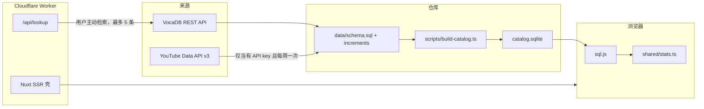

# 初音未来演唱会曲目播放统计 — 设计

只读参考：`~/projects/others/open-personal-note/notes/ideas/hatsune-miku-concert-song-statistics.md`。

本文件在实现前固定范围、数据边界和模块划分。播放量、里程碑时间和开演钟点只写入有出处的值；缺数据时界面保持空态，不补造。

## 目标与范围

做一个可部署到 Cloudflare Workers 的 SSR 站点，统计 Crypton 主办的初音未来演唱会歌单，并在浏览器内比较各场、各系列、各年份的播放量区间。

收录范围（VocaDB 系列 id，类别均为 Concert）：

| 系列 | VocaDB series id |
| --- | --- |
| 初音ミク「マジカルミライ」 | 81 |
| MIKU EXPO | 82 |
| MIKU WITH YOU | 173 |
| 初音ミクシンフォニー | 256 |
| 初音ミクライブパーティー | 219 |
| SNOW MIKU LIVE! | 204 |

每条记录保存系列、场次、歌单行、歌曲、投稿和观测值，并分开保存「该场日期」与「该年首演」。首演取该 `series_id + series_number` 下角色为 `show` 的最早日期；名称或简介命中配信 / livestream 的场次标为 `broadcast`，不参与首演。VocaDB 的 `date` 只到日，记为 `time_precision = day`。只有简介里出现可引用的 `Showtime` / `開演` 钟点，且场馆国家为 JP 时，才写入当地 `HH:MM` 与 `Asia/Tokyo`（日本无夏令时）。歌单公布时间在公开 API 的歌单对象上不存在，字段留空。

串烧（`songType = Mashup`）拆到组成歌曲后再计数。找不到可核验的组成歌曲时，该行进入未拆分隔离区，不按一条曲目计入区间统计。

播放量区间使用固定阈值：不足 10 万、10 万–100 万、100 万–1000 万、1000 万及以上，外加「尚无快照」。区间数量和占比按歌曲去重。同一歌曲在 niconico、YouTube、bilibili 上各选一条代表投稿：未禁用，优先 `pvType = Original`，其余按 VocaDB PV id 最小者。

歌单公布时间与首演日期是观察点。某侧没有快照时，结果标为样本不足，不外推曲线。

跨平台换算只在「同一歌曲、niconico 与 YouTube 都有快照」的配对上检验。分层为投稿年代（发布年份的十年）、播放量区间、投稿类型。训练集 / 留出集按歌曲 id 取模切分。全部门槛通过后才把公式版本写入数据库；否则界面继续分平台展示。原始快照保留。

## 非目标

- 不覆盖上表以外的活动、俱乐部或企划。
- 不抓取 niconico 非官方观看页接口，也不抓取哔哩哔哩播放量。公开资料表明里程碑达成时间没有面向全库的官方接口，故里程碑表结构保留，但没有可引用的达成时间就不插入行。
- 不把 VocaDB 简介里的「殿堂入り」字样当成带时间的里程碑。
- 不爬 YouTube 页面。没有 `YOUTUBE_API_KEY` 时跳过快照，不估计播放量。
- 不把日常聚合放到 Workers 上。Workers 只做首屏 SSR 和按需的缺歌检索。
- 不下载或再分发第三方封面、歌词和官方标识。

## 方案与取舍

**Nuxt 3 + Nitro `cloudflare-module`。** 需要 Vue（箭头函数约束）和 Workers SSR。相比 Next.js / vinext，少一层 React 兼容运行时，Nitro 直接产出 Worker。相比纯静态站，保留一个按需检索路由。代价是本地统计必须放在客户端，首屏在目录下载完成前只显示壳。

**SQL 增量文件是源，SQLite 是构建产物。** 规范要求把可审查的 SQL 提交到 Git。浏览器用 sql.js 只读打开构建出的 `catalog.sqlite`，再在本地用同一套 TypeScript 聚合。聚合不写第二套 SQL，避免 wasm SQL 与测试 SQL 漂移。代价是浏览器要下载整库；以当前六系列的规模（约两百场）可以接受。服务端不跑 better-sqlite3，原生模块进不了 Workers。

**目录以 VocaDB 公共 REST API 为准。** `https://vocadb.net/api/`，JSON，自定义 User-Agent，请求间隔 ≥ 300ms，并缓存原始响应。数据库内容按 [VocaDB License](https://wiki.vocadb.net/docs/license) 为 CC BY，页面给出返回链接。官方站点（如 magicalmirai.com）只作为场次上已有的 web link 保存，不另爬 HTML。代价是开演钟点多数缺失，日期精度停在「日」。

**YouTube Data API v3 `videos.list`（`part=statistics`，每次最多 50 个 id）仅在密钥存在时调用。** 这是历史曲线的采样起点；每周工作流追加快照。密钥缺失时工作流仍更新目录，并在日志中说明跳过播放量。

**换算公式默认不发布。** 首版没有成对历史快照，门槛不可能通过。用带 `SAMPLE` 标记的测试夹具验证门槛逻辑，夹具不进入 `data/increments`。

## 模块与职责

| 模块 | 职责 |
| --- | --- |
| 采集 | 拉取系列、场次、歌单、歌曲与 PV；标示配信场；解析有证据的开演钟点；隔离无法拆分的串烧 |
| SQL | 表结构、转义后的增量、应用到 SQLite |
| 统计 | 代表投稿、区间、跨系列/年份比较、观察点前后差值 |
| 换算 | 分层相关、对数拟合、训练/留出门槛、公式版本行 |
| 站点 | SSR 壳、客户端读库、筛选与图表、出处 |
| 检索 | `GET /api/lookup`：仅当用户查询尚未满足于本地目录时，向 VocaDB 查最多 5 首歌曲及其已登记 PV 链接 |
| 工作流 | CI 跑 lint、类型检查、测试和目录构建；每周采集并在有 diff 时提交 SQL |

## 路径

新增（本分支从空仓库实现）：

- `docs/design.md`
- `package.json`、`pnpm-lock.yaml`、`tsconfig.json`、`nuxt.config.ts`、`eslint.config.mjs`、`vitest.config.ts`、`wrangler.toml`、`.gitignore`、`.github/workflows/ci.yml`、`.github/workflows/weekly-collect.yml`
- `data/schema.sql`、`data/increments/0001-vocadb-catalog.sql`（采集后写入）
- `scripts/vocadb/client.ts`、`scripts/vocadb/normalize.ts`、`scripts/vocadb/collect.ts`
- `scripts/sql/emit.ts`、`scripts/build-catalog.ts`、`scripts/snapshot-youtube.ts`
- `shared/types.ts`、`shared/bands.ts`、`shared/premiere.ts`、`shared/showtime.ts`、`shared/medley.ts`、`shared/stats.ts`、`shared/correlation.ts`、`shared/catalog.ts`
- `tests/premiere.test.ts`、`tests/showtime.test.ts`、`tests/medley.test.ts`、`tests/stats.test.ts`、`tests/correlation.test.ts`、`tests/catalog.test.ts`
- `server/api/lookup.get.ts`
- `app.vue`、`layouts/default.vue`、`assets/css/main.css`
- `pages/index.vue`、`pages/compare.vue`、`pages/windows.vue`、`pages/correlation.vue`、`pages/lookup.vue`
- `components/SiteHeader.vue`、`components/CatalogView.vue`、`composables/useCatalog.ts`

修改：

- `README.md`：运行方式、VocaDB 署名、播放量空态说明

只读参考：

- 上文 idea 笔记
- [VocaDB Public API](https://wiki.vocadb.net/docs/public-api)、[Events](https://wiki.vocadb.net/docs/events)、[License](https://wiki.vocadb.net/docs/license)
- [YouTube videos.list](https://developers.google.com/youtube/v3/docs/videos/list)
- [GitHub Actions schedule](https://docs.github.com/actions/using-workflows/events-that-trigger-workflows#schedule)
- [Cloudflare Workers 全栈路由](https://developers.cloudflare.com/workers/static-assets/routing/full-stack-application/)

`public/data/catalog.sqlite` 与 sql.js wasm 由构建复制，不作为源文件提交。

## 数据流

首演规则在写入 SQL 前于 `shared/premiere.ts` 计算，并落表 `edition_premieres`，便于复核。

换算发布门槛（同时满足才 `status = published`）：

- 训练不少于 40 对，留出不少于 15 对
- 两侧 Pearson |r| ≥ 0.8（对数播放量）
- 两侧中位绝对百分比误差 ≤ 25%
- 任一层若样本 ≥ 8，该层留出 MAPE ≤ 40%

公式形式固定为 `log10(youtube) = a + b * log10(niconico)`，系数、样本期、误差与版本号写入 `conversion_formulas`。未发布时 `formula_json` 为空。

## 风险与验证

| 风险 | 处理 |
| --- | --- |
| VocaDB 日期是午夜 UTC，不是开演时刻 | 精度为 day；钟点必须带简介原文摘录 |
| 同年版多城、后至配信被当成首演 | `broadcast` 排除；首演取最早 `show` |
| 串烧被当成一首歌 | 无组成歌曲则隔离，不进分母 |
| 无密钥时站点看起来「没有统计」 | 空态写明原因；测试断言快照不会被填上猜测值 |
| 换算在小样本上过拟合 | 默认不发布；门槛用 SAMPLE 夹具单测 |
| 每周任务打满 API | 六系列、≥300ms 间隔、自定义 UA；超过预算则失败而不分片狂刷 |
| Workers 上误跑统计或原生 sqlite | 聚合只在客户端；服务端路由只用 `fetch` |

验证：

- `pnpm test` 覆盖首演、钟点解析、串烧、区间、观察窗、换算门槛
- `pnpm test` 中的目录测试打开已提交 SQL，核对 2014 年マジカルミライ首演是大阪场 `2014-08-30` 而不是东京场 `2014-09-20`，且 `view_snapshots` 与 `milestones` 在没有 YouTube 采集时为 0 行
- `pnpm lint`、`pnpm typecheck`
- 浏览器走通首页筛选、比较、观察窗、换算页和缺歌检索

## 实现步骤

1. **模式与纯函数** — `data/schema.sql`，`shared/premiere.ts`，`shared/showtime.ts`，`shared/medley.ts`，`shared/bands.ts`，`shared/stats.ts`，`shared/correlation.ts` 及对应 `tests/*`。
2. **采集与 SQL** — `scripts/vocadb/*`，`scripts/sql/emit.ts`，`scripts/build-catalog.ts`，`scripts/snapshot-youtube.ts`；运行一次采集生成 `data/increments/0001-vocadb-catalog.sql`；`tests/catalog.test.ts`。
3. **站点** — Nuxt 页面、`composables/useCatalog.ts`、`server/api/lookup.get.ts`、署名与空态。
4. **发布自动化** — `wrangler.toml`、CI、每周工作流；README。
