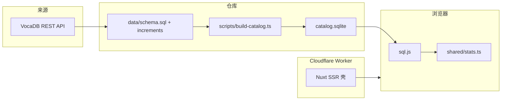

# 初音未来演唱会曲目播放统计 — 设计

只读参考：`~/projects/others/open-personal-note/notes/ideas/hatsune-miku-concert-song-statistics.md`。

本文件固定范围、数据边界和模块划分。开演钟点只写入有出处的值；缺数据时界面保持空态，不补造。

## 目标与范围

做一个可部署到 Cloudflare Workers 的 SSR 站点，统计 Crypton 主办的初音未来演唱会歌单，并在浏览器内比较各场、各系列、各年份的曲目构成。

收录范围（VocaDB 系列 id，类别均为 Concert）：

| 系列 | VocaDB series id |
| --- | --- |
| 初音ミク「マジカルミライ」 | 81 |
| MIKU EXPO | 82 |
| MIKU WITH YOU | 173 |
| 初音ミクシンフォニー | 256 |
| 初音ミクライブパーティー | 219 |
| SNOW MIKU LIVE! | 204 |

每条记录保存系列、演出、歌单行、歌曲、投稿和观测值，并分开保存「演出日期」与「系列年度首演」。年度首演取该 `series_id + series_number` 下第一个有日期、角色为 `show` 的演出；名称或简介命中配信 / livestream 的场次标为 `broadcast`，不参与首演。VocaDB 的 `date` 只到日，记为 `time_precision = day`。只有简介里出现可引用的 `Showtime` / `開演` 钟点，且场馆国家为 JP 时，才写入当地 `HH:MM` 与 `Asia/Tokyo`（日本无夏令时）。歌单公布时间在公开 API 的歌单对象上不存在，字段留空。

串烧（`songType = Mashup`）拆到组成歌曲后再计数。找不到可核验的组成歌曲时，该行进入未拆分隔离区，不按一条曲目计入区间统计。

## 非目标

- 不覆盖上表以外的活动、俱乐部或企划。
- 不采集、不估算任何平台的播放量。niconico 非官方观看页接口与哔哩哔哩播放量都不抓取，VocaDB 简介里的「殿堂入り」字样也不算数据。
- 不把日常聚合放到 Workers 上。Workers 只做首屏 SSR 和按需的缺歌检索。
- 不下载或再分发第三方封面、歌词和官方标识。

## 方案与取舍

**Nuxt 3 + Nitro `cloudflare-module`。** 需要 Vue（箭头函数约束）和 Workers SSR。相比 Next.js / vinext，少一层 React 兼容运行时，Nitro 直接产出 Worker。相比纯静态站，保留一个按需检索路由。代价是本地统计必须放在客户端，首屏在目录下载完成前只显示壳。

**SQL 增量文件是源，SQLite 是构建产物。** 规范要求把可审查的 SQL 提交到 Git。浏览器用 sql.js 只读打开构建出的 `catalog.sqlite`，再在本地用同一套 TypeScript 聚合。聚合不写第二套 SQL，避免 wasm SQL 与测试 SQL 漂移。代价是浏览器要下载整库；以当前六系列的规模（约两百场）可以接受。服务端不跑 better-sqlite3，原生模块进不了 Workers。Cloudflare 不压缩 sqlite 类型，所以构建同时写出 `catalog.sqlite.gz`，浏览器下载后自己解压。

**VocaDB 是同级参考源，不是标准。** `https://vocadb.net/api/`，JSON，自定义 User-Agent，请求间隔 ≥ 300ms，并缓存原始响应。数据库内容按 [VocaDB License](https://wiki.vocadb.net/docs/license) 为 CC BY，页面给出返回链接。取数顺序是「官网 → 萌娘百科 → 初音ミク Wiki → VocaDB」；`performances.id` / `series.id` / `songs.id` 尽量沿用 VocaDB 的 id，VocaDB 没有条目时用本地保留区间，VocaDB 与本项目不一致时保留已采集的数据，不改上游也不回改自己。只要本项目记录了某个演出的歌单，该演出就进入统计，不再要求上游歌单存在。代价是开演钟点多数缺失，日期精度停在「日」。

## 模块与职责

| 模块 | 职责 |
| --- | --- |
| 采集 | 拉取系列、演出、歌单、歌曲与 PV；标示配信场；解析有证据的开演钟点；隔离无法拆分的串烧 |
| SQL | 表结构、转义后的增量、应用到 SQLite |
| 统计 | 按场次 / 演出计数、跨系列与年份分组、版本合并 |
| 站点 | SSR 壳、客户端读库、筛选与图表、出处 |
| 检索 | 页内搜索只在已下载的本地目录里匹配，不向站外查询 |
| 工作流 | CI 跑 lint、类型检查、测试和目录构建；每周采集并在有 diff 时提交 SQL |

## 路径

新增（本分支从空仓库实现）：

- `docs/design.md`
- `package.json`、`pnpm-lock.yaml`、`tsconfig.json`、`nuxt.config.ts`、`eslint.config.mjs`、`vitest.config.ts`、`wrangler.toml`、`.gitignore`、`.github/workflows/ci.yml`、`.github/workflows/weekly-collect.yml`
- `data/schema.sql`、`data/increments/0001-vocadb-catalog.sql`（采集后写入）
- `scripts/vocadb/client.ts`、`scripts/vocadb/normalize.ts`、`scripts/vocadb/collect.ts`
- `scripts/sql/emit.ts`、`scripts/build-catalog.ts`
- `shared/types.ts`、`shared/premiere.ts`、`shared/showtime.ts`、`shared/medley.ts`、`shared/stats.ts`、`shared/catalog.ts`
- `tests/premiere.test.ts`、`tests/showtime.test.ts`、`tests/medley.test.ts`、`tests/catalog.test.ts`
- `app.vue`、`layouts/default.vue`、`assets/css/main.css`
- `pages/index.vue`、`pages/raw.vue`、`pages/shows/[id].vue`
- `components/SiteHeader.vue`、`components/CatalogView.vue`、`composables/useCatalog.ts`

修改：

- `README.md`：运行方式与 VocaDB 署名

只读参考：

- 上文 idea 笔记
- [VocaDB Public API](https://wiki.vocadb.net/docs/public-api)、[Events](https://wiki.vocadb.net/docs/events)、[License](https://wiki.vocadb.net/docs/license)
- [GitHub Actions schedule](https://docs.github.com/actions/using-workflows/events-that-trigger-workflows#schedule)
- [Cloudflare Workers 全栈路由](https://developers.cloudflare.com/workers/static-assets/routing/full-stack-application/)

`public/data/catalog.sqlite`（以及发给浏览器的 gzip 副本 `catalog.sqlite.gz`）与 sql.js wasm 由构建复制，不作为源文件提交。

## 数据流



系列年度首演规则在写入 SQL 前于 `shared/premiere.ts` 计算，并落表 `edition_premieres`（表名保留，含义是「系列年度第一个演出」），便于复核。

## 风险与验证

| 风险 | 处理 |
| --- | --- |
| VocaDB 日期是午夜 UTC，不是开演时刻 | 精度为 day；钟点必须带简介原文摘录 |
| 同一系列年度多城、后至配信被当成首演 | `broadcast` 排除；首演取最早 `show` |
| 串烧被当成一首歌 | 无组成歌曲则隔离，不进分母 |
| 每周任务打满 API | 六系列、≥300ms 间隔、自定义 UA；超过预算则失败而不分片狂刷 |
| Workers 上误跑统计或原生 sqlite | 聚合只在客户端；服务端路由只用 `fetch` |

验证：

- `pnpm test` 覆盖首演、钟点解析、串烧、版本合并与计数口径
- `pnpm test` 中的目录测试打开已提交 SQL，核对 2014 年マジカルミライ首演是大阪场 `2014-08-30` 而不是东京场 `2014-09-20`
- `pnpm lint`、`pnpm typecheck`
- 浏览器走通首页筛选、单曲、演出、系列与制作人页

## 歌曲出现次数排行

首页按歌曲统计「出现过多少次」。聚合仍是 `shared/stats.ts` 里的纯函数，读已加载的目录行（场次层 `performance_show_setlist_items` 优先，没有展开行时回退 `setlist_item_songs` / `setlist_items`，以及 `songs`、`performances`、`series`），不另写 SQL。

计数不以上游 VocaDB 为准：只要本项目记录了某个演出的歌单（上游歌单、专辑补位，或只有百科逐曲表、`song_list_id` 为空的演出），该演出的曲目就进入排行、单曲出场记录与制作人统计。

三级单位与 VocaDB 对齐：系列（`series`）> 演出（一条 `performances` 行 = 一个 VocaDB release event = 一个城市站）> 场次（一天，或同一天日场 / 夜场各一场）。

两种计数：

- `show`（按场次，默认）：读场次层 `performance_show_setlist_items`，按 `show_key` 去重。三日巡演计 3；同日日场 + 夜场计 2；没有日期的演出没有场次。没有展开行的旧目录回退到 `event-schedule.ts` 推导与歌单备注解析（备注写了天 / 半天 / 场次号时只计对应场次，否则一行计入该演出的全部场次）；解析不了的场次仍给出约数，并标不确定。
- `event`（按演出）：每条 `performances` 行最多计 1。同一年大阪与东京各计一次，不再按 `series_id` + `series_number` 合并。

筛选：

- 系列 id 列表。省略或空列表表示全部系列。
- 年份闭区间，取演出 `start_date` 的公历年。没有日期的演出在设置了任一年份边界时不计入。
- `includeBroadcast` 为 false 时排除 `role = broadcast`，以及名称、日文名或 `series_suffix` 命中 livestream、online、オンライン、VR、ＶＲ、配信的演出。演出简介没有单独落在 `performances` 上；`performance_links.description` 多是外链标题（例如现场场次的 “Online Live Information”），不参与排除。
- `includeMedleyComponents` 为 false 时只计 `setlist_item_songs.role = listed`（直接列出的曲目）。`component` 仅在为 true 时计入。未能拆分的串烧不写入 `setlist_item_songs`，两种模式都不计。

每行输出歌曲 id、名称（`songs.name`）、制作人署名、次数、出现过的演出数、最早年份、最晚年份。次数为 0 的歌曲不输出。默认按次数降序、歌曲 id 升序。`seriesCount` 仍保留在返回值里但不再展示；表格的「演出数」用 `performanceCount`（去重后的演出行数，两种统计模式都一样）。

首页改为这张可排序的表，并提供模式、系列多选、年份、配信/VR、串烧组成的控件。覆盖说明写明：默认按场次统计，按演出时每个城市站各算一次。

## 歌单备注与逐场解析

`setlist_items.notes` 保存 VocaDB 歌单行的自由文本。采集已经写入该列，原始响应在 `data/cache`，已提交的 `data/increments/0001-vocadb-catalog.sql` 含这些备注（例如歌单 17933 的「愛の詩」与「サイハテ」）。空备注表示该歌单下的每个演出都演出了这首歌。不为此重新请求网络。

`shared/rotation.ts` 把备注拆成场次集合。城市名对齐到共用该 `song_list_id` 的演出（名称、日文名、场馆、`series_suffix`）。`Day N` 是该城市按日期排序后的第 N 个不同日期；日期来自 `start_date` 到 `end_date`（含首尾）。一场演出覆盖多日时，这些日仍对应同一条演出记录。

不确定时保留已识别出的场次，并记下原因：只写了城市但该城市有多场或多日；某一日存在日夜场或备注写了 daytime / nighttime / 1st / 2nd show；格式无法识别；城市对不上任何演出。

同一歌单内，解析后统计每场的歌单行数。与该歌单行数的众数不同的场次记为 `setlist length mismatch: X vs expected Y`，并把因此受影响的行（有备注、或被排除出该场的行）标成不确定。

按场次的排行使用解析结果，并用 `showsForNotes` 把一行收窄到 `Day N` / 日场 / 夜场所指的场次。次数不可靠时显示「≈」，悬停列出尚未确认具体场次数的演出。页上另列未解决的行和演出。演出页 `/shows/:id` 展示场次列表、原始备注与解析结果；系列主页 `/series/:id` 列出该系列的全部演出，并从排行、演出页链入。

外观由 Nuxt UI 的 color mode 控制，默认跟随系统，系统无偏好时回落到深色。`html.dark` 由 `@nuxtjs/color-mode` 写入，页眉的 `UColorModeButton` 切换并记忆。深色是艺术方向基准：近黑背景配青绿 `#39C5BB` 与洋红 `#E12885` 的径向光晕；浅色同样必须可用。光晕画在固定的 `-z-10` 层，不进入正文层，避免影响对比度。

## 歌名中文

`data/song-titles.zh-CN.json` 是按 VocaDB 歌曲 id 索引的对象。键是十进制 id 字符串。没有把握的歌不写进行去。

```json
{
  "1326": {
    "title": "世界第一公主殿下",
    "aliases": ["世界属于我", "世界第一的公主殿下"],
    "source": "vocadb-alias",
    "comment": "可选"
  }
}
```

`title` 非空，是站内唯一显示的中文名。`aliases` 可省略，列出其他通行中文译名：站内不显示，只让搜索能命中（例如搜「世界末日舞厅」仍能找到 `title` 为「世末舞厅」的歌）；同一个别名不要重复，也不要与 `title` 相同。繁体写法不进 `aliases`，写到暂不参与显示的 `data/song-titles.zh-Hant.json`（同样的 `title` / `aliases` / `source` 结构）。
`source` 记录出处，优先级也是这个顺序：`官方中译`（官方频道 / 官方专辑的中文曲名）> `vocawiki` / `萌娘百科` / `vocadb-alias`（民间通行译名）> `人工核定`（自己翻译）；`简繁转换` 只给汉字同名的器乐曲。曲名是英文词的假名写法时（`クリスタルスノウ` → `Crystal Snow`、`サンドリヨン` → `Cendrillon`、`ネクストネスト` → `Next Nest`），中文位直接用英文，并把英文写进 `songs.name_en`（VocaDB 没给时补在 `data/increments/0012-song-english-names.sql`），不要把英文混进中文名或 `comment`；官方罗马字名同理（`ロキ` → `ROKI`）。`comment` 可省略，只写 `title` 与 `aliases` 放不下的说明。中文名与 `songs.name` 完全相同时不登记：显示结果一样，只会虚增映射条数；例外是原曲名虽相同、但有需要参与检索的别名（`番凩` 的「落叶秋风」「对霜风」）。`shared/song-titles.ts` 校验并按 id 取出。测试要求每个 id 都在已提交目录里。

顶栏用「中文歌名」开关（`USwitch`）控制是否显示中文，记在 `localStorage` 键 `miku-concert-stats-song-lang`（`zh` / `original`）。没有记录时，`navigator.language` 以 `zh` 开头则用中文。服务端和注水先显示原文，挂载后再读本地选择，避免注水不一致。选中中文且该歌有译文时，译文作主标题，原文用灰色小字换行显示在译文下方；否则只显示原文。各页歌曲名走同一个 `SongTitle` 组件。

## 演出角色

`data/characters.json` 把固定的角色本名映射到匹配规则，用来合并声库变体。键是显示名，例如 `初音ミク`。值含 `patterns`（锚定在名称开头的正则）、可选 `aliases`（整段或作为前缀的别名，如英语名）与可选 `color`（应援色的 `#rrggbb`，渲染歌手标签时用作边框色，并以 12% 透明度作底色）。`初音ミク Append (Unknown)`、`初音ミク V4X (Original)`、`初音ミク V4X (Dark)` 都落到 `初音ミク`。对不上任何规则的名字保持未匹配，不猜测；没有 `color` 的角色标签不带颜色。

一首歌的演唱者优先取 `song_vocalists` 表：`scripts/vocadb/vocalists.ts`（`pnpm collect:vocalists`）对每首歌请求 VocaDB 的 `fields=Artists`，只保留 `categories` 或 `roles` 含 `Vocalist` 的条目，名字用条目的 `name`，否则用嵌套 `artist.name`，写成 `data/increments/0006-song-vocalists.sql`。`artist_string` 会把大编制合唱压成 `feat. various`（例如 Hand in Hand 的现场翻唱实际由 KAITO、MEIKO、初音ミク、巡音ルカ、鏡音リン、鏡音レン 演唱），所以这份名单才是「演出角色」的来源。库里没有该歌的名单时，退回 `songs.artist_string` 里第一次出现的 `feat.` 之后的名单，按逗号拆开；`feat.` 前面的制作人不算角色。

结果在读取目录时推导，不另写 SQL 列。排行、演出、系列索引与单曲页的歌曲行显示「歌手」。排行可按一个角色筛选。

`shared/credit.ts` 负责署名文本：`producerCredit` 取 `feat.` 之前的制作人，`displayArtistString` 保留完整署名，两者都会丢掉 VocaDB 的名字占位（`Unknown producer(s)`、`Unknown artist` 等，不指向任何作者），只由占位组成的署名返回 `null`，页面显示「未记录」。页头、站内搜索结果与 `/raw` 的歌曲表都走这两个函数；单曲页的「其他版本」卡片按下面的制作人规则取值。排行的「制作人」列先取结构化的 `song_producers` 名单，只有该行（含合并的版本组）没有任何结构化署名时才退回 `producerCredit`；Publisher、Illustrator、厂牌 / 社团等署名不是制作人，`VoiceManipulator`（調声 / 調音）保留。

制作人署名以证据强度排序：官方专辑 / 官方页的署名优先，其次是 VocaDB `fields=Artists` 里的制作侧署名 `song_producers`，`artist_string` 只在歌曲条目没有任何制作人记录时作为回退。VocaDB 的结构化名单与别的来源冲突时不自动采用任一方：显示仍用结构化名单，差异写进由 `pnpm report:producers` 生成的 `docs/reports/producer-conflicts.md`，维护者确认后才改。

制作人页（`/producers` 与 `/producers/{name}`）沿用同一份名单，不再另写一套规则。曲目数是不同歌曲 id 数，变体版本分别计数、不合并版本组；「演出曲目」与「表演次数」读场次层，旧目录回退到源歌单备注解析，串烧展开为组成曲；演出数是不同 `performances` 行数，场次按 `show_key` 去重；配信、线上与 VR 演出默认剔除。场次层里有歌单的演出都计入，包括 `song_list_id` 为空、歌单只来自百科逐曲表的演出，这样「演出曲目」和「表演次数」与首页同一制作人筛选后的行数、次数合计一致。自由文本署名没有 `artist_id` 时只显示名字，不编造 VocaDB 链接；没有出场记录的制作人仍然列出。页面用曲目数降序作为默认排序，页眉主导航、首页「制作人」列、单曲页「其他版本」和页眉搜索都链到 `/producers/{name}`。因为自由文本回退与排行完全一致，`DECO*27`、`kz` 这类同时出现在没有结构化署名的歌里的名字，曲目数会高于 `song_producers` 的单表 SQL，这是预期行为。

## 实现步骤

1. **模式与纯函数** — `data/schema.sql`，`shared/premiere.ts`，`shared/showtime.ts`，`shared/medley.ts`，`shared/stats.ts` 及对应 `tests/*`。
2. **采集与 SQL** — `scripts/vocadb/*`，`scripts/sql/emit.ts`，`scripts/build-catalog.ts`；运行一次采集生成 `data/increments/0001-vocadb-catalog.sql`；`tests/catalog.test.ts`。
3. **站点** — Nuxt 页面、`composables/useCatalog.ts`、署名与空态。
4. **发布自动化** — `wrangler.toml`、CI、每周工作流；README。

## 版本合并

`data/song-variants.json` 是人工核对的清单，只收录确认属于同一首歌的 remix、remaster、声库、翻唱与语言版本。`shared/song-variants.ts` 拒绝链式映射与自指。统计函数接受 `SongVariantIndex`：计数时先归一到 canonical id 再按演出或场次去重，代表投稿在合并组内选，排行行带上 `variantSongIds`，页面标注「含 N 个版本」时 N 含原版（`variantSongIds.length + 1`）。单曲页的「其他版本」卡片只列并入的其他版本（没有并入版本时整块不渲染）：类型、制作人与歌手。制作人先取该版本的 `song_producers`，没有时才取署名 `feat.` 之前的部分，并去掉 VocaDB 的 `Unknown producer(s)` 占位（它不指向任何作者）；歌手取 `song_vocalists` 里该变体自己的名单，没有时退回 `feat.` 名单，仍解析不到才改用原版的角色。原版的投稿日期与演出角色留在页头。清单之外的重复条目不会被自动合并，`/raw` 的「疑似重复但未合并」会持续列出候选。

## 歌单槽位与跨地区合并

同一槽位的替换曲目在 VocaDB 里是相邻但序号不同的多行。`shared/setlist-slots.ts` 判定两行是否可以共用一个序号：演出集合不同时要求日期与场次对齐；同一场记录跨多天时按备注的日期/日夜/场次判定；任一侧没有备注就不合并。只有连续且与槽位内每一行都互斥的行才会合并。

**场次层（2026-11-05 起）**：源歌单不再直接充当「这场演出的歌单」。`pnpm derive:setlists` 把每一行展开到 `showsForNotes` 判定它覆盖的场次，写入 `performance_show_setlist_items`；一个演出有几天就存几套完整曲目，日内有日夜场就再拆成两套。源层（`song_lists` / `setlist_items` / `setlist_item_songs`）保持 VocaDB 原样，`/raw` 的跨演出对照与 `/report` 继续读它。

**演出级合并（2026-11-06 起）**：`/shows` 把可合并的场次折成一张表。`mergeShowSetlists` 先按代表场次定序并插入只在其他场次出现的曲目，再把「在演过它的每个场次里都落在同一序号」的行并成同一个槽位。日场 / 夜场轮换、分天替换都因此共用一个序号，`ShowSetlistTable` 用 `UTable` 的 `meta.rowspan` 把序号单元格上下合并（被吸收的单元格用 `meta.class` 置为 `hidden`），每首歌仍各占一行：编号只到单场曲目数，读者不会把替换曲误数成额外曲目。表格保持四列，不单设场次列，每个替代曲适用的场次写进「备注」（`仅日场` / `仅 8/11` / `仅 8/11 日场、8/12 夜场`，每场都演的省略），器乐曲等分类用 ` · ` 接在后面。70 个可合并演出里 64 个的槽位数与单场曲目数完全相等，其余 6 个是插入曲造成序号错位或场次长度本身不同，按实际情况多出或减少。并槽要求两侧场次集合完全不相交，序号错位的曲目仍单独占行，不猜测同槽位。

外部核实遵循「VocaDB 备注 → 官方页 → 萌娘百科等 wiki → 录播」的顺序；查到就**直接采用**，来源（URL、访问日期、置信度、一句话说明）存进 `performance_setlist_sources`，`/shows` 页脚展示，另在 `docs/setlist-confirmation.md` 第 1 节留档，不需要逐条确认。逐场次的特殊说明写进演出层的 `note`，不另建场次级来源表。

同一系列年度不同演出的歌单（例如 2019 マジカルミライ 东京与大阪）仍只在 `/raw` 的跨演出对照里用 `data/setlist-merges.json` 人工分组后并排展示，不作为该系列年度的合并歌单；如果其中一份歌单被轮换检查标出长度不一致，说明各演出曲目数量对不上，则拆开单独显示，不参与合并。`shared/edition-setlists.ts` 以演出最多的歌单为骨架，其余用 LCS 对齐，重复曲目折叠成一行并合并演出集合。渲染时槽位用 `rowspan` 共享序号，末尾「演出」列说明该行属于哪个演出；每个演出都演出的行留空，不写说明。

## 差异核验报告

`shared/setlist-diff.ts` 计算同一系列年度歌单对（以及相邻系列年度）的结构差异：行数、正片与安可行数、共有与独有曲目、LCS 覆盖率、是否已合并。分级为 `identical`、`order-only`、`count-differs`、`segment-differs`、`probably-different-program`。`pnpm report:setlist` 写出 `docs/reports/setlist-differences.{md,csv}`，`--check` 供 CI 校验；`/report` 在浏览器里用同一份纯函数渲染，可复制 Markdown。相邻系列年度只作参考，不参与分级统计。

## 界面

Nuxt 4 + Nuxt UI 4 + Tailwind 4。目录迁到 `app/`，`shared/` 留在根目录，页面用 `~~/shared/*` 引用纯逻辑。页眉是毛玻璃吸顶条，导航为「排行 / 原始数据 / 核验 / 搜索」。排行用 `UTable` 与 TanStack 排序，筛选条件写入 URL query，刷新与分享都能复原。

所有列表页的表格以曲目排行为基准：`TableSection` 提供标题、`UTable`、粘性表头、`ranking-scroll`、加载骨架与空状态，`SortableHeader` 提供统一下拉排序表头，页面不再各自决定外壳样式。角色一律用 `CharacterChips`（应援色描边与淡底色，超过 3 个折叠成 `+N` 气泡），制作人署名这类非角色标签用 `UBadge`；筛选标签用 `FilterField`（`UFormField`）。唯一的例外是 `/raw` 的「数据表」：列由目录表结构动态决定，保留手写表格，但沿用同样的外壳与空状态。详见 `docs/architecture.md` 的「共享 UI 组件」。

## 页眉搜索

搜索放在页眉，不单独占一个页面。宽屏是常驻输入框，结果浮层显示目录内命中与「查看全部」；窄屏折叠成顶栏按钮，点开是全屏浮层。搜索只读本地目录，不在页内请求 VocaDB。结果浮层依次列系列（`localSeriesMatches`，链到 `/series/{id}`）、演出（`localPerformanceMatches`，名字、日期与场馆，链到 `/shows/{id}`）、地点（`localPlaceMatches`，场馆名与演出数，链到 `/series?place={场馆}`）、制作人（`localProducerMatches`，名字、角色、曲目数，链到 `/producers/{name}`）与歌曲（链到 `/songs/{id}`）；中文译名同样参与匹配。排行表的「制作人」列先显示 VocaDB 结构化的 `song_producers` 名单，没有时才退回 `feat.` 之前的自由文本；每个名字与悬停气泡都可链到详情页；宽度受限，悬停看完整署名；「歌手」列负责角色，用应援色标签，最多直接显示 3 个，其余收进 `+N` 按钮的气泡。「演出数」列给出该曲出现过的演出数（与统计模式无关），「系列数」不再展示。`/raw` 的歌曲表同样用「制作人」列显示 `producerCredit`，另外用「歌手」列显示解析后的角色，不再显示 `artist_string` 原文。
